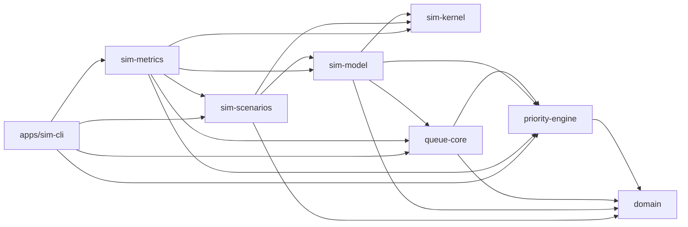
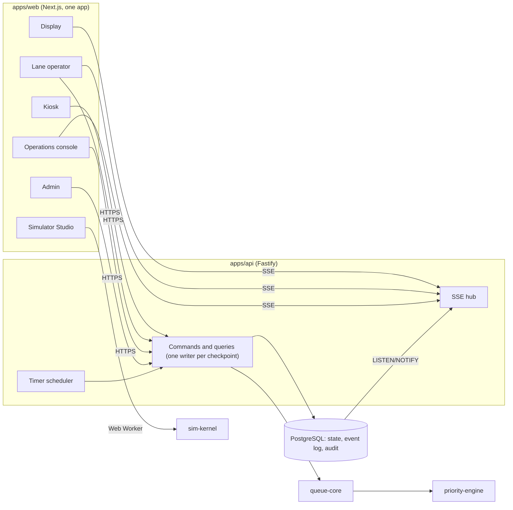

# GateFlow architecture

This document describes the architecture as implemented (slices S1 to S4: priority engine, queue
state machine and simulator) and the agreed direction for the operational product. Decisions are
referenced as ADR-nnn ([DECISIONS.md](DECISIONS.md)).

## 1. Principles

1. **The engine decides, deterministically and explainably.** The priority engine is a pure
   function: no I/O, no clock, no randomness. Every decision carries reason codes and the policy
   version.
2. **The same code in simulation and production.** The simulator drives the very queue state
   machine and engine that the operational product will run, so simulated evidence is evidence
   about the shipped code.
3. **Reproducible to the bit.** Identical inputs give byte-identical outputs on any machine and
   JavaScript engine (ADR-008).
4. **Never worse than the status quo because of data.** Missing or untrusted deadlines degrade to
   FIFO. The physical fallback of the operational product is the traditional queue.
5. **Honest results.** Every number in a report is labelled simulated, and every assumption is
   listed with its source (ADR-009).

## 2. Repository layout

```
apps/
  sim-cli/          gateflow-sim: runs experiments, writes results.json and report.md (bundled)
packages/
  domain/           shared domain types and units (integer milliseconds, segments, risk classes)
  priority-engine/  assessment and selection of the next call (pure)
  queue-core/       queue state machine: tickets, prepare window, calls, no-shows; policies (pure)
  sim-kernel/       seeded RNG streams, deterministic math, distributions, event calendar (pure)
  sim-model/        checkpoint simulation: physical queue or GateFlow virtual queue (pure)
  sim-scenarios/    scenario schema, validation, assumptions, synthetic population (pure)
  sim-metrics/      experiment runner, paired metrics, statistics, results and report (pure)
scenarios/          scenario files (YAML)
docs/kickoff/       kickoff analysis and proposal (Italian)
```

## 3. Dependency rules



Enforced automatically, on three levels:

| Level | Tool | Rule |
|---|---|---|
| Imports | dependency-cruiser (`pnpm boundaries`) | Packages may import only the dependencies shown above. Allowed npm modules: `zod` and `yaml` in `sim-scenarios`, nothing elsewhere. No Node.js built-ins in `packages/*/src`. No cycles. No unresolvable imports. |
| Environment | `tsconfig.src.json` | Package sources compile with `lib: ES2023` and no Node or DOM types, so they cannot use `process`, `console`, timers or browser APIs. |
| Determinism | ESLint | `packages/*/src` may not use `Math.random`, `Date`, `**`, implementation-approximated `Math` functions, `localeCompare` or `Intl`. |

Each rule was checked by introducing a deliberate violation and confirming that the tool rejects
it.

## 4. Determinism (ADR-008)

| Concern | Approach |
|---|---|
| Time | Integer milliseconds everywhere. Simulations use "ms since the start of the service day". |
| Randomness | `streamFor(seed, key)` derives an independent xoshiro128** generator from a 32-bit seed and a key of 32-bit words (MurmurHash3 with four seeds gives the 128-bit state). Every random attribute has its own stream, e.g. `[pax.arrival, flight, passenger]`: adding an attribute never shifts existing draws. |
| Floating point | `ln` and `exp` are fdlibm ports using only IEEE 754 basic operations (bit-identical to V8, `exp(1) === Math.E`). Normal variates use the Marsaglia polar method (no trigonometry). |
| Ordering | Event calendar ordered by (time, event priority, insertion sequence). Engine tie-breakers: latest call time, then FIFO key. Numeric sorts always use comparators or typed arrays. |
| Identity | Scenarios are hashed as SHA-256 of canonical JSON (sorted keys). Seeds are normalised (sorted, unique). |
| Output | Results are rounded to 4 decimals at serialisation time only. No timestamps. The source revision is recorded with a `-dirty` flag when applicable (ADR-014). |

Verification:
- known-answer tests (MurmurHash3 vectors cross-checked with `mmh3`; xoshiro128** reference
  output);
- byte-identical golden files, run on Node 22 and 24 in CI;
- an end-to-end `cmp` of two CLI runs in CI.

## 5. Priority engine (engine version 0.4.0)

Pure functions in `@gateflow/priority-engine`:

- `assessTicket(ticket, aheadInFifo, now, checkpoint, params, committedAhead)`: risk class and
  explanation.
- `selectNext({ now, checkpoint, waiting, recentPriorityCalls, selection, aheadOfWaiting })`: the
  next ticket to commit. `aheadOfWaiting` counts the people already committed ahead of the waiting
  list (the prepare window of the virtual queue).

A ticket may hold a party (`partySize`, ADR-021). Everything the engine counts is people: the
people ahead, the committed window, the overtake count of a ticket and the cap history (one entry
per person called).
- `assessQueue(snapshot, params)`: assessment of every waiting ticket in FIFO order.

Definitions for ticket *i* at time *t*:

| Symbol | Meaning |
|---|---|
| `D_i` | Deadline known to the system, from a feed or an approved rule (`allowRuleBasedDeadline`). |
| `L_i = D_i - (R + P_i + W_i + B)` | Latest useful call time. R = call to start of screening, P = screening time of the party (per person x party size), W = walk, B = safety buffer. |
| `FIFO wait_i = floor(ahead_i * 1 h / throughput)` | Wait if served in FIFO order; `ahead_i` counts the people ahead, committed ones included. |
| `C = floor(committed * 1 h / throughput)` | Time to call the committed people, whom nobody can overtake. |
| `slackFifo_i = L_i - t - FIFO wait_i`, `slackNow_i = L_i - t - C` | Margins under FIFO and if selected now (ADR-019). |
| `feasible_i = D_i - (R + P_i + W_i + F) - t - C` | Margin if selected now with the feasibility margin F instead of B (ADR-023). |

Classes:

| Class | Condition |
|---|---|
| `UNVERIFIED` | No trusted deadline. |
| `CRITICAL` | `feasible < 0` (escalate, never boost). |
| `URGENT` | `slackFifo < 0` and `feasible >= 0` (`INSIDE_SAFETY_MARGIN` when `slackNow < 0`). |
| `ATTENTION` | `0 <= slackFifo < threshold`. |
| `NORMAL` | Otherwise. |

A ticket is boost-eligible when it is `URGENT`, its segment is eligible and the late-presentation
rule (optional, `latePresentationCutoffMs`) does not block it: a departing passenger who presented
later than the cutoff before the scheduled departure is not boosted (`LATE_PRESENTATION`, or
`PRESENTATION_UNVERIFIED` when a time is unknown). A party larger than `k` is never boosted
(`GROUP_EXCEEDS_CAP`).

Selection (`constrained-edf`):
1. If a waiting ticket has been overtaken `K` times or more (in people), select the oldest such
   ticket (`OVERTAKE_LIMIT_GUARD`), unless calling it would push an older ticket past K: then
   select the oldest ticket.
2. Else, if boost-eligible tickets exist, select the one with the smallest `L` (`URGENT_FEASIBLE`)
   if the cap allows it: the priority people among the last commitments, plus this party, may not
   exceed `k` within a window of `N` people. Calling it may not push any older ticket past K
   either (`OVERTAKE_ROOM_EXHAUSTED`).
3. Else select the oldest ticket (`FIFO`, or `CAP_REACHED` when the cap blocked a boost).

Fast track (`fastTrack`, ADR-027, used by `priority-v2`):
- a boost is made next, ahead of the committed window;
- the party goes to the next free lane once its ticket is validated.

The engine therefore estimates a boosted journey differently from the journey through the queue
(`journeyEstimates`):
- the response time is the fast-track estimate (the walk back, without the call-ahead), or the
  time since the passenger was last at the access point when that is shorter;
- the time C to call the window is not counted;
- `slackFifo` keeps the journey through the queue.

An URGENT head of the waiting list is boosted too. A boost is refused when it would push one of
the committed people past K (`aheadMaxOvertakenCount`, reason `OVERTAKE_ROOM_EXHAUSTED`).

Selection `flight-call` models today's staff practice (baseline A', ADR-022): at the last
announcement `floor(t / I) x I`, the tickets whose deadline is at most `W` away are called first,
earliest deadline first, with no cap and no overtake bound (`FLIGHT_CALL`).

Guarantees, verified by property tests with 1,000 generated cases each:
- determinism and independence from input order;
- completeness of assessments;
- the selection is always a waiting ticket;
- priority selections are always `URGENT` and eligible;
- the guard takes precedence;
- the cap holds, in people, for a single decision, exactly at its boundary, and in every window
  of a sequence;
- no ticket is overtaken by more than `K` people;
- reduction to FIFO with a zero cap;
- monotonicity: an earlier but still feasible deadline never loses a selection;
- both margins match their definitions, and selection and assessment agree on boost eligibility;
- late presenters and parties larger than `k` are never boosted;
- the S3 parameters at their defaults reproduce the S2 engine;
- the flight-call selection matches an independent oracle;
- under the fast track a boost never pushes a committed person past K, the fast track never
  makes a ticket less feasible, and without it the new inputs are ignored.

Mutation checks (cap and guard off by one, guard disabled, committed window ignored, people counted
as tickets, rules disabled) are caught by the suite.

Not yet implemented (by design, later slices): hysteresis (S5).

## 6. Queue state machine (`@gateflow/queue-core`, ADR-016)

`CheckpointQueue` owns the tickets of one checkpoint and applies the policy; every ordering
decision is delegated to the engine. It performs no I/O and reads no clock: each operation takes
an explicit time, and time may never go backwards.

| Operation | Effect |
|---|---|
| `issue(ticket, t, estimates)` | New ticket, classified against everybody ahead (window included). |
| `callNext(t, estimates)` | Calls the head of the prepare window (or, without a window, the ticket the engine selects now). |
| `present(id, t, estimates)` | Validation at the access point: `ADMITTED`, `REACTIVATED` (a no-show rescanning in time), `EXPIRED`, or a refusal (`NOT_CALLED`, `ALREADY_ADMITTED`, `UNKNOWN_TICKET`). |
| `advance(t)` / `nextDueMs()` | Applies the timeouts due by `t` / tells when the next one is due. |

States: `QUEUED -> PREPARE -> CALLED -> RECALLED -> NO_SHOW -> EXPIRED`, where:
- `PREPARE` is skipped when there is no prepare window (M = 0);
- `ADMITTED` is reachable from `CALLED` and `RECALLED`;
- `NO_SHOW -> QUEUED` on reactivation (at the original place or at the back, at most `r` times);
- a no-show that may not be reactivated again expires at once.

- **Prepare window (M tickets).** Tickets are committed to the window by the engine and shown on
  displays; a committed ticket leaves the window only by being called (no churn).
- **Timeouts.** Second call after T1, no-show after T1 + T2, expiry at the end of the reactivation
  window. Timeouts strictly before `t` are applied before an operation at `t`, so a passenger
  presenting exactly at a deadline is on time.
- **Events.** Every transition is reported to a listener in chronological order (the audit log in
  production, metrics in simulation).
- **Parties.** A ticket carries its party size, presentation time and scheduled departure. The
  window, the waiting list and the outstanding calls are also counted in people; a party called
  ahead of older tickets adds its size to their overtake counts.
- **Fast track.** A fast-track priority commitment goes ahead of the prepare window, behind earlier
  fast-track commitments only. The tickets it passes are overtaken by its people.
- **Last seen.** Each ticket records when the passenger was last at the access point (issue,
  rescan), which shortens the engine's fast-track estimate.
- **Presets.** `fifo` (A, physical), `fifo-manual` (A', physical, staff flight calls),
  `virtual-fifo`, `priority-v0`, `priority-v1`, `priority-v1-strict` and `priority-v2` (virtual
  queue).

Property tests (1,000 random operation sequences on random policies, 300 for determinism) check,
independently of the implementation: zero churn, window size at most M, state counters, a single admission per ticket,
terminal states, chronological events, the cap and the K bound over commitments (with an
independent overtake model), and determinism. A coverage test guarantees that the sequences reach
priority commitments, the cap, the guard and reactivations.

## 7. Checkpoint simulation model (model version 0.4.0)

`simulateCheckpoint(population, policy, { classification })` is a discrete-event simulation of
one checkpoint operated by a `CheckpointQueue`:

- **Queues.** With a *physical* queue (status quo) passengers stand in line and the next one steps
  forward as soon as a lane is free. With a GateFlow *virtual* queue, tickets are called while the
  passengers called but not yet screened (walking to the access point, or waiting at the lanes)
  are fewer than the free lanes plus `ceil(call-ahead x open lanes x lane rate)` (ADR-017).
- **Passenger behaviour (ADR-018).** After taking the ticket a passenger walks away for at most
  their response time and walks back when called: a call that comes sooner is answered sooner, and
  a passenger who has not left cannot miss it. A passenger who has walked away may miss the first
  call and present later; the queue then recalls them, marks a no-show, reactivates them if they
  rescan in time, or they take a new ticket. After the first presentation the passenger answers
  later calls at once.
- **Parties and assisted passengers (ADR-021).** A party is called, validated and screened
  together on one lane, its members one after the other. Assisted parties go to the next free
  lane ahead of the queue and of the call-ahead buffer, under every policy, and count in the call
  pipeline.
- **Fast track at the lanes (ADR-027).** A fast-tracked party that validates its ticket goes ahead
  of the parties waiting at the lanes, never ahead of an earlier fast-tracked party, and stops
  behind the first party that would exceed K overtakes. Every party it passes counts the pass.
- **Lanes.** A planned schedule gives the open lanes over the day. Lanes close from the highest
  number down, finish the passenger they are screening, and a lane closing at time t takes nobody
  at t.
- **Events and order at the same instant:** lane change, end of service, presentation at the
  access point, timeouts, arrival. With instant calls and no call-ahead or window, this reproduces
  S1 exactly.
- **Outcome.** Time to screening, time standing in a queue, calls, no-shows, reactivations and new
  tickets per passenger; gate arrival = end of service + walking time; the passenger misses the
  flight if they reach the gate after the true boarding close.
- **Run statistics.** Lane busy and staffed time, idle lane time that waiting passengers could
  have used (`min(idle lanes, waiting + walking)`), integrals of tickets waiting for a call and of
  people standing in a queue.

Validation:
- hand-computed cases for the physical queue, lane schedules, call latency, call-ahead,
  recalls, no-shows, reactivation, expiry and new tickets, and the deadline boundaries;
- property tests on random populations, lane schedules and policies: conservation, lanes and
  schedules respected, one passenger per lane at a time, the outcome of every first call follows
  from the passenger's delay alone, standing-time integral, work conservation of the physical
  queue, the K bound, determinism, and "a virtual queue answered instantly behaves exactly like the
  physical queue";
- exact Little's law, equivalences (zero cap = FIFO with and without call mechanics; unknown
  deadlines = FIFO), Erlang C on three M/M/c configurations (ADR-012);
- the S1, S2 and S3 regressions: with the later features disabled, every S1, S2 and S3 metric is
  reproduced exactly on seeds 1-3 (sim-metrics);
- the lane order (validation order, except for fast-tracked parties) and the bound K, lane passes
  included, on random and congested populations, with a hand-computed fast-track timeline;
- hand-computed cases for groups (a family boosted as a whole) and for assisted precedence;
- mutation checks on the event order, lane accounting, call rule, response rule, party handling
  and metrics.

## 8. Scenarios and population (ADR-003, ADR-009, ADR-018, ADR-026)

- A scenario (`schemaVersion: 3`) defines the checkpoint (planned lane schedule, screening
  times), a synthetic hourly design day of departures, the aircraft mix, gate zones, load factors,
  show-up curves per segment, walking variability, how passengers answer calls, party sizes, the
  assisted share, strategic late arrivals (for stress tests), the boarding-close rule and how the
  system learns deadlines.
- `generateSchedule(scenario)` builds the same flights for every replication (it uses
  `schedule.generatorSeed`).
- `generatePopulation(scenario, seed)` draws the passengers of one day: load factor per flight,
  then segment, arrival, screening time, walking factor, call response and absence per passenger
  slot, each from its own stream. Generator 0.3.0 groups consecutive slots into parties: a party
  takes its leader's attributes and the sum of its members' screening times, and party size,
  assistance and strategic arrival have their own streams. With parties of one person the S2
  population is reproduced exactly.

## 9. Experiments, metrics and reports (ADR-011, ADR-015, ADR-020, ADR-026)

`runExperiment` runs every policy on every seed and computes, per day:
- policy metrics, counted in people: missed flights (total and by segment), time to screening
  and standing time, prioritised passengers, overtakes, calls, second calls, no-shows,
  reactivations, new tickets, staffed lane-hours, lane utilisation, idle lane time, tickets
  waiting and people standing, risk classes on arrival, groups, assisted passengers, strategic
  late arrivals, people through the fast track and people passed at the lanes;
- paired comparisons for each requested `candidate`/`reference` pair, weighted by party size:
  saved, lost, net, the at-risk cohort, the extra wait of non-prioritised passengers, and the
  change in time to screening and standing time. By default:
  - every policy against the status quo;
  - each reordering policy against the FIFO policy of the same queue;
  - each priority policy against today's practice with manual handling (A') and against the
    priority policies listed before it.

`buildResults` aggregates over days (mean, P5, P50, P95, min, max, and bootstrap intervals for
comparisons) into `results.json` (`schema: gateflow.sim.results/4`):
- disclaimer;
- manifest: versions, scenario hash, seeds, policies, comparisons, classification, statistics
  settings, source revision, reproduce command;
- assumptions;
- model limitations;
- summary;
- per-seed metrics.

`renderReport` renders `report.md` from that document only, so the two cannot disagree.

Golden files (`packages/sim-metrics/test/golden`) lock the full results and report of the demo
scenario for seeds 1-3. To regenerate them after an intentional change, run
`UPDATE_GOLDEN=1 pnpm --filter @gateflow/sim-metrics test` and explain the change in the
changelog.

## 10. Build and tooling (ADR-006, ADR-007)

- Packages export TypeScript sources. The CLI is bundled with esbuild into
  `apps/sim-cli/dist/gateflow-sim.mjs`. The banner adds a shebang and `createRequire` for
  CommonJS dependencies.
- Turborepo runs `typecheck`, `lint`, `test` and `build`. A `transit` task makes caches depend on
  the sources of dependencies. `scenarios/**` is a global dependency.
- `pnpm check` runs Prettier, dependency-cruiser and every Turborepo task.
- CI (GitHub Actions) runs `pnpm check` on Node 22 and 24, builds the CLI, compares two CLI runs
  byte for byte, and publishes 200-day reports for the four scenarios as an artefact.

## 11. Target architecture of the operational product (ADR-013)

Direction agreed at kickoff, to be implemented from milestone M2/M3:



- **Consistency.** One writer per checkpoint (an advisory lock), idempotency keys, database
  constraints for invariants (e.g. a unique admission per ticket), and state plus an append-only
  event log written in one transaction, with a hash-chained audit log.
- **Privacy.** Boarding passes are parsed in memory and never stored. Deduplication uses an HMAC
  keyed per flight date; destroying the keys makes the data unlinkable.
- **Fail-safe.** If GateFlow is unavailable, the checkpoint reverts to its traditional queue. The
  system never controls physical barriers.
