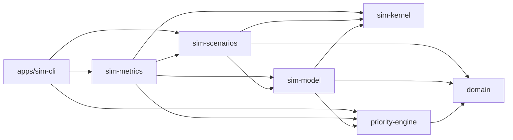
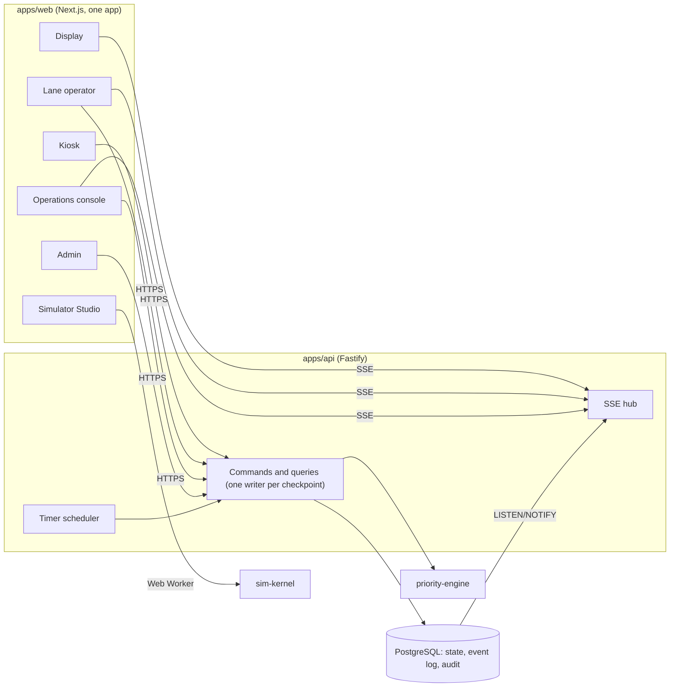

# GateFlow architecture

This document describes the architecture as implemented (slice S1: simulator and priority engine)
and the agreed direction for the operational product. Decisions are referenced as ADR-nnn
([DECISIONS.md](DECISIONS.md)).

## 1. Principles

1. **The engine decides, deterministically and explainably.** The priority engine is a pure
   function: no I/O, no clock, no randomness. Every decision carries reason codes and the policy
   version.
2. **The same code in simulation and production.** The simulator calls the very engine that the
   operational product will run, so simulated evidence is evidence about the shipped code.
3. **Reproducible to the bit.** Identical inputs give byte-identical outputs on any machine and
   JavaScript engine (ADR-008).
4. **Never worse than the status quo because of data.** Missing or untrusted deadlines degrade to
   FIFO. The physical fallback of the operational product is the traditional queue.
5. **Honest results.** Every number in a report is labelled simulated, and every assumption is
   listed with its source (ADR-009).

## 2. Repository layout

```
apps/
  sim-cli/          gateflow-sim: runs experiments, writes results.json and report.md (bundled)
packages/
  domain/           shared domain types and units (integer milliseconds, segments, risk classes)
  priority-engine/  assessment and selection of the next call (pure)
  sim-kernel/       seeded RNG streams, deterministic math, distributions, event calendar (pure)
  sim-model/        checkpoint virtual-queue simulation driven by the priority engine (pure)
  sim-scenarios/    scenario schema, validation, assumptions, synthetic population (pure)
  sim-metrics/      experiment runner, paired metrics, statistics, results and report (pure)
scenarios/          scenario files (YAML)
docs/kickoff/       kickoff analysis and proposal (Italian)
```

## 3. Dependency rules



Enforced automatically, on three levels:

| Level | Tool | Rule |
|---|---|---|
| Imports | dependency-cruiser (`pnpm boundaries`) | Packages may import only the dependencies shown above. Allowed npm modules: `zod` and `yaml` in `sim-scenarios`, nothing elsewhere. No Node.js built-ins in `packages/*/src`. No cycles. No unresolvable imports. |
| Environment | `tsconfig.src.json` | Package sources compile with `lib: ES2023` and no Node or DOM types, so they cannot use `process`, `console`, timers or browser APIs. |
| Determinism | ESLint | `packages/*/src` may not use `Math.random`, `Date`, `**`, implementation-approximated `Math` functions, `localeCompare` or `Intl`. |

Each rule was checked by introducing a deliberate violation and confirming that the tool rejects
it.

## 4. Determinism (ADR-008)

| Concern | Approach |
|---|---|
| Time | Integer milliseconds everywhere. Simulations use "ms since the start of the service day". |
| Randomness | `streamFor(seed, key)` derives an independent xoshiro128** generator from a 32-bit seed and a key of 32-bit words (MurmurHash3 with four seeds gives the 128-bit state). Every random attribute has its own stream, e.g. `[pax.arrival, flight, passenger]`: adding an attribute never shifts existing draws. |
| Floating point | `ln` and `exp` are fdlibm ports using only IEEE 754 basic operations (bit-identical to V8, `exp(1) === Math.E`). Normal variates use the Marsaglia polar method (no trigonometry). |
| Ordering | Event calendar ordered by (time, event priority, insertion sequence). Engine tie-breakers: latest call time, then FIFO key. Numeric sorts always use comparators or typed arrays. |
| Identity | Scenarios are hashed as SHA-256 of canonical JSON (sorted keys). Seeds are normalised (sorted, unique). |
| Output | Results are rounded to 4 decimals at serialisation time only. No timestamps. The source revision is recorded with a `-dirty` flag when applicable (ADR-014). |

Verification:
- known-answer tests (MurmurHash3 vectors cross-checked with `mmh3`; xoshiro128** reference
  output);
- byte-identical golden files, run on Node 22 and 24 in CI;
- an end-to-end `cmp` of two CLI runs in CI.

## 5. Priority engine (v0)

Pure functions in `@gateflow/priority-engine`:

- `assessTicket(ticket, aheadInFifo, now, checkpoint, params)`: risk class and explanation.
- `selectNext({ now, checkpoint, waiting, recentPriorityCalls, policy })`: next ticket to call.
- `assessQueue(snapshot, params)`: assessment of every waiting ticket in FIFO order.

Definitions for ticket *i* at time *t*:

| Symbol | Meaning |
|---|---|
| `D_i` | Deadline known to the system, from a feed or an approved rule (`allowRuleBasedDeadline`). |
| `L_i = D_i - (R + P + W_i + B)` | Latest useful call time. R = response, P = process, W = walk, B = buffer. |
| `FIFO wait_i = floor(ahead_i * 1 h / throughput)` | Wait if served in FIFO order. |
| `slackFifo_i = L_i - t - FIFO wait_i`, `slackNow_i = L_i - t` | Margins under FIFO and if called now. |

Classes:

| Class | Condition |
|---|---|
| `UNVERIFIED` | No trusted deadline. |
| `CRITICAL` | `slackNow < 0` (escalate, never boost). |
| `URGENT` | `slackFifo < 0` and `slackNow >= 0`. |
| `ATTENTION` | `0 <= slackFifo < threshold`. |
| `NORMAL` | Otherwise. |

Selection (`constrained-edf`):
1. If a waiting ticket has been overtaken `K` times, call the oldest such ticket
   (`OVERTAKE_LIMIT_GUARD`).
2. Else, if boost-eligible `URGENT` tickets exist and fewer than `k` of the last `N - 1` calls
   were priority calls, call the one with the smallest `L` (`URGENT_FEASIBLE`).
3. Else call the oldest ticket (`FIFO` or `CAP_REACHED`).

Guarantees, verified by property tests with 1,000 generated cases each:
- determinism and independence from input order;
- completeness of assessments;
- the selection is always a waiting ticket;
- priority calls are always `URGENT` and eligible;
- the guard takes precedence;
- the cap holds for a single decision, exactly at its boundary, and in every window of a call
  sequence;
- no ticket is overtaken more than `K` times;
- reduction to FIFO with a zero cap;
- monotonicity: an earlier but still feasible deadline never loses a selection.

Mutation checks (cap off by one, guard disabled) are caught by the suite.

Not yet implemented (by design, later slices): the committed "prepare" window and call
latency (S2), eligibility rules against strategic late arrival (S3), hysteresis (S4).

## 6. Checkpoint simulation model (S1)

`simulateCheckpoint(population, policy, { classification })` is a discrete-event simulation:

- **Events.** Arrival (ticket issued immediately) and end of service. At equal times, service ends
  are processed first, so a freed lane can serve an arrival at once.
- **Dispatch.** While a lane is free and someone is waiting, the engine selects the next ticket.
  The call is answered instantly. Lanes are scanned from the lowest index.
- **Outcome.** gate arrival = end of service + individual walking time. The passenger misses the
  flight if they reach the gate after the true boarding close.
- **Bookkeeping.** Overtakes per ticket, recent priority flags (for the cap), risk class on
  arrival (the same classification for every policy), lane busy time, the integral of the queue
  length (Little's law), and calls blocked by the cap or the guard.

Validation:
- hand-computed cases;
- conservation (every passenger served once, never more lanes busy than exist);
- exact Little's law (queue area equals the sum of waits);
- equivalences: a zero cap reproduces FIFO passenger by passenger, unknown deadlines reproduce
  FIFO, and a single lane gives a policy-independent makespan;
- Erlang C within 1% on three M/M/c configurations, using control variates and simultaneous
  confidence intervals (ADR-012).

## 7. Scenarios and population (ADR-003, ADR-009)

- A scenario (`schemaVersion: 1`) defines the checkpoint, a synthetic hourly design day of
  departures, the aircraft mix, gate zones, load factors, show-up curves per segment, walking
  variability, the boarding-close rule and how the system learns deadlines.
- `generateSchedule(scenario)` builds the same flights for every replication (it uses
  `schedule.generatorSeed`).
- `generatePopulation(scenario, seed)` draws the passengers of one day: load factor per flight,
  then segment, arrival, screening time and walking factor per passenger, each from its own
  stream.

## 8. Experiments, metrics and reports (ADR-011)

`runExperiment` runs every policy on every seed and computes, per day:
- policy metrics: missed flights (total and by segment), wait distribution, prioritised
  passengers, overtakes, lane utilisation, queue length, risk classes on arrival;
- paired comparisons with the baseline: saved, lost, net, the at-risk cohort, and the extra wait
  of non-prioritised passengers.

`buildResults` aggregates over days (mean, P5, P50, P95, min, max, and bootstrap intervals for
comparisons) into `results.json` (`schema: gateflow.sim.results/1`):
- disclaimer;
- manifest: versions, scenario hash, seeds, policies, classification, statistics settings,
  source revision, reproduce command;
- assumptions;
- model limitations;
- summary;
- per-seed metrics.

`renderReport` renders `report.md` from that document only, so the two cannot disagree.

Golden files (`packages/sim-metrics/test/golden`) lock the full results and report of the demo
scenario for seeds 1-3. To regenerate them after an intentional change, run
`UPDATE_GOLDEN=1 pnpm --filter @gateflow/sim-metrics test` and explain the change in the
changelog.

## 9. Build and tooling (ADR-006, ADR-007)

- Packages export TypeScript sources. The CLI is bundled with esbuild into
  `apps/sim-cli/dist/gateflow-sim.mjs`. The banner adds a shebang and `createRequire` for
  CommonJS dependencies.
- Turborepo runs `typecheck`, `lint`, `test` and `build`. A `transit` task makes caches depend on
  the sources of dependencies. `scenarios/**` is a global dependency.
- `pnpm check` runs Prettier, dependency-cruiser and every Turborepo task.
- CI (GitHub Actions) runs `pnpm check` on Node 22 and 24, builds the CLI, compares two CLI runs
  byte for byte, and publishes 200-day reports for both demo scenarios as an artefact.

## 10. Target architecture of the operational product (ADR-013)

Direction agreed at kickoff, to be implemented from milestone M2/M3:



- **Consistency.** One writer per checkpoint (an advisory lock), idempotency keys, database
  constraints for invariants (e.g. a unique admission per ticket), and state plus an append-only
  event log written in one transaction, with a hash-chained audit log.
- **Privacy.** Boarding passes are parsed in memory and never stored. Deduplication uses an HMAC
  keyed per flight date; destroying the keys makes the data unlinkable.
- **Fail-safe.** If GateFlow is unavailable, the checkpoint reverts to its traditional queue. The
  system never controls physical barriers.
