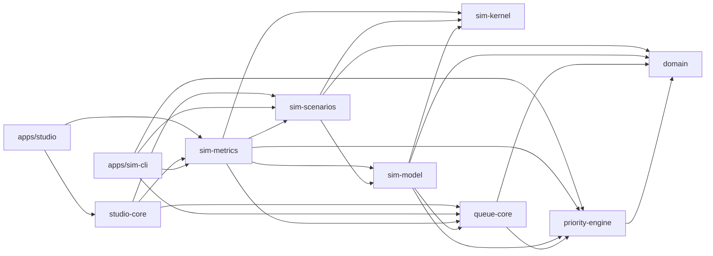
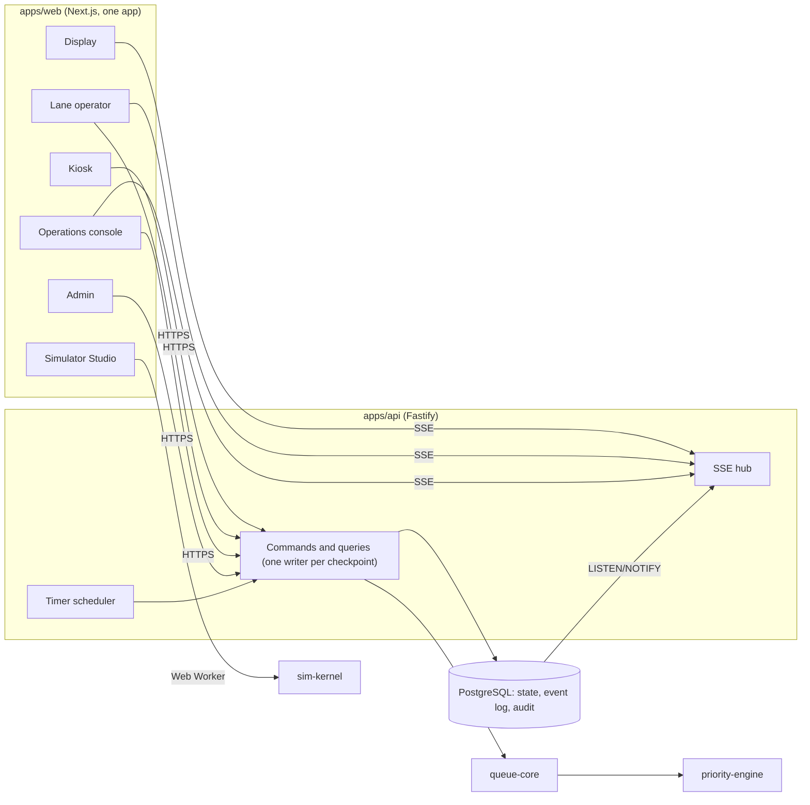

# GateFlow architecture

This document describes the architecture as implemented (slices S1 to S6: priority engine, queue
state machine, simulator, parallel batches and sensitivity sweeps) and the agreed direction for the operational product. Decisions are
referenced as ADR-nnn ([DECISIONS.md](DECISIONS.md)).

## 1. Principles

1. **The engine decides, deterministically and explainably.** The priority engine is a pure
   function: no I/O, no clock, no randomness. Every decision carries reason codes and the policy
   version.
2. **The same code in simulation and production.** The simulator drives the very queue state
   machine and engine that the operational product will run, so simulated evidence is evidence
   about the shipped code.
3. **Reproducible to the bit.** Identical inputs give byte-identical outputs on any machine and
   JavaScript engine (ADR-008).
4. **Never worse than the status quo because of data.** Missing or untrusted deadlines degrade to
   FIFO. The physical fallback of the operational product is the traditional queue.
5. **Honest results.** Every number in a report is labelled simulated, and every assumption is
   listed with its source (ADR-009).

## 2. Repository layout

```
apps/
  sim-cli/          gateflow-sim: experiments and sweeps on worker threads; JSON, Markdown, HTML (bundled)
  studio/           GateFlow Simulator Studio: the simulator in one offline HTML page (React, Web Workers)
packages/
  domain/           shared domain types and units (integer milliseconds, segments, risk classes)
  priority-engine/  assessment and selection of the next call (pure)
  queue-core/       queue state machine: tickets, prepare window, calls, no-shows; policies and lane modes (pure)
  sim-kernel/       seeded RNG streams, deterministic math, distributions, event calendar (pure)
  sim-model/        checkpoint simulation: physical queue or GateFlow virtual queue, extra lanes (pure)
  sim-scenarios/    scenario schema, validation, assumptions, synthetic population, arrival forecast (pure)
  sim-metrics/      experiments, sweeps, paired metrics, statistics, results, Markdown and HTML (pure)
  studio-core/      what the Studio adds in the browser: SHA-256, files, library, setup, what-if, comparison (pure)
airports/           airport configurations: parameters of each airport and checkpoint (YAML)
airports/private/   airport-provided configurations, ignored by git
scenarios/          scenario files (YAML), including the S7 library
scenarios/flights/  flight lists (CSV, gateflow.flights/1) and the generator of the synthetic ones
scenarios/private/  airport-provided files, ignored by git (docs/data-request)
sweeps/             sensitivity sweep specifications (YAML)
docs/kickoff/       kickoff analysis and proposal (Italian)
docs/data-request/  what GateFlow needs from an airport, with a flight list template
```

## 3. Dependency rules



Enforced automatically, on three levels:

| Level | Tool | Rule |
|---|---|---|
| Imports | dependency-cruiser (`pnpm boundaries`) | Packages may import only the dependencies shown above. Allowed npm modules: `zod` and `yaml` in `sim-scenarios`, nothing elsewhere. No Node.js built-ins in `packages/*/src`. No cycles. No unresolvable imports. |
| Environment | `tsconfig.src.json` | Package sources compile with `lib: ES2023` and no Node or DOM types, so they cannot use `process`, `console`, timers or browser APIs. |
| Determinism | ESLint | `packages/*/src` may not use `Math.random`, `Date`, `**`, implementation-approximated `Math` functions, `localeCompare` or `Intl`. |

Each rule was checked by introducing a deliberate violation and confirming that the tool rejects
it.

## 4. Determinism (ADR-008)

| Concern | Approach |
|---|---|
| Time | Integer milliseconds everywhere. Simulations use "ms since the start of the service day". |
| Randomness | `streamFor(seed, key)` derives an independent xoshiro128** generator from a 32-bit seed and a key of 32-bit words (MurmurHash3 with four seeds gives the 128-bit state). Every random attribute has its own stream, e.g. `[pax.arrival, flight, passenger]`: adding an attribute never shifts existing draws. |
| Floating point | `ln` and `exp` are fdlibm ports using only IEEE 754 basic operations (bit-identical to V8, `exp(1) === Math.E`). Normal variates use the Marsaglia polar method (no trigonometry). |
| Ordering | Event calendar ordered by (time, event priority, insertion sequence). Engine tie-breakers: latest call time, then FIFO key. Numeric sorts always use comparators or typed arrays. |
| Identity | Scenarios are hashed as SHA-256 of canonical JSON (sorted keys). Seeds are normalised (sorted, unique). |
| Output | Results are rounded to 4 decimals at serialisation time only. No timestamps. The source revision is recorded with a `-dirty` flag when applicable (ADR-014). |

Verification:
- known-answer tests (MurmurHash3 vectors cross-checked with `mmh3`; xoshiro128** reference
  output);
- byte-identical golden files, run on Node 22 and 24 in CI;
- an end-to-end `cmp` of two CLI runs in CI.

## 5. Priority engine (engine version 0.5.0)

Pure functions in `@gateflow/priority-engine`:

- `assessTicket(ticket, aheadInFifo, now, checkpoint, params, committedAhead)`: risk class and
  explanation.
- `selectNext({ now, checkpoint, waiting, recentPriorityCalls, selection, aheadOfWaiting })`: the
  next ticket to commit. `aheadOfWaiting` counts the people already committed ahead of the waiting
  list (the prepare window of the virtual queue).

A ticket may hold a party (`partySize`, ADR-021). Everything the engine counts is people: the
people ahead, the committed window, the overtake count of a ticket and the cap history (one entry
per person called).
- `assessQueue(snapshot, params)`: assessment of every waiting ticket in FIFO order.

Definitions for ticket *i* at time *t*:

| Symbol | Meaning |
|---|---|
| `D_i` | Deadline known to the system, from a feed or an approved rule (`allowRuleBasedDeadline`). |
| `L_i = D_i - (R + P_i + W_i + B)` | Latest useful call time. R = call to start of screening, P = screening time of the party (per person x party size), W = walk, B = safety buffer. |
| `FIFO wait_i = floor(ahead_i * 1 h / throughput)` | Wait if served in FIFO order; `ahead_i` counts the people ahead, committed ones included. |
| `C = floor(committed * 1 h / throughput)` | Time to call the committed people, whom nobody can overtake. |
| `slackFifo_i = L_i - t - FIFO wait_i`, `slackNow_i = L_i - t - C` | Margins under FIFO and if selected now (ADR-019). |
| `feasible_i = D_i - (R + P_i + W_i + F) - t - C` | Margin if selected now with the feasibility margin F instead of B (ADR-023). |

Classes:

| Class | Condition |
|---|---|
| `UNVERIFIED` | No trusted deadline, or a stale one (`DEADLINE_STALE`, see below). |
| `CRITICAL` | `feasible < 0` (escalate, never boost). |
| `URGENT` | `slackFifo < 0` and `feasible >= 0` (`INSIDE_SAFETY_MARGIN` when `slackNow < 0`). |
| `ATTENTION` | `0 <= slackFifo < threshold`. |
| `NORMAL` | Otherwise. |

A ticket is boost-eligible when it is `URGENT`, its segment is eligible and the late-presentation
rule (optional, `latePresentationCutoffMs`) does not block it: a departing passenger who presented
later than the cutoff before the scheduled departure is not boosted (`LATE_PRESENTATION`, or
`PRESENTATION_UNVERIFIED` when a time is unknown). A party larger than `k` is never boosted
(`GROUP_EXCEEDS_CAP`).

Selection (`constrained-edf`):
1. If a waiting ticket has been overtaken `K` times or more (in people), select the oldest such
   ticket (`OVERTAKE_LIMIT_GUARD`), unless calling it would push an older ticket past K: then
   select the oldest ticket.
2. Else, if boost-eligible tickets exist, select the one with the smallest `L` (`URGENT_FEASIBLE`)
   if the cap allows it: the priority people among the last commitments, plus this party, may not
   exceed `k` within a window of `N` people. Calling it may not push any older ticket past K
   either (`OVERTAKE_ROOM_EXHAUSTED`).
3. Else select the oldest ticket (`FIFO`, or `CAP_REACHED` when the cap blocked a boost).

Fast track (`fastTrack`, ADR-027, used by `priority-v2`):
- a boost is made next, ahead of the committed window;
- the party goes to the next free lane once its ticket is validated.

The engine therefore estimates a boosted journey differently from the journey through the queue
(`journeyEstimates`):
- the response time is the fast-track estimate (the walk back, without the call-ahead), or the
  time since the passenger was last at the access point when that is shorter;
- the time C to call the window is not counted;
- `slackFifo` keeps the journey through the queue.

An URGENT head of the waiting list is boosted too. A boost is refused when it would push one of
the committed people past K (`aheadMaxOvertakenCount`, reason `OVERTAKE_ROOM_EXHAUSTED`).

Data quality (ADR-029, used by `priority-v3`):
- **Stale data.** A known deadline carries `observedAtMs`, when its source last confirmed it
  (absent: the source is live). With `maxDeadlineAgeMs`, a deadline confirmed longer ago is not
  trusted: the ticket is `UNVERIFIED` (`DEADLINE_STALE`), served in FIFO order and never boosted,
  until the source confirms it again.
- **Hysteresis.** With `hysteresisMs` h, a ticket escalates at once and returns to a less urgent
  class only when its margin passes the threshold by h: `feasible >= h` to leave CRITICAL,
  `slackFifo >= h` to leave URGENT, `slackFifo >= threshold + h` to leave ATTENTION
  (`HYSTERESIS_HOLD`). The previous class is an input of the ticket (`lastRiskClass`). With
  h = 0 it has no effect.

Selection `flight-call` models today's staff practice (baseline A', ADR-022): at the last
announcement `floor(t / I) x I`, the tickets whose deadline is at most `W` away are called first,
earliest deadline first, with no cap and no overtake bound (`FLIGHT_CALL`).

Guarantees, verified by property tests with 1,000 generated cases each:
- determinism and independence from input order;
- completeness of assessments;
- the selection is always a waiting ticket;
- priority selections are always `URGENT` and eligible;
- the guard takes precedence;
- the cap holds, in people, for a single decision, exactly at its boundary, and in every window
  of a sequence;
- no ticket is overtaken by more than `K` people;
- reduction to FIFO with a zero cap;
- monotonicity: an earlier but still feasible deadline never loses a selection;
- both margins match their definitions, and selection and assessment agree on boost eligibility;
- late presenters and parties larger than `k` are never boosted;
- the S3 parameters at their defaults reproduce the S2 engine;
- the flight-call selection matches an independent oracle;
- under the fast track a boost never pushes a committed person past K, the fast track never
  makes a ticket less feasible, and without it the new inputs are ignored;
- a stale ticket is never boosted; the hysteresis only holds a class between the raw class and the
  previous one, and with h = 0 the previous class is irrelevant; for a margin that oscillates
  around a threshold the class changes at most once with hysteresis, and at every crossing
  without it.

Mutation checks (cap and guard off by one, guard disabled, committed window ignored, people counted
as tickets, rules disabled) are caught by the suite.

## 6. Queue state machine (`@gateflow/queue-core`, ADR-016)

`CheckpointQueue` owns the tickets of one checkpoint and applies the policy; every ordering
decision is delegated to the engine. It performs no I/O and reads no clock: each operation takes
an explicit time, and time may never go backwards.

| Operation | Effect |
|---|---|
| `issue(ticket, t, estimates)` | New ticket, classified against everybody ahead (window included). |
| `callNext(t, estimates)` | Calls the head of the prepare window (or, without a window, the ticket the engine selects now). |
| `present(id, t, estimates)` | Validation at the access point: `ADMITTED`, `REACTIVATED` (a no-show rescanning in time), `EXPIRED`, or a refusal (`NOT_CALLED`, `ALREADY_ADMITTED`, `UNKNOWN_TICKET`). |
| `advance(t)` / `nextDueMs()` | Applies the timeouts due by `t` / tells when the next one is due. |

States: `QUEUED -> PREPARE -> CALLED -> RECALLED -> NO_SHOW -> EXPIRED`, where:
- `PREPARE` is skipped when there is no prepare window (M = 0);
- `ADMITTED` is reachable from `CALLED` and `RECALLED`;
- `NO_SHOW -> QUEUED` on reactivation (at the original place or at the back, at most `r` times);
- a no-show that may not be reactivated again expires at once.

- **Prepare window (M tickets).** Tickets are committed to the window by the engine and shown on
  displays; a committed ticket leaves the window only by being called (no churn).
- **Timeouts.** Second call after T1, no-show after T1 + T2, expiry at the end of the reactivation
  window. Timeouts strictly before `t` are applied before an operation at `t`, so a passenger
  presenting exactly at a deadline is on time.
- **Events.** Every transition is reported to a listener in chronological order (the audit log in
  production, metrics in simulation).
- **Parties.** A ticket carries its party size, presentation time and scheduled departure. The
  window, the waiting list and the outstanding calls are also counted in people; a party called
  ahead of older tickets adds its size to their overtake counts.
- **Fast track.** A fast-track priority commitment goes ahead of the prepare window, behind earlier
  fast-track commitments only. The tickets it passes are overtaken by its people.
- **Last seen.** Each ticket records when the passenger was last at the access point (issue,
  rescan), which shortens the engine's fast-track estimate.
- **Flight knowledge (S5).** A ticket carries its flight. `updateFlight(flight, knowledge, t,
  estimates)` gives every live ticket of that flight a new known deadline or walking time (a delay
  or a gate change from the feed, or a deadline marked stale or fresh again).
- **Classes and stability (S5).** Whenever a ticket is issued or called, the queue assesses every
  waiting ticket under the policy's own parameters, records its class (the input of the
  hysteresis) and counts its changes of class and its reversals of direction (flapping).
- **Presets.** `fifo` (A, physical), `fifo-manual` (A', physical, staff flight calls),
  `virtual-fifo`, `priority-v0`, `priority-v1`, `priority-v1-strict`, `priority-v2` and
  `priority-v3` (virtual queue).
- **Lane modes (S8, ADR-039).** `withLaneMode(policy, mode)` adds lane management to any policy,
  with the id `<policy>@<mode>`, without changing its calls: `reactive` (today's supervisor) or
  `predict` (GateFlow's recommendations). `findPolicyPreset('fifo-manual@reactive')` resolves
  such ids. The queue itself does not manage lanes: the simulator does (section 7), and in
  production the operations console will.

Property tests (1,000 random operation sequences on random policies, 300 for determinism) check,
independently of the implementation: zero churn, window size at most M, state counters, a single admission per ticket,
terminal states, chronological events, the cap and the K bound over commitments (with an
independent overtake model), class changes and reversals against an independent record of the
observed classes, and determinism. A coverage test guarantees that the sequences reach
priority commitments, the cap, the guard and reactivations.

## 7. Checkpoint simulation model (model version 0.6.0)

`simulateCheckpoint(population, policy, { classification })` is a discrete-event simulation of
one checkpoint operated by a `CheckpointQueue`:

- **Queues.** With a *physical* queue (status quo) passengers stand in line and the next one steps
  forward as soon as a lane is free. With a GateFlow *virtual* queue, tickets are called while the
  passengers called but not yet screened (walking to the access point, or waiting at the lanes)
  are fewer than the free lanes plus `ceil(call-ahead x open lanes x lane rate)` (ADR-017).
- **Passenger behaviour (ADR-018).** After taking the ticket a passenger walks away for at most
  their response time and walks back when called: a call that comes sooner is answered sooner, and
  a passenger who has not left cannot miss it. A passenger who has walked away may miss the first
  call and present later; the queue then recalls them, marks a no-show, reactivates them if they
  rescan in time, or they take a new ticket. After the first presentation the passenger answers
  later calls at once.
- **Parties and assisted passengers (ADR-021).** A party is called, validated and screened
  together on one lane, its members one after the other. Assisted parties go to the next free
  lane ahead of the queue and of the call-ahead buffer, under every policy, and count in the call
  pipeline.
- **Fast track at the lanes (ADR-027).** A fast-tracked party that validates its ticket goes ahead
  of the parties waiting at the lanes, never ahead of an earlier fast-tracked party, and stops
  behind the first party that would exceed K overtakes. Every party it passes counts the pass.
- **Lanes.** A planned schedule gives the open lanes over the day, minus the lanes out of service
  during unplanned outages (S5), always at least one. Lanes close from the highest number down,
  finish the passenger they are screening, and a lane closing at time t takes nobody at t. The
  engine's throughput estimate follows the open lanes at once.
- **Extra lanes (S8, ADR-039).** A policy with lane management (`policy.lanes`) can open lanes
  beyond the plan when the population has staff on call (`population.staffing`). Open lanes are
  `max(1, min(planned + extra, lanes the checkpoint has) - out of service)`, so without extra
  lanes this is the plan of S5.
  - Lane management looks at the queue every 5 minutes (event `LANE_REVIEW`, after everything
    else at the same instant) while passengers are still to come or to be screened.
  - A decision to open takes the day's delay of that decision (`staffing.openDelaysMs`). The
    lane then opens (event `LANE_READY`, with the priority of a lane change) if the checkpoint and
    the staff still have room.
  - At most `maxExtraLanes` extra lanes are open or decided at the same time. A decision is
    followed by a wait (cooldown), and an extra lane stays open at least `minOpenMs`. When the
    plan grows, staff beyond the lanes it leaves free go back.
  - *Reactive* (today's supervisor): opens one lane when the wait the queue shows (people waiting
    / throughput of the open lanes) exceeds a threshold, and closes one below another.
  - *Predict* (GateFlow): projects the backlog minute by minute over a horizon from the people
    waiting and the forecast of arrivals (`population.forecast`), scaled by the arrivals of the
    last hour. It recommends the fewest lanes that keep the projected wait below the target, and
    closing a lane when the projection without it stays short. The duty manager follows the n-th
    recommendation when `staffing.follows[n]` is true.
- **Ground truth and knowledge (S5, ADR-030).** The system starts the day with the known
  deadlines and learns of delays and gate changes from the feed messages, at the time the feed
  sends them. During a feed outage the messages are held until the feed recovers, and every known
  deadline is marked as confirmed at the start of the outage (so that a policy with a maximum data
  age stops trusting it). After a gate change, passengers who finish screening from that instant
  walk to the new gate, their walk scaled by the nominal walking times of the two gates.
- **Events and order at the same instant:** the feed recovers, the feed goes down, feed messages
  arrive, lane change (and an extra lane ready), end of service, presentation at the access point,
  timeouts, arrival, then the lane review. With instant calls and no call-ahead or window, this
  reproduces S1 exactly.
- **Outcome.** Time to screening, time standing in a queue, calls, no-shows, reactivations, new
  tickets, class changes and reversals per passenger; gate arrival = end of service + walking time
  (after a gate change, to the new gate); the passenger misses the flight if they reach the gate
  after the true boarding close. The run counts the people boosted while the system's knowledge
  of their flight differed from the truth.
- **Run statistics.** Lane busy and staffed time, extra lane time beyond the plan, lane decisions
  (and those followed), lanes opened and closed and the most lanes open, idle lane time that
  waiting passengers could have used (`min(idle lanes, waiting + walking)`), integrals of tickets
  waiting for a call and of
  people standing in a queue.

Validation:
- hand-computed cases for the physical queue, lane schedules, call latency, call-ahead,
  recalls, no-shows, reactivation, expiry and new tickets, and the deadline boundaries;
- property tests on random populations, lane schedules and policies: conservation, lanes and
  schedules respected, one passenger per lane at a time, the outcome of every first call follows
  from the passenger's delay alone, standing-time integral, work conservation of the physical
  queue, the K bound, determinism, and "a virtual queue answered instantly behaves exactly like the
  physical queue";
- exact Little's law, equivalences (zero cap = FIFO with and without call mechanics; unknown
  deadlines = FIFO), Erlang C on three M/M/c configurations (ADR-012);
- the S1, S2 and S3 regressions: with the later features disabled, every S1, S2 and S3 metric is
  reproduced exactly on seeds 1-3 (sim-metrics);
- the lane order (validation order, except for fast-tracked parties) and the bound K, lane passes
  included, on random and congested populations, with a hand-computed fast-track timeline;
- hand-computed cases for groups (a family boosted as a whole) and for assisted precedence;
- mutation checks on the event order, lane accounting, call rule, response rule, party handling
  and metrics;
- S5: hand-computed cases for lane outages, gate changes, delay notices, messages held during a
  feed outage, the stale-data rule and the order of feed events at the same instant; properties on
  random populations with random disruptions (every invariant above, no boost on stale data, the
  walk after a gate change, misinformed boosts only when the knowledge is wrong); the S4 regression
  (seeds 1-3, every S4 metric); and the acceptance criterion: with the feed down all day, B gives
  exactly the outcomes of the same queue in FIFO order, and with calls answered at once those of
  the physical FIFO queue A.

## 8. Scenarios and population (ADR-003, ADR-009, ADR-018, ADR-026, ADR-030, ADR-035 to ADR-037)

- A scenario (`schemaVersion: 5`) lists its data sources with their licence or terms of use
  (`dataSources`; any parameter can name its source with `ref`). It defines the checkpoint
  (planned lane schedule, screening times) and the design day of departures. The design day is
  either a synthetic hourly profile with an aircraft mix, or a flight list read from a CSV file
  (`gateflow.flights/1`, see `scenarios/flights/README.md`). It also defines gate zones, load factors,
  show-up curves per segment, walking variability, how passengers answer calls, party sizes, the
  assisted share, strategic late arrivals (for stress tests), the boarding-close rule, how the
  system learns deadlines (`RULE`, `FEED` or `NONE`) and the disruptions (flight delays with their
  notice, gate changes, lane outages, feed outages).
- A scenario may extend an airport configuration (`airports/<id>.yaml`, ADR-038):
  `extends: { airport, checkpoint }`. The loader composes the airport's `defaults`, then the
  checkpoint's part, then the day (objects merge key by key; labelled parameters, lists and values
  replace), and records the airport and the file's SHA-256 in `scenario.airport`.
- A checkpoint may give `lanesAvailable` and a `lanePlanRule` instead of a lane schedule. The plan
  is then made at load time (`planLanes`) from the expected arrivals of simulated days 1 to N, up
  to `maxLanes` (the roster) when the rule gives it.
- A checkpoint may give staff on call (`laneStaffing`, S8): extra lanes, the time to open one, the
  minimum time open and the share of GateFlow's recommendations the duty manager follows.
  Generator 0.6.0 draws the day's 64 open delays (log-normal) and answers (Bernoulli) on streams of
  their own, so every policy meets the same ones and the rest of the population is unchanged.
- `arrivalForecast(scenario)` is GateFlow's forecast for lane recommendations: the people
  arriving per minute, averaged over 50 simulated days that the reports never simulate (seeds from
  1,000,001). `planExperiment` and `sweepDayJob` compute it once, only when a policy uses it.
- The scenario's `gateflow`, `todayPractice` and `fairnessTarget` configure the checkpoint.
  `applyScenarioSettings` (sim-metrics) applies the first two to the policies before a run or
  sweep (including the lane thresholds of `@reactive` and `@predict`), and the reports check the
  third.
- The package does no I/O: `parseScenarioText(text, format, files)` receives functions that read
  the flight list named by the scenario (relative to the scenario file) and hash it. The CLI
  passes file system access. The rows are then part of the scenario, so its hash, the worker
  threads and the sweeps see the same data; the file's SHA-256 is recorded too.
- `generateSchedule(scenario)` builds the same flights for every replication (it uses
  `schedule.generatorSeed`). For a flight list, flights are ordered by departure. Seats come from
  the row or from the seats of the aircraft type (`schedule.seats`). A row may fix its passengers.
  Missing gate zones are drawn from the zone shares. `designDayRows` and
  `formatFlightCsv` write any design day back as a flight list; a flight list scenario made from it
  generates exactly the same population.
- Public flight data is not used: OPDI and EUROCONTROL's portal publish for non-commercial use
  only (ADR-035). Real schedules come from the airport, under a data agreement.
- `generatePopulation(scenario, seed)` draws the passengers of one day: load factor per flight,
  then segment, arrival, screening time, walking factor, call response and absence per passenger
  slot, each from its own stream. Generator 0.3.0 groups consecutive slots into parties: a party
  takes its leader's attributes and the sum of its members' screening times, and party size,
  assistance and strategic arrival have their own streams. With parties of one person the S2
  population is reproduced exactly.
- Generator 0.4.0 adds the disruptions of the day, each on streams of its own: delays and their
  notices, gate changes and their notices, lane outages and feed outages (Poisson processes over
  the operating day, log-normal durations). Without disruptions the populations of generator
  0.3.0 are reproduced.

## 9. Experiments, metrics and reports (ADR-011, ADR-015, ADR-020, ADR-026, ADR-031 to ADR-033)

An experiment is a set of independent days. `planExperiment` validates it, `runDay(job, seed)`
simulates one day (every policy on the same passengers), and `assembleExperiment` orders the days
by seed, whatever the order in which they were computed. `runExperiment` does all three in one
thread; the CLI spreads the days over worker threads (section 10). For each day:
- policy metrics, counted in people: missed flights (total and by segment), time to screening
  and standing time, prioritised passengers, overtakes, calls, second calls, no-shows,
  reactivations, new tickets, staffed lane-hours, extra lane-hours, lane decisions, lanes opened
  and closed, the most lanes open, lane utilisation, idle lane time, tickets
  waiting and people standing, risk classes on arrival, groups, assisted passengers, strategic
  late arrivals, people through the fast track and people passed at the lanes, class changes,
  reversals and people whose class flapped, people boosted on wrong information, and misses among
  passengers of delayed or re-gated flights;
- the disruptions of the day (delayed flights, gate changes, lane outages, feed outages, feed
  messages and those held), the same for every policy;
- paired comparisons for each requested `candidate`/`reference` pair, weighted by party size:
  saved, lost, net, the at-risk cohort, the extra wait of non-prioritised passengers, the
  change in time to screening and standing time, the change in waiting (person-hours) and in
  extra lane-hours. By default:
  - every policy against the status quo;
  - each reordering policy against the FIFO policy of the same queue;
  - each priority policy against today's practice with manual handling (A') and against the
    priority policies listed before it, these references managing lanes as the candidate does;
  - each policy with a lane mode against the same policy without it, `@predict` against
    `@reactive`, and a priority policy with `@predict` against `fifo-manual@reactive`.

`buildResults` aggregates over days (mean, P5, P50, P95, min, max, and bootstrap intervals for
comparisons; for comparisons that only add lane-hours, the waiting saved and the net flights made
per extra lane-hour, as ratios of totals with a bootstrap interval) into `results.json`
(`schema: gateflow.sim.results/7`):
- disclaimer;
- manifest: versions, scenario hash, the scenario's data sources and how its design day was built
  (hourly profile or flight list, with the file and its SHA-256), seeds, policies, comparisons,
  classification, statistics settings, source revision, reproduce command;
- assumptions;
- model limitations;
- summary;
- per-seed metrics.

`renderReport` renders `report.md` from that document only, so the two cannot disagree.
`renderHtmlReport` renders `report.html` from the same Markdown, converted to HTML, with charts
under the headline: missed flights by policy (bars with the P5-P95 spread) and net flights saved
by comparison (intervals). Charts are inline SVG, with no script or external resource, light and
dark, rounded to 0.1 px, so the HTML is as deterministic as the JSON (ADR-033).

**Sensitivity sweeps** (ADR-032). A sweep varies one parameter at a time around a base:
- the specification (`sweeps/*.yaml`) names the base scenario, the policies, the candidate, the
  comparisons and the curves (a parameter, its values, optionally a modified base);
- `applySetting` changes the candidate (K, k, N, h, maximum data age, GateFlow's target wait for
  extra lanes), every virtual queue (M, call-ahead, response estimate) or the scenario (lanes,
  load factor, arrival shift, call response, missed calls, delays, lane and feed outages, staff on
  call, time to open a lane, share of recommendations followed), and validates the result again;
- `planSweep` groups the points by scenario. A task is one day of one scenario variant:
  `runSweepDay` generates the population once and simulates each distinct policy once, so
  baselines are shared by every policy-only point;
- `buildSweepResults` summarises each point (missed flights per policy, net saved against each
  reference with a bootstrap interval, cost to other passengers, largest overtake count, extra
  lane-hours and the change in time to screening) into `sweep.json` (`gateflow.sim.sweep/3`),
  rendered as `sweep.md` and `sweep.html` (two charts per curve).

Golden files (`packages/sim-metrics/test/golden`) lock the full results, Markdown and HTML report
of the demo scenario for seeds 1-3, the report of the disrupted scenario, and a small sweep (JSON,
Markdown and HTML). To regenerate them after an intentional change, run
`UPDATE_GOLDEN=1 pnpm --filter @gateflow/sim-metrics test` and explain the change in the
changelog.

## 10. Build and tooling (ADR-006, ADR-007)

- Packages export TypeScript sources. The CLI is bundled with esbuild into
  `apps/sim-cli/dist/gateflow-sim.mjs`. The banner adds a shebang and `createRequire` for
  CommonJS dependencies.
- **Simulator Studio** (ADR-040). `apps/studio/build.mjs` bundles the React application and its
  worker with esbuild into one HTML file, `apps/studio/dist/gateflow-studio.html`, with the
  scenario library, the version and the commit inside. Its Content Security Policy forbids every
  connection. A second output is the body of a claude.ai page. See section 11.
- **Worker threads** (ADR-031). The bundle is also the script of its worker threads: started
  as a worker, it serves tasks (one simulated day of an experiment or of a sweep variant) and
  returns plain data. The pool hands each thread the next task as soon as it finishes one, and
  returns the results in task order. `--workers` defaults to every CPU; the outputs do not
  depend on it. Threads, files and the clock stay in the CLI: the packages remain pure.
- Turborepo runs `typecheck`, `lint`, `test` and `build`. A `transit` task makes caches depend on
  the sources of dependencies. `scenarios/**` is a global dependency.
- `pnpm check` runs Prettier, dependency-cruiser and every Turborepo task.
- CI (GitHub Actions) runs `pnpm check` on Node 22 and 24, builds the CLI, compares runs and
  sweeps made with 1 and 4 worker threads byte for byte, and publishes 200-day reports for the
  six scenarios and 20-day sweeps as an artefact. A job runs the Studio's end-to-end tests in
  Chromium and publishes the page.

## 11. Simulator Studio (`apps/studio`, `@gateflow/studio-core`, ADR-040)

The simulator in the browser, as one self-contained page that works offline and on a phone.

- **The same code as the CLI.** The page imports the pure packages. `@gateflow/studio-core` adds:
  - a synchronous SHA-256 identical to node:crypto;
  - files by path, resolved as the CLI resolves them on disk; files a person adds, which come
    without folders, are also found by name (`looseFolder`);
  - the library (`loadLibrary`), the experiment setup (`experimentConfig`, which calls
    `recommendedComparisons` and `arrivalClassification` of sim-metrics as the CLI does) and
    the results (`studioResults`, generator `gateflow-studio`);
  - the what-if settings (`LEVERS`, `withLevers`), the parameter editor (`withParameter`) and
    the comparison of runs (`compareRuns`).
- **Workers.** `planRun` (the arrival forecast), `runDays` (one worker per core up to 8, each
  taking the next day) and `resultsOfRun` (the statistics) run on Web Workers created from the
  code inside the page. Results come back in seed order. Where workers are refused, the page
  runs the same code itself.
- **Interface** (React 19): the scenario (library or the person's files), the what-if settings,
  every parameter with its source, the policies with their lane modes, the number of days, the
  results with the CLI's report in a shadow root, copies or downloads of the results, the report
  and the scenario, and the comparison of two runs (of the session or results files).
- **Same results as the CLI.** The page's `results.json` equals the CLI's byte for byte, except
  the generator. End-to-end tests in Chromium check it with and without workers, and for a
  scenario changed in the page and saved for the CLI.

## 12. Target architecture of the operational product (ADR-013)

Direction agreed at kickoff, to be implemented from milestone M2/M3:



- **Consistency.** One writer per checkpoint (an advisory lock), idempotency keys, database
  constraints for invariants (e.g. a unique admission per ticket), and state plus an append-only
  event log written in one transaction, with a hash-chained audit log.
- **Privacy.** Boarding passes are parsed in memory and never stored. Deduplication uses an HMAC
  keyed per flight date; destroying the keys makes the data unlinkable.
- **Fail-safe.** If GateFlow is unavailable, the checkpoint reverts to its traditional queue. The
  system never controls physical barriers.
