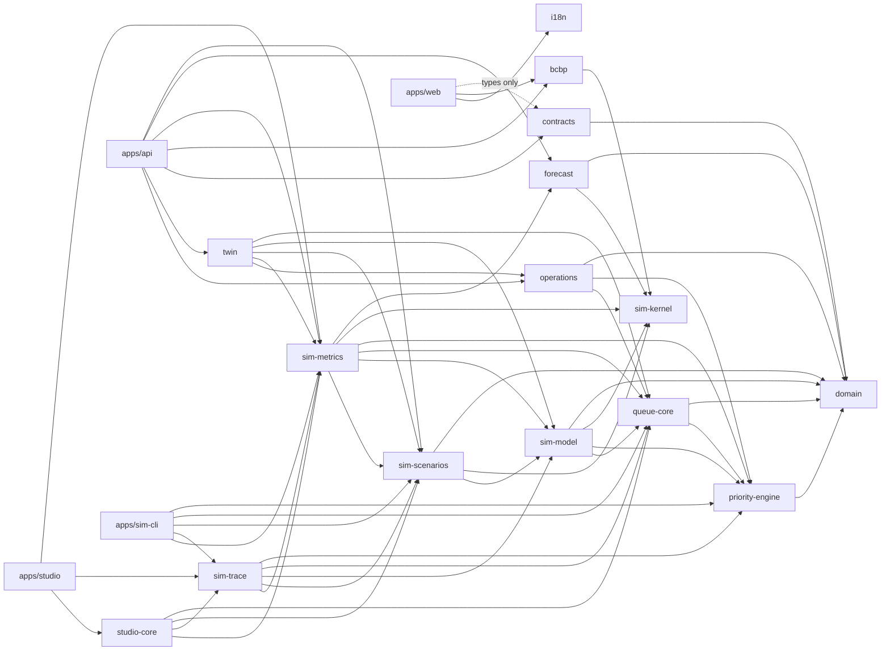
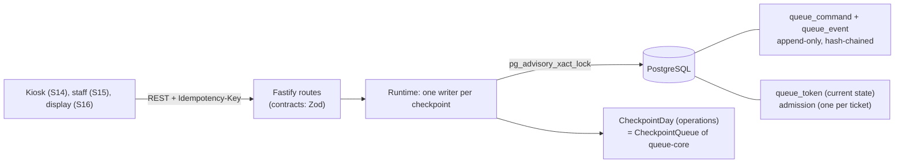
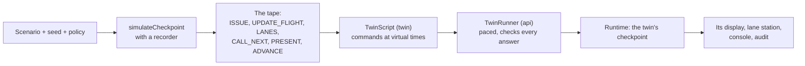
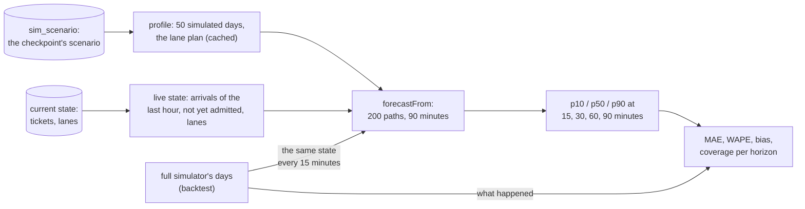
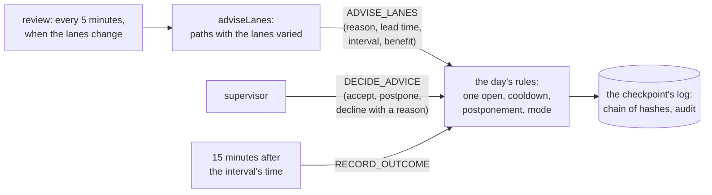
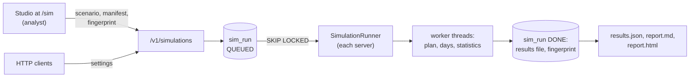
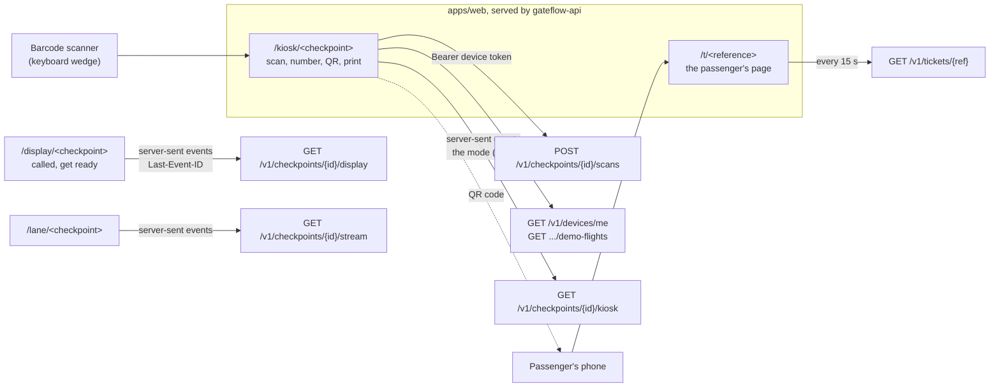
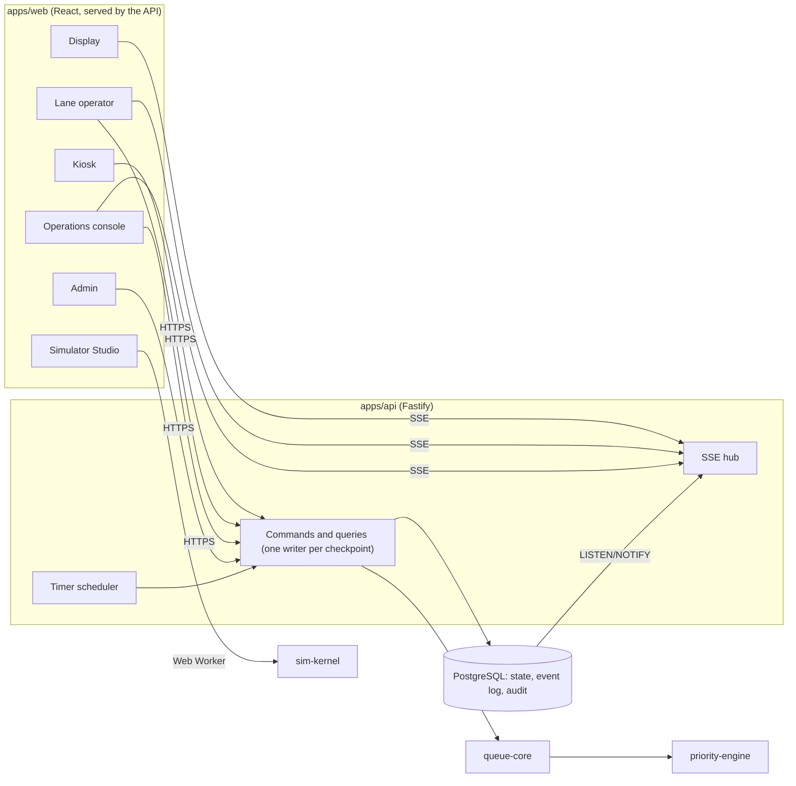

# GateFlow architecture

This document describes the architecture as implemented (slices S1 to S6: priority engine, queue
state machine, simulator, parallel batches and sensitivity sweeps) and the agreed direction for the operational product. Decisions are
referenced as ADR-nnn ([DECISIONS.md](DECISIONS.md)).

## 1. Principles

1. **The engine decides, deterministically and explainably.** The priority engine is a pure
   function: no I/O, no clock, no randomness. Every decision carries reason codes and the policy
   version.
2. **The same code in simulation and production.** The simulator drives the very queue state
   machine and engine that the operational product will run, so simulated evidence is evidence
   about the shipped code.
3. **Reproducible to the bit.** Identical inputs give byte-identical outputs on any machine and
   JavaScript engine (ADR-008).
4. **Never worse than the status quo because of data.** Missing or untrusted deadlines degrade to
   FIFO. The physical fallback of the operational product is the traditional queue.
5. **Honest results.** Every number in a report is labelled simulated, and every assumption is
   listed with its source (ADR-009).

## 2. Repository layout

```
apps/
  api/              gateflow-api: the operational checkpoint behind HTTP (Fastify) on PostgreSQL (Drizzle)
  sim-cli/          gateflow-sim: experiments and sweeps on worker threads; JSON, Markdown, HTML (bundled)
  studio/           GateFlow Simulator Studio: the simulator in one offline HTML page (React, Web Workers);
                    a build of it is served by the API at /sim, to save runs (S19)
  web/              the product's screens, served by the API: kiosk, ticket page, display, lane, console, demo (React)
packages/
  bcbp/             IATA boarding passes: a parser that never throws or returns the name, encoder, generator (pure)
  domain/           shared domain types and units (integer milliseconds, segments, risk classes)
  forecast/         GateFlow Predict: the next 90 minutes of a checkpoint from its live state; forecast errors;
                    the lane recommendations made from them (pure)
  contracts/        the API's request, answer and OpenAPI schemas (Zod, pure)
  i18n/             every text of the passengers' screens in Italian, English and Mexican Spanish (pure)
  operations/       one service day of a live checkpoint on the simulator's queue, rebuilt from its log (pure)
  priority-engine/  assessment and selection of the next call (pure)
  queue-core/       queue state machine: tickets, prepare window, calls, no-shows; policies and lane modes (pure)
  sim-kernel/       seeded RNG streams, deterministic math, distributions, event calendar (pure)
  sim-model/        checkpoint simulation: physical queue or GateFlow virtual queue, extra lanes (pure)
  sim-scenarios/    scenario schema, validation, assumptions, synthetic population, arrival forecast (pure)
  sim-metrics/      experiments, sweeps, paired metrics, statistics, results, Markdown and HTML, backtests,
                    the pitch figures read from the published reports (pure)
  sim-trace/        the trace of one day: every event of two policies, replay views, explanations (pure)
  studio-core/      what the Studio adds in the browser: SHA-256, files, library, setup, what-if, comparison, traces (pure)
  twin/             the digital twin: a simulated day as the live system's commands at virtual times, checked (pure)
airports/           airport configurations: parameters of each airport and checkpoint (YAML)
airports/private/   airport-provided configurations, ignored by git
scenarios/          scenario files (YAML), including the S7 library
scenarios/flights/  flight lists (CSV, gateflow.flights/1) and the generator of the synthetic ones
scenarios/private/  airport-provided files, ignored by git (docs/data-request)
sweeps/             sensitivity sweep specifications (YAML)
docs/kickoff/       kickoff analysis and proposal (Italian)
docs/data-request/  what GateFlow needs from an airport, with a flight list template
```

## 3. Dependency rules



Enforced automatically, on three levels:

| Level | Tool | Rule |
|---|---|---|
| Imports | dependency-cruiser (`pnpm boundaries`) | Packages may import only the dependencies shown above. Allowed npm modules: `zod` and `yaml` in `sim-scenarios`, `zod` in `contracts`, nothing elsewhere. No Node.js built-ins in `packages/*/src`: the database, HTTP and the clock live in `apps/api`. No cycles. No unresolvable imports. The web application takes only the types of the contracts, so Zod never reaches the browser. |
| Environment | `tsconfig.src.json` | Package sources compile with `lib: ES2023` and no Node or DOM types, so they cannot use `process`, `console`, timers or browser APIs. |
| Determinism | ESLint | `packages/*/src` may not use `Math.random`, `Date`, `**`, implementation-approximated `Math` functions, `localeCompare` or `Intl`. |

Each rule was checked by introducing a deliberate violation and confirming that the tool rejects
it.

## 4. Determinism (ADR-008)

| Concern | Approach |
|---|---|
| Time | Integer milliseconds everywhere. Simulations use "ms since the start of the service day". |
| Randomness | `streamFor(seed, key)` derives an independent xoshiro128** generator from a 32-bit seed and a key of 32-bit words (MurmurHash3 with four seeds gives the 128-bit state). Every random attribute has its own stream, e.g. `[pax.arrival, flight, passenger]`: adding an attribute never shifts existing draws. |
| Floating point | `ln` and `exp` are fdlibm ports using only IEEE 754 basic operations (bit-identical to V8, `exp(1) === Math.E`). Normal variates use the Marsaglia polar method (no trigonometry). |
| Ordering | Event calendar ordered by (time, event priority, insertion sequence). Engine tie-breakers: latest call time, then FIFO key. Numeric sorts always use comparators or typed arrays. |
| Identity | Scenarios are hashed as SHA-256 of canonical JSON (sorted keys). Seeds are normalised (sorted, unique). |
| Output | Results are rounded to 4 decimals at serialisation time only. No timestamps. The source revision is recorded with a `-dirty` flag when applicable (ADR-014). |

Verification:
- known-answer tests (MurmurHash3 vectors cross-checked with `mmh3`; xoshiro128** reference
  output);
- byte-identical golden files, run on Node 22 and 24 in CI;
- an end-to-end `cmp` of two CLI runs in CI.

## 5. Priority engine (engine version 0.5.0)

Pure functions in `@gateflow/priority-engine`:

- `assessTicket(ticket, aheadInFifo, now, checkpoint, params, committedAhead)`: risk class and
  explanation.
- `selectNext({ now, checkpoint, waiting, recentPriorityCalls, selection, aheadOfWaiting })`: the
  next ticket to commit. `aheadOfWaiting` counts the people already committed ahead of the waiting
  list (the prepare window of the virtual queue).

A ticket may hold a party (`partySize`, ADR-021). Everything the engine counts is people: the
people ahead, the committed window, the overtake count of a ticket and the cap history (one entry
per person called).
- `assessQueue(snapshot, params)`: assessment of every waiting ticket in FIFO order.

Definitions for ticket *i* at time *t*:

| Symbol | Meaning |
|---|---|
| `D_i` | Deadline known to the system, from a feed or an approved rule (`allowRuleBasedDeadline`). |
| `L_i = D_i - (R + P_i + W_i + B)` | Latest useful call time. R = call to start of screening, P = screening time of the party (per person x party size), W = walk, B = safety buffer. |
| `FIFO wait_i = floor(ahead_i * 1 h / throughput)` | Wait if served in FIFO order; `ahead_i` counts the people ahead, committed ones included. |
| `C = floor(committed * 1 h / throughput)` | Time to call the committed people, whom nobody can overtake. |
| `slackFifo_i = L_i - t - FIFO wait_i`, `slackNow_i = L_i - t - C` | Margins under FIFO and if selected now (ADR-019). |
| `feasible_i = D_i - (R + P_i + W_i + F) - t - C` | Margin if selected now with the feasibility margin F instead of B (ADR-023). |

Classes:

| Class | Condition |
|---|---|
| `UNVERIFIED` | No trusted deadline, or a stale one (`DEADLINE_STALE`, see below). |
| `CRITICAL` | `feasible < 0` (escalate, never boost). |
| `URGENT` | `slackFifo < 0` and `feasible >= 0` (`INSIDE_SAFETY_MARGIN` when `slackNow < 0`). |
| `ATTENTION` | `0 <= slackFifo < threshold`. |
| `NORMAL` | Otherwise. |

A ticket is boost-eligible when it is `URGENT`, its segment is eligible and the late-presentation
rule (optional, `latePresentationCutoffMs`) does not block it: a departing passenger who presented
later than the cutoff before the scheduled departure is not boosted (`LATE_PRESENTATION`, or
`PRESENTATION_UNVERIFIED` when a time is unknown). A party larger than `k` is never boosted
(`GROUP_EXCEEDS_CAP`).

Selection (`constrained-edf`):
1. If a waiting ticket has been overtaken `K` times or more (in people), select the oldest such
   ticket (`OVERTAKE_LIMIT_GUARD`), unless calling it would push an older ticket past K: then
   select the oldest ticket.
2. Else, if boost-eligible tickets exist, select the one with the smallest `L` (`URGENT_FEASIBLE`)
   if the cap allows it: the priority people among the last commitments, plus this party, may not
   exceed `k` within a window of `N` people. Calling it may not push any older ticket past K
   either (`OVERTAKE_ROOM_EXHAUSTED`).
3. Else select the oldest ticket (`FIFO`, or `CAP_REACHED` when the cap blocked a boost).

Fast track (`fastTrack`, ADR-027, used by `priority-v2`):
- a boost is made next, ahead of the committed window;
- the party goes to the next free lane once its ticket is validated.

The engine therefore estimates a boosted journey differently from the journey through the queue
(`journeyEstimates`):
- the response time is the fast-track estimate (the walk back, without the call-ahead), or the
  time since the passenger was last at the access point when that is shorter;
- the time C to call the window is not counted;
- `slackFifo` keeps the journey through the queue.

An URGENT head of the waiting list is boosted too. A boost is refused when it would push one of
the committed people past K (`aheadMaxOvertakenCount`, reason `OVERTAKE_ROOM_EXHAUSTED`).

Data quality (ADR-029, used by `priority-v3`):
- **Stale data.** A known deadline carries `observedAtMs`, when its source last confirmed it
  (absent: the source is live). With `maxDeadlineAgeMs`, a deadline confirmed longer ago is not
  trusted: the ticket is `UNVERIFIED` (`DEADLINE_STALE`), served in FIFO order and never boosted,
  until the source confirms it again.
- **Hysteresis.** With `hysteresisMs` h, a ticket escalates at once and returns to a less urgent
  class only when its margin passes the threshold by h: `feasible >= h` to leave CRITICAL,
  `slackFifo >= h` to leave URGENT, `slackFifo >= threshold + h` to leave ATTENTION
  (`HYSTERESIS_HOLD`). The previous class is an input of the ticket (`lastRiskClass`). With
  h = 0 it has no effect.

Selection `flight-call` models today's staff practice (baseline A', ADR-022): at the last
announcement `floor(t / I) x I`, the tickets whose deadline is at most `W` away are called first,
earliest deadline first, with no cap and no overtake bound (`FLIGHT_CALL`).

Guarantees, verified by property tests with 1,000 generated cases each:
- determinism and independence from input order;
- completeness of assessments;
- the selection is always a waiting ticket;
- priority selections are always `URGENT` and eligible;
- the guard takes precedence;
- the cap holds, in people, for a single decision, exactly at its boundary, and in every window
  of a sequence;
- no ticket is overtaken by more than `K` people;
- reduction to FIFO with a zero cap;
- monotonicity: an earlier but still feasible deadline never loses a selection;
- both margins match their definitions, and selection and assessment agree on boost eligibility;
- late presenters and parties larger than `k` are never boosted;
- the S3 parameters at their defaults reproduce the S2 engine;
- the flight-call selection matches an independent oracle;
- under the fast track a boost never pushes a committed person past K, the fast track never
  makes a ticket less feasible, and without it the new inputs are ignored;
- a stale ticket is never boosted; the hysteresis only holds a class between the raw class and the
  previous one, and with h = 0 the previous class is irrelevant; for a margin that oscillates
  around a threshold the class changes at most once with hysteresis, and at every crossing
  without it.

Mutation checks (cap and guard off by one, guard disabled, committed window ignored, people counted
as tickets, rules disabled) are caught by the suite.

## 6. Queue state machine (`@gateflow/queue-core`, ADR-016)

`CheckpointQueue` owns the tickets of one checkpoint and applies the policy; every ordering
decision is delegated to the engine. It performs no I/O and reads no clock: each operation takes
an explicit time, and time may never go backwards.

| Operation | Effect |
|---|---|
| `issue(ticket, t, estimates)` | New ticket, classified against everybody ahead (window included). |
| `callNext(t, estimates)` | Calls the head of the prepare window (or, without a window, the ticket the engine selects now). |
| `present(id, t, estimates)` | Validation at the access point: `ADMITTED`, `REACTIVATED` (a no-show rescanning in time), `EXPIRED`, or a refusal (`NOT_CALLED`, `ALREADY_ADMITTED`, `UNKNOWN_TICKET`). |
| `advance(t)` / `nextDueMs()` | Applies the timeouts due by `t` / tells when the next one is due. |
| `recall`, `markNoShow`, `reactivate`, `hold`, `resolve`, `cancel` (S15) | Staff actions, each allowed only in the states the table below gives; otherwise `NOT_ALLOWED`, and nothing changes. The simulator never takes them. |
| `grow(id, people, t, estimates)` (ADR-046) | More people join a waiting ticket (`QUEUED` or `PREPARE`): a family adds its boarding passes at the kiosk. Reports `PARTY_GROWN` with the new size; otherwise `NOT_ALLOWED`. Nobody more (0, an infant counted already) changes nothing. The simulator never takes it. |

States: `QUEUED -> PREPARE -> CALLED -> RECALLED -> NO_SHOW -> EXPIRED`, where:
- `PREPARE` is skipped when there is no prepare window (M = 0);
- `ADMITTED` is reachable from `CALLED` and `RECALLED`;
- `NO_SHOW -> QUEUED` on reactivation (at the original place or at the back, at most `r` times);
- a no-show that may not be reactivated again expires at once;
- `REVIEW` (S15): staff hold a waiting ticket (`QUEUED` or `PREPARE`) out of the order of calls; it
  keeps its place and goes back to it, or is `CANCELLED`, when the review ends;
- `CANCELLED` (S15) is final, from any state but `ADMITTED` and `EXPIRED`.

| State | Call again | Mark no-show | Reactivate | Hold | End review | Cancel |
|---|---|---|---|---|---|---|
| `QUEUED`, `PREPARE` | | | | `REVIEW` | | `CANCELLED` |
| `CALLED`, `RECALLED` | `RECALLED` | `NO_SHOW` | | | | `CANCELLED` |
| `NO_SHOW` | | | `QUEUED` | | | `CANCELLED` |
| `REVIEW` | | | | | `QUEUED` or `CANCELLED` | `CANCELLED` |
| `ADMITTED`, `EXPIRED`, `CANCELLED` | | | | | | |

- **Prepare window (M tickets).** Tickets are committed to the window by the engine and shown on
  displays; a committed ticket leaves the window only by being called (no churn).
- **Timeouts.** Second call after T1, no-show T2 after the second call (by the first timeout or
  by staff), expiry at the end of the reactivation window. Timeouts strictly before `t` are
  applied before an operation at `t`, so a passenger presenting exactly at a deadline is on time.
- **Events.** Every transition is reported to a listener in chronological order (the audit log in
  production, metrics in simulation). A commitment carries what it was decided on: the reasons,
  the tickets and people it passes, the fast track, the urgent tickets waiting and the engine's
  assessment of the ticket chosen (ADR-041).
- **Parties.** A ticket carries its party size, presentation time and scheduled departure. The
  window, the waiting list and the outstanding calls are also counted in people; a party called
  ahead of older tickets adds its size to their overtake counts. A waiting party may grow
  (`grow`, ADR-046); the overtakes already counted keep the size it had then.
- **Fast track.** A fast-track priority commitment goes ahead of the prepare window, behind earlier
  fast-track commitments only. The tickets it passes are overtaken by its people.
- **Last seen.** Each ticket records when the passenger was last at the access point (issue,
  rescan), which shortens the engine's fast-track estimate.
- **Flight knowledge (S5).** A ticket carries its flight. `updateFlight(flight, knowledge, t,
  estimates)` gives every live ticket of that flight a new known deadline or walking time (a delay
  or a gate change from the feed, or a deadline marked stale or fresh again).
- **Classes and stability (S5).** Whenever a ticket is issued or called, the queue assesses every
  waiting ticket under the policy's own parameters, records its class (the input of the
  hysteresis) and counts its changes of class and its reversals of direction (flapping).
- **Presets.** `fifo` (A, physical), `fifo-manual` (A', physical, staff flight calls),
  `virtual-fifo`, `priority-v0`, `priority-v1`, `priority-v1-strict`, `priority-v2` and
  `priority-v3` (virtual queue).
- **Lane modes (S8, ADR-039).** `withLaneMode(policy, mode)` adds lane management to any policy,
  with the id `<policy>@<mode>`, without changing its calls: `reactive` (today's supervisor) or
  `predict` (GateFlow's recommendations). `findPolicyPreset('fifo-manual@reactive')` resolves
  such ids. The queue itself does not manage lanes: the simulator does (section 7), and in
  production the operations console will.

Property tests (1,000 random operation sequences on random policies, 300 for determinism) check,
independently of the implementation: zero churn (a ticket leaves the window only by its call or
by staff), window size at most M, state counters, a single admission per ticket,
terminal states, chronological events, the cap and the K bound over commitments (with an
independent overtake model), class changes and reversals against an independent record of the
observed classes, and determinism. The sequences include staff actions (S15): an action the state
does not allow changes nothing and reports nothing; the others give the state of the table. A
coverage test guarantees that the sequences reach priority commitments, the cap, the guard,
reactivations and every staff action. A unit test runs every action on every state.

## 7. Checkpoint simulation model (model version 0.6.0)

`simulateCheckpoint(population, policy, { classification })` is a discrete-event simulation of
one checkpoint operated by a `CheckpointQueue`. An optional `observer` receives every event of the
day (`DayEvent`, ADR-041) and never changes the run:

- **Queues.** With a *physical* queue (status quo) passengers stand in line and the next one steps
  forward as soon as a lane is free. With a GateFlow *virtual* queue, tickets are called while the
  passengers called but not yet screened (walking to the access point, or waiting at the lanes)
  are fewer than the free lanes plus `ceil(call-ahead x open lanes x lane rate)` (ADR-017).
- **Passenger behaviour (ADR-018).** After taking the ticket a passenger walks away for at most
  their response time and walks back when called: a call that comes sooner is answered sooner, and
  a passenger who has not left cannot miss it. A passenger who has walked away may miss the first
  call and present later; the queue then recalls them, marks a no-show, reactivates them if they
  rescan in time, or they take a new ticket. After the first presentation the passenger answers
  later calls at once.
- **Parties and assisted passengers (ADR-021).** A party is called, validated and screened
  together on one lane, its members one after the other. Assisted parties go to the next free
  lane ahead of the queue and of the call-ahead buffer, under every policy, and count in the call
  pipeline.
- **Fast track at the lanes (ADR-027).** A fast-tracked party that validates its ticket goes ahead
  of the parties waiting at the lanes, never ahead of an earlier fast-tracked party, and stops
  behind the first party that would exceed K overtakes. Every party it passes counts the pass.
- **Lanes.** A planned schedule gives the open lanes over the day, minus the lanes out of service
  during unplanned outages (S5), always at least one. Lanes close from the highest number down,
  finish the passenger they are screening, and a lane closing at time t takes nobody at t. The
  engine's throughput estimate follows the open lanes at once.
- **Extra lanes (S8, ADR-039).** A policy with lane management (`policy.lanes`) can open lanes
  beyond the plan when the population has staff on call (`population.staffing`). Open lanes are
  `max(1, min(planned + extra, lanes the checkpoint has) - out of service)`, so without extra
  lanes this is the plan of S5.
  - Lane management looks at the queue every 5 minutes (event `LANE_REVIEW`, after everything
    else at the same instant) while passengers are still to come or to be screened.
  - A decision to open takes the day's delay of that decision (`staffing.openDelaysMs`). The
    lane then opens (event `LANE_READY`, with the priority of a lane change) if the checkpoint and
    the staff still have room.
  - At most `maxExtraLanes` extra lanes are open or decided at the same time. A decision is
    followed by a wait (cooldown), and an extra lane stays open at least `minOpenMs`. When the
    plan grows, staff beyond the lanes it leaves free go back.
  - *Reactive* (today's supervisor): opens one lane when the wait the queue shows (people waiting
    / throughput of the open lanes) exceeds a threshold, and closes one below another.
  - *Predict* (GateFlow): projects the backlog minute by minute over a horizon from the people
    waiting and the forecast of arrivals (`population.forecast`), scaled by the arrivals of the
    last hour. It recommends the fewest lanes that keep the projected wait below the target, and
    closing a lane when the projection without it stays short. The duty manager follows the n-th
    recommendation when `staffing.follows[n]` is true.
  - *Advise* (GateFlow's console, S22.3, ADR-057): the simulator asks `options.laneAdvisor`, a
    function, for the recommendation; sim-metrics gives it the console's rule (`adviseLanes` on
    S21's forecast) and what the live system would know of the day (`LiveView`, from the day's
    events as they happen). None within 15 minutes of the previous one; the duty manager decides
    at once, as for *Predict*. The simulator itself does not depend on the forecasts.
  - *Advise on the measured throughput* (`@advise-measured`, S22.5, ADR-060): the same, with
    `AdvisedLanes.measuredThroughput`. The console's forecast then drains the queue at the lanes'
    throughput measured from the day (`measureThroughput` in `@gateflow/forecast`, on the minutes
    of the last 30 that `LiveView.minutesBefore` rebuilds from the day's events: the people not
    yet admitted and the lanes open at each minute's start, the people admitted in it). Only the
    busy minutes count (at least 4 people per open lane not yet admitted), once there are 15 of
    them and 30 people; the measure is kept within 0.5 to 1.5 times the settings' rate
    (`consoleRate`), and without it the console reads the settings'. The queue's estimates and
    call-ahead, *Predict* and the supervisor keep the usual throughput.
- **Ground truth and knowledge (S5, ADR-030).** The system starts the day with the known
  deadlines and learns of delays and gate changes from the feed messages, at the time the feed
  sends them. During a feed outage the messages are held until the feed recovers, and every known
  deadline is marked as confirmed at the start of the outage (so that a policy with a maximum data
  age stops trusting it). After a gate change, passengers who finish screening from that instant
  walk to the new gate, their walk scaled by the nominal walking times of the two gates.
- **The screening time of the plan (S22.4, ADR-059).** GateFlow's estimates (the lanes' rate and
  a person's screening time: the queue's throughput estimate, its call-ahead, S8's projection, the
  console's forecast, the twin's settings) and the supervisor's reading of the queue come from the
  population's `serviceRatePerLanePerHour` and `processEstimateMs`, which the generator makes from
  the screening time the plan and the checkpoint's settings assume
  (`checkpoint.plannedServiceTimeMeanSeconds`, by default the day's). Each passenger's screening
  time comes from the day's `serviceTimeMeanSeconds`. A day slower than planned therefore shows
  only in the queue, as it does live; the sweep parameter `actualServiceTimeMeanSeconds` makes
  one.
- **Events and order at the same instant:** the feed recovers, the feed goes down, feed messages
  arrive, lane change (and an extra lane ready), end of service, presentation at the access point,
  timeouts, arrival, then the lane review. With instant calls and no call-ahead or window, this
  reproduces S1 exactly.
- **Outcome.** Time to screening, time standing in a queue, calls, no-shows, reactivations, new
  tickets, class changes and reversals per passenger; gate arrival = end of service + walking time
  (after a gate change, to the new gate); the passenger misses the flight if they reach the gate
  after the true boarding close. The run counts the people boosted while the system's knowledge
  of their flight differed from the truth.
- **Run statistics.** Lane busy and staffed time, extra lane time beyond the plan, lane decisions
  (and those followed), lanes opened and closed and the most lanes open, idle lane time that
  waiting passengers could have used (`min(idle lanes, waiting + walking)`), integrals of tickets
  waiting for a call and of
  people standing in a queue.

Validation:
- hand-computed cases for the physical queue, lane schedules, call latency, call-ahead,
  recalls, no-shows, reactivation, expiry and new tickets, and the deadline boundaries;
- property tests on random populations, lane schedules and policies: conservation, lanes and
  schedules respected, one passenger per lane at a time, the outcome of every first call follows
  from the passenger's delay alone, standing-time integral, work conservation of the physical
  queue, the K bound, determinism, and "a virtual queue answered instantly behaves exactly like the
  physical queue";
- exact Little's law, equivalences (zero cap = FIFO with and without call mechanics; unknown
  deadlines = FIFO), Erlang C on three M/M/c configurations (ADR-012);
- the S1, S2 and S3 regressions: with the later features disabled, every S1, S2 and S3 metric is
  reproduced exactly on seeds 1-3 (sim-metrics);
- the lane order (validation order, except for fast-tracked parties) and the bound K, lane passes
  included, on random and congested populations, with a hand-computed fast-track timeline;
- hand-computed cases for groups (a family boosted as a whole) and for assisted precedence;
- mutation checks on the event order, lane accounting, call rule, response rule, party handling
  and metrics;
- S5: hand-computed cases for lane outages, gate changes, delay notices, messages held during a
  feed outage, the stale-data rule and the order of feed events at the same instant; properties on
  random populations with random disruptions (every invariant above, no boost on stale data, the
  walk after a gate change, misinformed boosts only when the knowledge is wrong); the S4 regression
  (seeds 1-3, every S4 metric); and the acceptance criterion: with the feed down all day, B gives
  exactly the outcomes of the same queue in FIFO order, and with calls answered at once those of
  the physical FIFO queue A.

## 8. Scenarios and population (ADR-003, ADR-009, ADR-018, ADR-026, ADR-030, ADR-035 to ADR-037)

- A scenario (`schemaVersion: 5`) lists its data sources with their licence or terms of use
  (`dataSources`; any parameter can name its source with `ref`). It defines the checkpoint
  (planned lane schedule, screening times) and the design day of departures. The design day is
  either a synthetic hourly profile with an aircraft mix, or a flight list read from a CSV file
  (`gateflow.flights/1`, see `scenarios/flights/README.md`). It also defines gate zones, load factors,
  show-up curves per segment, walking variability, how passengers answer calls, party sizes, the
  assisted share, strategic late arrivals (for stress tests), the boarding-close rule, how the
  system learns deadlines (`RULE`, `FEED` or `NONE`) and the disruptions (flight delays with their
  notice, gate changes, lane outages, feed outages).
- A scenario may extend an airport configuration (`airports/<id>.yaml`, ADR-038):
  `extends: { airport, checkpoint }`. The loader composes the airport's `defaults`, then the
  checkpoint's part, then the day (objects merge key by key; labelled parameters, lists and values
  replace), and records the airport and the file's SHA-256 in `scenario.airport`.
- A checkpoint may give `lanesAvailable` and a `lanePlanRule` instead of a lane schedule. The plan
  is then made at load time (`planLanes`) from the expected arrivals of simulated days 1 to N, up
  to `maxLanes` (the roster) when the rule gives it.
- A checkpoint may give staff on call (`laneStaffing`, S8): extra lanes, the time to open one, the
  minimum time open and the share of GateFlow's recommendations the duty manager follows.
  Generator 0.6.0 draws the day's 64 open delays (log-normal) and answers (Bernoulli) on streams of
  their own, so every policy meets the same ones and the rest of the population is unchanged.
- `arrivalForecast(scenario)` is GateFlow's forecast for lane recommendations: the people
  arriving per minute, averaged over 50 simulated days that the reports never simulate (seeds from
  1,000,001). `planExperiment` and `sweepDayJob` compute it once, only when a policy uses it.
- The scenario's `gateflow`, `todayPractice` and `fairnessTarget` configure the checkpoint.
  `applyScenarioSettings` (sim-metrics) applies the first two to the policies before a run or
  sweep (including the lane thresholds of `@reactive` and `@predict`), and the reports check the
  third.
- The package does no I/O: `parseScenarioText(text, format, files)` receives functions that read
  the flight list named by the scenario (relative to the scenario file) and hash it. The CLI
  passes file system access. The rows are then part of the scenario, so its hash, the worker
  threads and the sweeps see the same data; the file's SHA-256 is recorded too.
- `generateSchedule(scenario)` builds the same flights for every replication (it uses
  `schedule.generatorSeed`). For a flight list, flights are ordered by departure. Seats come from
  the row or from the seats of the aircraft type (`schedule.seats`). A row may fix its passengers.
  Missing gate zones are drawn from the zone shares. `designDayRows` and
  `formatFlightCsv` write any design day back as a flight list; a flight list scenario made from it
  generates exactly the same population.
- Public flight data is not used: OPDI and EUROCONTROL's portal publish for non-commercial use
  only (ADR-035). Real schedules come from the airport, under a data agreement.
- `generatePopulation(scenario, seed)` draws the passengers of one day: load factor per flight,
  then segment, arrival, screening time, walking factor, call response and absence per passenger
  slot, each from its own stream. Generator 0.3.0 groups consecutive slots into parties: a party
  takes its leader's attributes and the sum of its members' screening times, and party size,
  assistance and strategic arrival have their own streams. With parties of one person the S2
  population is reproduced exactly.
- Generator 0.4.0 adds the disruptions of the day, each on streams of its own: delays and their
  notices, gate changes and their notices, lane outages and feed outages (Poisson processes over
  the operating day, log-normal durations). Without disruptions the populations of generator
  0.3.0 are reproduced.

## 9. Experiments, metrics and reports (ADR-011, ADR-015, ADR-020, ADR-026, ADR-031 to ADR-033)

An experiment is a set of independent days. `planExperiment` validates it, `runDay(job, seed)`
simulates one day (every policy on the same passengers), and `assembleExperiment` orders the days
by seed, whatever the order in which they were computed. `runExperiment` does all three in one
thread; the CLI spreads the days over worker threads (section 10). For each day:
- policy metrics, counted in people: missed flights (total and by segment), time to screening
  and standing time, prioritised passengers, overtakes, calls, second calls, no-shows,
  reactivations, new tickets, staffed lane-hours, extra lane-hours, lane decisions, lanes opened
  and closed, the most lanes open, lane utilisation, idle lane time, tickets
  waiting and people standing, risk classes on arrival, groups, assisted passengers, strategic
  late arrivals, people through the fast track and people passed at the lanes, class changes,
  reversals and people whose class flapped, people boosted on wrong information, and misses among
  passengers of delayed or re-gated flights;
- the disruptions of the day (delayed flights, gate changes, lane outages, feed outages, feed
  messages and those held), the same for every policy;
- paired comparisons for each requested `candidate`/`reference` pair, weighted by party size:
  saved, lost, net, the at-risk cohort, the extra wait of non-prioritised passengers, the
  change in time to screening and standing time, the change in waiting (person-hours) and in
  extra lane-hours. By default:
  - every policy against the status quo;
  - each reordering policy against the FIFO policy of the same queue;
  - each priority policy against today's practice with manual handling (A') and against the
    priority policies listed before it, these references managing lanes as the candidate does;
  - each policy with a lane mode against the same policy without it, `@predict` against
    `@reactive`, and a priority policy with `@predict` against `fifo-manual@reactive`.

`buildResults` aggregates over days (mean, P5, P50, P95, min, max, and bootstrap intervals for
comparisons; for comparisons that only add lane-hours, the waiting saved and the net flights made
per extra lane-hour, as ratios of totals with a bootstrap interval) into `results.json`
(`schema: gateflow.sim.results/7`):
- disclaimer;
- manifest: versions, scenario hash, the scenario's data sources and how its design day was built
  (hourly profile or flight list, with the file and its SHA-256), seeds, policies, comparisons,
  classification, statistics settings, source revision, reproduce command;
- assumptions;
- model limitations;
- summary;
- per-seed metrics.

`renderReport` renders `report.md` from that document only, so the two cannot disagree.
`renderHtmlReport` renders `report.html` from the same Markdown, converted to HTML, with charts
under the headline: missed flights by policy (bars with the P5-P95 spread) and net flights saved
by comparison (intervals). Charts are inline SVG, with no script or external resource, light and
dark, rounded to 0.1 px, so the HTML is as deterministic as the JSON (ADR-033).

**Sensitivity sweeps** (ADR-032). A sweep varies one parameter at a time around a base:
- the specification (`sweeps/*.yaml`) names the base scenario, the policies, the candidate, the
  comparisons and the curves (a parameter, its values, optionally a modified base);
- `applySetting` changes the candidate (K, k, N, h, maximum data age, GateFlow's target wait for
  extra lanes), every virtual queue (M, call-ahead, response estimate) or the scenario (lanes,
  load factor, arrival shift, call response, missed calls, delays, lane and feed outages, staff on
  call, time to open a lane, share of recommendations followed), and validates the result again;
- `planSweep` groups the points by scenario. A task is one day of one scenario variant:
  `runSweepDay` generates the population once and simulates each distinct policy once, so
  baselines are shared by every policy-only point;
- `buildSweepResults` summarises each point (missed flights per policy, net saved against each
  reference with a bootstrap interval, cost to other passengers, largest overtake count, extra
  lane-hours and the change in time to screening) into `sweep.json` (`gateflow.sim.sweep/3`),
  rendered as `sweep.md` and `sweep.html` (two charts per curve).

Golden files (`packages/sim-metrics/test/golden`) lock the full results, Markdown and HTML report
of the demo scenario for seeds 1-3, the report of the disrupted scenario, and a small sweep (JSON,
Markdown and HTML). To regenerate them after an intentional change, run
`UPDATE_GOLDEN=1 pnpm --filter @gateflow/sim-metrics test` and explain the change in the
changelog.

The pitch figures (ADR-058) are a page written from the published reports, not a simulation:
`buildPitch` (sim-metrics, pure) is given the parsed JSON of the reports it lists
(`PITCH_SOURCES`: the library and sweeps of S22.3, the sweep of S22.4 on a day harder than planned,
the backtests of S21) and reads every figure at a JSON pointer, keeping the file and the pointer
with it; `renderPitchMarkdown`, `renderPitchHtml` and `stringifyPitch` write the page, its HTML
twin with three charts and the document (`gateflow.pitch.figures/1`). It refuses a source whose
schema is not the one it reads, without the SIMULATED disclaimer, not on synthetic data or not of
a clean commit, and each claim checks the words its figures must support. `gateflow-sim pitch`
reads the files and writes `docs/pitch` (`pnpm pitch`) or checks it (`pnpm pitch:check`, in CI);
a test of sim-metrics compares the committed page with what the reports give.

## 10. Build and tooling (ADR-006, ADR-007)

- Packages export TypeScript sources. The CLI is bundled with esbuild into
  `apps/sim-cli/dist/gateflow-sim.mjs`. The banner adds a shebang and `createRequire` for
  CommonJS dependencies.
- **Simulator Studio** (ADR-040). `apps/studio/build.mjs` bundles the React application and its
  worker with esbuild into one HTML file, `apps/studio/dist/gateflow-studio.html`, with the
  scenario library, the version and the commit inside. Its Content Security Policy forbids every
  connection. A second output is the body of a claude.ai page. See section 11.
- **Worker threads** (ADR-031). The bundle is also the script of its worker threads: started
  as a worker, it serves tasks (one simulated day of an experiment or of a sweep variant) and
  returns plain data. The pool hands each thread the next task as soon as it finishes one, and
  returns the results in task order. `--workers` defaults to every CPU; the outputs do not
  depend on it. Threads, files and the clock stay in the CLI: the packages remain pure.
- Turborepo runs `typecheck`, `lint`, `test` and `build`. A `transit` task makes caches depend on
  the sources of dependencies. `scenarios/**` is a global dependency.
- `pnpm check` runs Prettier, dependency-cruiser and every Turborepo task.
- CI (GitHub Actions) runs `pnpm check` on Node 22 and 24, builds the CLI, compares runs and
  sweeps made with 1 and 4 worker threads byte for byte, and publishes 200-day reports for the
  six scenarios and 20-day sweeps as an artefact. A job runs the Studio's end-to-end tests in
  Chromium and publishes the page.

## 11. Simulator Studio (`apps/studio`, `@gateflow/studio-core`, ADR-040)

The simulator in the browser, as one self-contained page that works offline and on a phone.

- **The same code as the CLI.** The page imports the pure packages. `@gateflow/studio-core` adds:
  - a synchronous SHA-256 identical to node:crypto;
  - files by path, resolved as the CLI resolves them on disk; files a person adds, which come
    without folders, are also found by name (`looseFolder`);
  - the library (`loadLibrary`), the experiment setup (`experimentConfig`, which calls
    `recommendedComparisons` and `arrivalClassification` of sim-metrics as the CLI does) and
    the results (`studioResults`, generator `gateflow-studio`);
  - the what-if settings (`LEVERS`, `withLevers`), the parameter editor (`withParameter`) and
    the comparison of runs (`compareRuns`).
- **Workers.** `planRun` (the arrival forecast), `runDays` (one worker per core up to 8, each
  taking the next day) and `resultsOfRun` (the statistics) run on Web Workers created from the
  code inside the page. Results come back in seed order. Where workers are refused, the page
  runs the same code itself.
- **Interface** (React 19): the scenario (library or the person's files), the what-if settings,
  every parameter with its source, the policies with their lane modes, the number of days, the
  results with the CLI's report in a shadow root, copies or downloads of the results, the report
  and the scenario, and the comparison of two runs (of the session or results files).
- **Same results as the CLI.** The page's `results.json` equals the CLI's byte for byte, except
  the generator. End-to-end tests in Chromium check it with and without workers, and for a
  scenario changed in the page and saved for the CLI.
- **Served by GateFlow (ADR-052).** A third build, `gateflow-studio.server.html`, is the page the
  API serves at `/sim`. Its GateFlow panel signs an analyst in, saves the run on screen (its
  scenario, then its manifest with the fingerprint of the page's results: GateFlow computes it
  again and says whether it is the same), lists the airport's runs and opens them. It connects to
  its own server only (`connect-src 'self'`) and its script is allowed by its hash; the API
  sends the page's policy as a header too, with `frame-ancestors 'none'`. The build constant
  `__STUDIO_SERVER__` leaves the panel out of the offline pages entirely.

## 12. Trace and replay of a day (`@gateflow/sim-trace`, ADR-041)

The record of one simulated day, from which the replay, each passenger's journey and the
explanation of every call are computed.

- **Trace** (`traceDay`, schema `gateflow.sim.trace/1`):
  - one day (seed) of a run's job, for two of its policies (a reference and a candidate) on the
    same passengers;
  - the day itself (the population) and, for each policy, every `DayEvent` in processing order,
    the outcomes and the statistics.
- **Fingerprint:** `traceContent` is the canonical JSON without the generator and the commit;
  its SHA-256 is the same in the CLI (`gateflow-sim trace`) and in the Studio.
- **Projections**, all from the events:
  - `buildTimeline` and `stateAt`: people waiting, called, absent, at the lanes and in
    screening, lanes open and extra;
  - `screeningsByLane` and `lanesAt`: who is on each lane;
  - `eventsByParty`, `commitmentIndexes` and `knownDeadlines` (what the system knew of the
    flight at each decision);
  - `missedByClosing`: misses as boarding closes;
  - `pairParties` and `summariseDay`: saved, lost or both, the change in wait.
  - Tests check them against the simulator's own statistics: the integrals of waiting and
    standing, maxima, the day's metrics and its paired comparison.
- **Explanations** (`explainCommitment`): the engine's reason in words (`REASON_DESCRIPTIONS` of
  the engine package), the figures of the decision, with margins as times at the gate, and the
  engine's notes on the ticket.
- **In the Studio:**
  - a worker traces the chosen day of the run and then computes the fingerprint;
  - the replay shows both policies at any moment, three aligned charts (people standing,
    flights missed, lanes), the latest calls with their reasons, lists of passengers (saved,
    lost, delayed) and the journey of any passenger under both policies.

## 13. Operational core (`apps/api`, `@gateflow/operations`, ADR-042)

The product's server: a checkpoint's day runs on the simulator's queue, behind HTTP, on
PostgreSQL.



- **A command is one transaction.**
  1. It takes the checkpoint's advisory lock.
  2. A known `Idempotency-Key` returns the stored answer.
  3. The day in memory is brought in step with the log; another server's commands are applied,
     and a day that is not the log's is rebuilt from its `OPEN_DAY`.
  4. The service day is opened when it changed.
  5. The command is applied to the `CheckpointDay`.
  6. The command, its events (the queue's own), the tickets it changed and any admission are
     written. Any failure rolls back and drops the day in memory.
- **The log rebuilds the day.** Every value a command needs is in its record (identifiers,
  opaque reference, the flight as known, the time), and the queue is deterministic. The tests
  check that the current state equals a replay of the log, on random days and through the API.
- **Tables.**
  - Configuration: `organization`, `airport` (IANA time zone), `checkpoint` (lock key, start of
    the service day, settings), `flight` (closing time with its source).
  - Log: `queue_command` (seq per checkpoint, idempotency key, request hash, actor,
    `prev_hash`, `hash`) and `queue_event`. Both are append-only by trigger.
  - Current state: `queue_token` (number per checkpoint and day, opaque reference).
  - `admission`: its primary key is the ticket, so a second admission is impossible.
  - Boarding passes (ADR-043): `scan` (append-only, no personal data), `dedup_secret` (one
    random secret per airport and flight date), `queue_token.dedup_key` (an HMAC, unique among
    a checkpoint's active tickets), and the flight's carrier, number and departure date.
  - Devices (ADR-044): `device` (kiosk, display or lane station of a checkpoint, the SHA-256 of
    its token, revocation).
  - The queue's timers (ADR-045): `checkpoint_timer`, the time each checkpoint's next timeout is
    due, written with every command.
  - Staff (ADR-045): `staff_user` (login, scrypt hash of the password, role, checkpoints) and
    `staff_session` (the SHA-256 of a session's token, its expiry, its end).
  - Parties (ADR-046): `party_pass` (append-only), the HMAC of each boarding pass added to a
    party, with its ticket and the command that added it. A rescan finds the latest ticket a pass
    was given or joined.
  - Displays (ADR-047): `display_board`, what the displays show after each checkpoint's latest
    command (the numbers called and the prepare window), written with it, at its sequence number.
  - Policies (ADR-050): `policy_version` (immutable, per airport, named by the SHA-256 of the
    policy's canonical JSON) and `policy_activation` (a version for a checkpoint from a service
    day, in the order written); both append-only.
  - The digital twin (ADR-051): `twin_run` (what a run plays, how far it went, whether it
    matched; one running per airport by a partial unique index) and `flight.twin_run_id`, the
    run's own flights, SIMULATED, which kiosks and real checkpoints never read; a twin's
    checkpoint is marked in its settings (`twin`).
  - Simulations (ADR-052): `sim_scenario` (an airport's scenarios, append-only, named by the hash
    results record, kept as the JSON file the CLI runs) and `sim_run` (the experiment of a run as
    a manifest has it, in a `json` column that keeps the order of the policies' fields; its
    state, its days done, the server at it and its heartbeat; the results file as written, its
    SHA-256 and its fingerprint; the fingerprint it had to give and whether it did).
- **Timers (ADR-045).** `serve` runs a scheduler: every second it sends `ADVANCE` to each
  checkpoint whose next timeout is due. The command goes through the log like any other; its
  idempotency key names the timeout, so it applies once whichever servers see it due. A rescan at
  a kiosk applies the due timeouts first.
- **Streams (ADR-047).** Displays and lane stations follow a checkpoint by server-sent events.
  The server that applies a command tells its streams after the commit; every second each server
  also reads the sequence number of the checkpoints its streams follow, so that another server's
  commands reach them within a second. A display's message carries the board and the calls since
  its previous message, with the command's sequence number as its id: a display that reconnects
  with `Last-Event-ID` gets every call it missed. A heartbeat every 10 seconds checks the client
  again (a revoked display, a member signed out, stop there).
- **Modes (ADR-048).** A supervisor sets the mode of a checkpoint with `SET_MODE`, a command of the
  log like any other:
  - `NORMAL`, the policy of the day; `FIFO_ONLY`, the oldest waiting ticket enters the prepare
    window whatever the policy;
  - `PAUSED`, nobody is called (`CALL_NEXT` answers 409 `CALLS_PAUSED`) while kiosks issue;
  - `EMERGENCY`, nobody is called, the day refuses tickets and parties (409 `EMERGENCY`) and the
    call timers stop (`checkpoint_timer` has no due time), to start again where they stopped;
  - on resuming, a reset takes the prepare window back and announces it in order of arrival.
  The board carries the mode, so displays learn it with their next message; kiosks follow their
  own stream. A new service day opens in the mode the previous one ended in.
- **Overrides and lanes (ADR-049).** `OVERRIDE` (`BOOST`: a waiting ticket enters the prepare
  window at once, after the numbers announced; `CALL_NOW`: a ticket is called at once), with a
  coded reason, is the queue's event `OVERRIDDEN`, counted apart from the engine's commitments;
  `queue_token.overridden` keeps the mark. `SET_LANES` changes the engine's estimates for the
  rest of the service day, and the risk classes follow at its next decision, as in the simulator
  (ADR-051); the queue's answer reads the lanes open from the day's log.
- **Policies and the audit view (ADR-050).** A day opens with the version activated for it,
  read under the checkpoint's lock, as activations are written; the day keeps it to its end. The
  audit view reads a day's commands and their events and shows coded values only: who, what,
  when, why, the tickets by number.
- **The digital twin (ADR-051).** The simulator records its tape, every operation on its queue
  with its result; `@gateflow/twin` turns it into the commands staff and kiosks send, with the
  simulator's inputs, at a virtual time (the day's local midnight plus the time of the run). The
  runner sends them through the same `Runtime` to a checkpoint made for the run, paced at a speed
  (or as fast as the server goes), and checks each answer against the simulator's; the first
  difference stops it. Only a twin's checkpoint takes a command's own time, never earlier than its
  log's last nor outside its virtual day; staff, kiosks and activations are refused there, and the
  timer scheduler leaves it to the twin. `UPDATE_FLIGHT` gives a flight's tickets what the feed
  knows. The engine decides the same at any origin of the clock: its margins subtract whole
  milliseconds before any fractional estimate.



- **The operations overview (ADR-053).** Each command of a day names the tickets it changed
  without an event (`Applied.changed`: a new class at a reassessment, people who overtook them),
  and the runtime writes them with the tickets of its events: the current state stays equal to
  the log after every command. `overviewOf` (operations, pure) computes the day's figures from any
  source; `GET .../overview` feeds it the current state in one snapshot (`REPEATABLE READ`), and
  `GET .../overview/verify` replays the service day's log in the same snapshot and compares every
  figure and every ticket.
- **GateFlow Predict, a preview (ADR-054).** `forecastFrom` (forecast, pure) projects the next 90
  minutes of a checkpoint from its live state: 200 paths (50 simulated days of its scenario, four
  service draws each) of arrivals in 5-minute buckets, scaled by the last hour's arrivals as S8
  does with the scaling fading in 15 minutes, and of the people not yet admitted, served per
  minute by a Poisson number of people at the lanes' rate; the lanes follow the scenario's plan
  with today's difference from it. A band reads the sorted paths at three quantile levels: the
  median, and edges calibrated on the scenario library (ADR-055: where 10 % and 90 % of the truths
  fell among the paths on other simulated days; `LIBRARY_CALIBRATION`, a module generated by
  `gateflow-sim calibrate` and checked by CI). The
  checkpoint's settings name its scenario (`scenarioHash`, among the airport's saved scenarios);
  the API computes the scenario's profile (`profileOf`, sim-metrics) once per process, a
  simulated day at a time so that requests get in between, and keeps the 16 most recent. `GET
  .../forecast` reads the live state from the same snapshot as the overview: the people on
  tickets first presented in the hour before now, the people waiting, announced or called, the
  lanes open. The backtest (`SimulatedDay`, `backtestDay` in sim-metrics) reads exactly that state
  from the full simulator's days, so it measures the forecasts the console shows; a test checks a
  twin's checkpoint reads the same state as the backtest of its day.



- **Lane recommendations (ADR-056).** `adviseLanes` (forecast, pure) runs S8's rule on the
  forecast's paths in 5-minute steps over the next hour: open when the median wait of a party
  arriving passes 10 minutes (the fewest lanes, within the lanes the checkpoint has and the staff
  of the plan and on call, staffed after the scenario's opening delay), close a lane beyond the
  plan when one fewer keeps the wait below 2 minutes; every recommendation carries its reason, lead
  time, calibrated interval and expected benefit. The checkpoint's day keeps their rules
  (operations, pure, `AdviceBook`): `ADVISE_LANES`, `DECIDE_ADVICE` and `RECORD_OUTCOME` are
  commands of the log that never touch the queue; the day refuses a recommendation while one is
  open, within the cooldown or a postponement, or while calls are paused or in an emergency, and
  reads its recommendations back from those commands alone (`advicesOfLog`). In the API the
  `LaneAdvisor` reviews every checkpoint with a scenario once per 5-minute slot (a pass every 30
  seconds with the timers), at once after the lanes are set, and records the outcomes when due;
  the twin's runner calls it at the virtual time. A review with nothing to open or close reads no
  forecast; its commands go through the runtime like any other, under the checkpoint's lock.



- **Simulations (ADR-052).** Analysts (and administrators) save an airport's scenarios and ask
  for runs, from settings as the CLI's command line or from the manifest of results. Each server
  with a runner takes the oldest run that waits (`FOR UPDATE SKIP LOCKED`), one at a time, and
  computes it on worker threads of its own bundle (the bundle started again with a marker in
  `workerData`): the plan with the forecast of arrivals, the days, then the statistics and the
  results file. The thread that serves the checkpoints only reads and writes the database. A
  heartbeat says the server is at the run and learns of a cancellation; a run whose server went
  quiet for a minute waits again. The results name `gateflow-api` and the bundle's revision; their
  fingerprint (`fingerprintMaterial` in sim-metrics: the canonical JSON without the generator and
  the revision) is the same whichever tool computed them, so a run reproduced from its manifest,
  or a run of the Studio, says whether it gave the same results.



- **Staff (ADR-045).** Every staff route checks, in this order: the request comes from this site,
  a session (401), the checkpoint (404), the role and the checkpoints of the member (403). The
  log records the member as the actor (`staff:<id>`). Analysts (ADR-052) have no live role: the
  routes of simulations check the airport only.
- **Endpoints** (OpenAPI at `/v1/openapi.json`):
  - `POST /v1/checkpoints/{id}/scans`: a boarding pass gives a ticket, the same ticket again, or
    a reason (ADR-043). Only a kiosk of the checkpoint may send one (ADR-044). With `party`, the
    pass joins that waiting ticket instead (ADR-046);
  - `GET /v1/devices/me` and `GET /v1/checkpoints/{id}/demo-flights`, for kiosks;
  - `GET /v1/checkpoints/{id}/display`, a display's stream, and `GET /v1/checkpoints/{id}/stream`,
    the lane stations' (ADR-047);
  - `POST /v1/checkpoints/{id}/mode`, for supervisors, and `GET /v1/checkpoints/{id}/kiosk`, a
    kiosk's stream of the mode (ADR-048);
  - `POST /v1/checkpoints/{id}/tickets/{ticket}/boost` and `/call-now` with a coded reason, and
    `POST /v1/checkpoints/{id}/lanes`, for supervisors (ADR-049);
  - `GET /v1/checkpoints/{id}/audit` and `/policy` for supervisors, `POST .../policy/versions`
    and `.../policy/activations` for administrators (ADR-050);
  - `GET /v1/checkpoints/{id}/overview` and `/overview/verify`, for supervisors (ADR-053);
  - `GET /v1/checkpoints/{id}/forecast`, for supervisors: SIMULATED bands (ADR-054);
  - `GET /v1/checkpoints/{id}/advice` and `POST .../advice/{adviceId}/decision`, for
    supervisors: GateFlow's lane recommendations and the decision on the open one (ADR-056);
  - with `serve --twin`, for the administrators of a synthetic airport: `GET /v1/twin/options`,
    `GET /v1/twin`, `POST /v1/twin/runs`, `POST /v1/twin/runs/{run}/speed`, `/stop` and
    `/display` (ADR-051);
  - for analysts and administrators (ADR-052): `POST` and `GET /v1/simulation-scenarios`,
    `GET /v1/simulation-scenarios/{id}/file`, `POST` and `GET /v1/simulations`,
    `GET /v1/simulations/{run}`, `/results`, `/report`, `/report.html`, and
    `POST /v1/simulations/{run}/reproduce` and `/cancel`;
  - `GET /sim`, the Simulator Studio's page for GateFlow, under its own security policy (its
    script by hash, `connect-src 'self'`);
  - `POST /v1/auth/sign-in`, `GET /v1/auth/me`, `POST /v1/auth/sign-out` (ADR-045);
  - `POST /v1/checkpoints/{id}/tickets/{ticket}/recall`, `no-show`, `reactivate`, `review`,
    `resolve` and `cancel` (ADR-045);
  - `GET /v1/checkpoints/{id}` and `/flights`, for the lane station;
  - `POST /v1/checkpoints/{id}/tickets`, `/calls` and `/admissions`;
  - `GET /v1/checkpoints/{id}/queue` (`?inPlay=true`: the tickets still in play) and
    `/audit/verify`;
  - `GET /v1/tickets/{ref}` (number, party size, state, checkpoint, day and the checkpoint's
    mode only);
  - `GET /v1/health`.
- **Privacy.** No field holds personal data; the request log keeps no client address and no
  ticket reference.
- **Commands** of the bundle `gateflow-api`: `migrate`, `seed --scenario <file>` (demo data from
  the library), `device add` and `device revoke`, `user add`, `user password` and `user disable`,
  `serve`, which also serves the web application and runs the timers (and the twin, with
  `--twin <scenarios>`), and `twin --scenario <file>`, which plays a day and prints whether the
  live order is the simulator's.

## 14. The screens (`apps/web`, `@gateflow/i18n`, ADR-044, ADR-045, ADR-047 to ADR-051)

One React application, built by esbuild into static files and served by the API: one process,
one origin, one Content Security Policy.



- **The kiosk** knows its checkpoint from its device token. The token arrives once in the
  address's fragment, is kept in the browser and leaves the address at once.
  - A scanner's keystrokes always reach the scan field: buttons never take the focus, and
    keystrokes elsewhere are sent to it.
  - A number comes with a QR code to its page and a print layout; a refusal comes with its
    reason, in the passenger's language.
  - The kiosk is back on its welcome screen, in its own language, 45 seconds later.
  - **People travelling together** (ADR-046): "Add travel companions", under a number
    still waiting, opens a screen where each companion's pass joins the number. It shows the
    people on the number and the answer to each scan, and closes after a minute without a pass.
    The ticket, its printout and the passenger's page say for how many people it is.
  - **Infants** (ADR-046): an adult's pass whose passenger description says "with infant" counts
    two people; an infant's own pass is counted once with it, in either order (the operations
    day's `partyGrowth`). The parser returns nothing else of the description.
  - **The mode** (ADR-048): the kiosk follows its own stream. In an emergency it shows the
    emergency message, in its language and in English, without a scan field; paused, a new
    number says that calls are paused and that it stays valid.
- **The passenger's page** shows the number and what to do now, in the phone's language or the
  one chosen. It asks the API again every 15 seconds while the ticket is open: a few requests per
  phone do not justify a stream each. It says when calls are paused, and in an emergency that the
  staff's instructions come first (ADR-048).
- **The display** (`/display/<checkpoint>`, ADR-047) shows the numbers called (the latest first, a
  second call marked) and the numbers to get ready, in its language and in English, with the time
  of the latest news. It reads its stream over `fetch`, so that its token stays in a header, and
  reconnects with `Last-Event-ID`; the calls it missed flash. Without news for 30 seconds it says
  it is not up to date; after 2 minutes it shows "Please follow the instructions of the staff"
  instead of numbers. Light numbers on a dark screen; landscape screens in two columns. Paused, a
  banner above the numbers; in an emergency, only the emergency message (ADR-048).
- **Texts** are in `@gateflow/i18n`, pure and checked by tests: the same keys and placeholders in
  every language, and nothing that promises priority.
- **Headers.** `nosniff` and `no-referrer` on every answer. Pages also get a policy allowing only
  the application's own files, and `X-Robots-Tag: noindex`. Ticket references are kept out of
  the log.
- **The lane station** (`/lane/<checkpoint>`, ADR-045): staff sign in (the session is a cookie the
  page cannot read), call the next passenger, validate a ticket by its QR code, its boarding pass
  or its number, call again, mark an absence, bring it back, hold a ticket for a review and, as
  supervisors, end reviews and cancel. Manual tickets carry a reason and the size of the party.
  The station follows the checkpoint's stream (ADR-047): it asks for the queue whenever it
  changes, and every 20 seconds in case the stream is down. It shows the mode the supervisor set,
  and its call button is off while calls are paused or stopped (ADR-048); a ticket the supervisor
  moved up says so (ADR-049).
- **The supervisor's console** (`/supervisor/<checkpoint>`, ADR-050), for supervisors and
  administrators: the mode (an emergency confirmed first, resuming in the same order or in order
  of arrival), the lanes open, the queue with "Move up" and "Call now" and a reason asked each
  time, today's and the next day's policy with the activation of a version for administrators,
  and the day's audit with the check of the chain. It follows the stream as the lane station
  does; both share the staff's sign-in form.
- **The demo page** (`/demo`, ADR-051), for the administrators of a synthetic airport on a server
  with the twin: a scenario of the airport, a policy, a day (seed), a speed and an optional end;
  start, stop, start again. It shows the virtual clock, the progress, the check against the
  simulator, the counts, the board and the latest calls with the engine's reasons, and links to
  the twin's display (a display device made on demand), lane station and console. A twin's
  console and lane station carry a banner and only show; the lane station reads the twin's clock.
  Every staff screen asks for the tickets in play only, one request at a time however fast the
  checkpoint changes.
- **Build** (`node build.mjs`): `index.html`, `assets/app.js` and `app.css` with Brotli and gzip
  copies, an icon, and `THIRD-PARTY-NOTICES.txt` with the licences of the bundled libraries.

## 15. Target architecture of the operational product (ADR-013, ADR-044)

Direction agreed at kickoff, being implemented in M3 (S12 on); the screens are one React
application served by the API (ADR-044):



- **Consistency.** One writer per checkpoint (an advisory lock), idempotency keys, database
  constraints for invariants (e.g. a unique admission per ticket), and state plus an append-only
  event log written in one transaction, with a hash-chained audit log.
- **Privacy.** Boarding passes are parsed in memory and never stored. Deduplication uses an HMAC
  keyed per flight date; destroying the keys makes the data unlinkable.
- **Fail-safe.** If GateFlow is unavailable, the checkpoint reverts to its traditional queue. The
  system never controls physical barriers.
