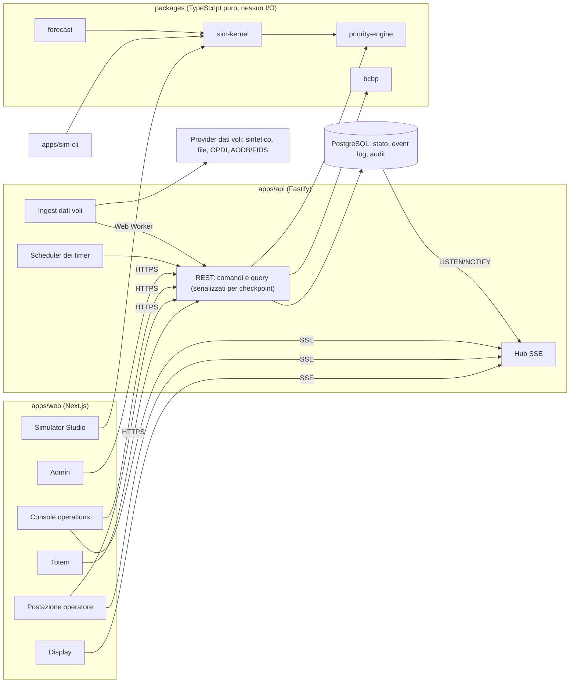
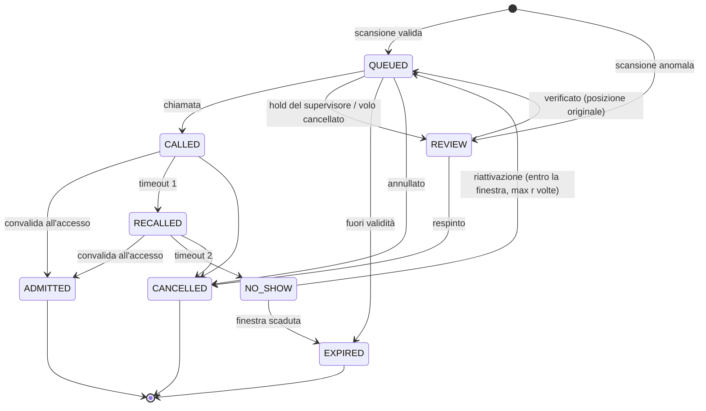

# GateFlow — Analisi, proposta di prodotto e piano di sviluppo (kickoff)

> **Stato:** BOZZA DA APPROVARE — non è stato scritto codice.
> **Data:** 21 novembre 2026
> **Input analizzati:**
> - *Airport Smart Queue — Product Requirements Document + Business Plan*, v1.0 del 18/11/2026 (di seguito **PRD-BP**). I cinque file caricati contengono un unico documento: tre `.docx` byte-identici e due `.pdf` byte-identici, con lo stesso testo. Il `.docx` include anche il diagramma della §05: Ingresso → Motore regole → Ciclo coda → Controllo, con i feed dati e il modulo futuro di previsione.
> - Istruzioni di kickoff "GateRush — Project Kickoff" (di seguito **KO**).
>
> Il PRD-BP è marcato "riservato": non è stato copiato nel repository.

**Etichette usate**

| Etichetta | Significato |
|---|---|
| `DOC-VER` | Il PRD-BP lo indica come verificato, con fonte [S#]. Non l'ho riverificato, salvo dove indicato. |
| `DOC-DEC` | Decisione registrata nel PRD-BP. |
| `DOC-IPO` | Ipotesi o stima del PRD-BP. |
| `KO` | Requisito o principio delle istruzioni di kickoff. |
| `PROP` | Mia proposta, da approvare. |
| `VERIFICARE` | Va verificato sul piano legale, operativo o dei dati prima di farci affidamento. |

---

## Indice

0. [Sintesi esecutiva](#0-sintesi-esecutiva)
1. [Analisi documentale (Fase 1)](#1-analisi-documentale-fase-1)
2. [Definizione del prodotto (Fase 2)](#2-definizione-del-prodotto-fase-2)
3. [Piano di sviluppo: milestone e vertical slice (Fase 3)](#3-piano-di-sviluppo-milestone-e-vertical-slice)
4. [Decisioni da prendere prima di iniziare](#4-decisioni-da-prendere-prima-di-iniziare)
5. [Prima vertical slice proposta](#5-prima-vertical-slice-proposta)
- [Appendici](#appendice-a--glossario): glossario, mappatura dei nomi, fonti esterne

---

## 0. Sintesi esecutiva

**Cos'è.** GateFlow è una piattaforma B2B per gestori aeroportuali che ordina l'accesso a un checkpoint, tipicamente un filtro di sicurezza, tramite un ticket di attesa. Il passeggero scansiona la carta d'imbarco a un totem e riceve un numero, stampato o digitale. Attende in un'area libera e si presenta quando il display lo chiama. Non servono app né registrazione.

**Cosa lo distingue da un eliminacode.** L'ordine di chiamata non è puramente FIFO. Un motore deterministico anticipa i passeggeri che con l'ordine FIFO non arriverebbero al gate prima della chiusura dell'imbarco, ma che possono ancora farcela se anticipati. Lo fa entro limiti di equità dichiarati e misurabili. Ogni decisione ha un codice di motivazione, una versione di policy e un input riproducibile.

**Obiettivo.** Ridurre i voli persi a causa dell'attesa al checkpoint, coincidenze incluse, senza peggiorare in modo sproporzionato chi non ha urgenza. Lo scopo non è eliminare le code.

**Confini invalicabili.** GateFlow organizza il flusso *prima* del punto in cui iniziano i controlli. Non sostituisce screening, frontiera, Fast Track o assistenza PRM, non comanda varchi fisici e non apre postazioni da solo: le suggerisce, decide una persona. Quando i dati mancano o sono vecchi non inventa: nessuna priorità automatica, servizio in ordine di arrivo.

**Moduli.**
- **Priority**: motore operativo (ticket, coda, chiamate, convalida, override, audit).
- **Simulator**: dimostra o smentisce il beneficio prima di qualsiasi installazione.
- **Predict**: previsioni di arrivi e code a 15/30/60/90 minuti, suggerimenti di apertura postazioni.
- **Connect**: informazioni ai passeggeri tramite sito o app dell'aeroporto; è secondario.

**Sequenza obbligata** (`DOC-DEC`): simulatore credibile e demo → pilota pagato, circoscritto e in shadow mode → installazione operativa. Niente hardware prima del contratto.

**Rischio principale della tesi** (dal PRD-BP). Il checkpoint davvero controllabile potrebbe non essere quello dove si perdono le coincidenze. Nell'UE molti transiti non ripassano i controlli di sicurezza, e il primo candidato del PRD-BP è un filtro partenze landside, dove i passeggeri in coincidenza sono pochi. Per questo propongo come KPI primario i *voli persi per attesa al checkpoint*, con le coincidenze come segmento, e un prodotto parametrico sul tipo di checkpoint. In Messico i transiti internazionale→nazionale di norma ripassano immigrazione, dogana e sicurezza (`VERIFICARE`): lì il caso "coincidenze" è più diretto.

**Perché può vincere** (ipotesi):
- onboarding senza app;
- priorità spiegabile e auditabile, con equità quantificata;
- un simulatore che esegue **lo stesso codice** del motore di produzione: la prova di vendita è il software che si installa;
- architettura modulare, vendibile anche come plugin, solo simulatore o solo forecast se l'aeroporto ha già un incumbent (Veovo, Moviik, VIA Guide, Qtrac…).

---

## 1. Analisi documentale (Fase 1)

### 1.1 Requisiti funzionali

| ID | Requisito | Fonte |
|---|---|---|
| FR-01 | Lettura del BCBP 2D (IATA Res. 792, una o più tratte) da carta o da telefono; scansione hands-free | PRD-BP §4.2, §6.1, §9.1 |
| FR-02 | Scelta della tratta pertinente al checkpoint (aeroporto e data); verifica sul feed voli se disponibile | §4.2 |
| FR-03 | BP illeggibile, duplicato, scaduto o di un altro scalo → rifiuto o rinvio all'operatore, mai accesso automatico | §4.5 |
| FR-04 | Emissione del ticket: numero pubblico leggibile e stabile + QR opaco senza PNR né nome; ricevuta con area, stato, istruzioni multilingue e scadenza | §4.2, §6.2, §7.5 |
| FR-05 | Riscansione idempotente: recupera il ticket esistente, permette la ristampa, mostra lo stato; nessun duplicato | KO p.10, PRD-BP M02 |
| FR-06 | Calcolo di eleggibilità, classe di rischio e motivazione deterministica; rivalutazione a ogni evento significativo | §7.1–7.2 |
| FR-07 | Controlli di equità: quota massima di capacità per i prioritari, aging dei normali, limiti anti-churn, eccezioni manuali documentate | §7.2, §7.5 |
| FR-08 | Chiamate emesse solo per capacità reale; seconda chiamata; timeout di assenza; finestra di recupero limitata | §4.2, §4.5, §7.2 |
| FR-09 | Convalida all'accesso da parte di operatore o lettore; al massimo un'ammissione per ticket | §4.2, §7.5 |
| FR-10 | Display pubblico con numeri chiamati, direzione o postazione e numeri imminenti; nessun dato personale; audio solo dove consentito | KO p.7, §6.1–6.2 |
| FR-11 | Postazione operatore: chiamati, convalida, eccezioni, override con motivo, re-invio, ticket non validi | §6.1, §4.1 |
| FR-12 | Console operations: overview, coda live, forecast, alert, staffing; badge di stato dei dati live/stale/demo | §6.1, §6.3 |
| FR-13 | Backoffice: aeroporti, checkpoint, dispositivi, policy (anteprima, rollback, approvazione a due persone), utenti, audit | §6.1, §10.4 |
| FR-14 | Audit di ogni transizione, override e modifica di configurazione, con causa, timestamp, ruolo e origine | §7.4, KO |
| FR-15 | Qualità dati: ogni dato ha source, observed_at, valid_until, confidence e ambiente; un dato vecchio fa uscire dalla modalità automatica per il criterio interessato | §9.3 |
| FR-16 | Percorsi dedicati per assistiti, gruppi e famiglie, senza penalizzare i diritti esistenti | §4.5, §7.5 |
| FR-17 | Modalità degradate in caso di caduta della rete o dei dispositivi, senza mai disabilitare barriere di sicurezza | §4.5, §7.5 |
| FR-18 | Simulatore: scenari, policy (FIFO, regole, varianti, apertura corsie), batch su più seed, KPI, report, confronto | §12, KO |
| FR-19 | Forecast di arrivi e code a 15/30/60/90 min, saturazione, suggerimento di apertura postazione con decisione registrata | §8, KO |
| FR-20 | Connect: attese attuali, previsione all'orario di arrivo, stima per volo, priorità solo indicativa, percorso al gate | §8.4, KO |
| FR-21 | Coordinamento fra checkpoint — **non definito nel PRD-BP** (vedi C-07) | KO |
| FR-22 | Analytics ed export, con risultati simulati e osservati nettamente separati | §6.1, §13.3 |

### 1.2 Requisiti non funzionali

| ID | Requisito | Fonte |
|---|---|---|
| NFR-01 | Motore deterministico, spiegabile e verificabile, isolato da UI, infrastruttura e dispositivi | KO, PRD-BP §10.2 |
| NFR-02 | Audit log append-only o a prova di manomissione | §10.5 |
| NFR-03 | Privacy by design: minimizzazione, pseudonimizzazione, nessun payload BCBP grezzo nei log, retention minima | §16.2 |
| NFR-04 | Sicurezza: OIDC/SAML, MFA per gli admin, RBAC least-privilege, TLS, cifratura at rest, segreti gestiti, approvazione a 4 occhi, segmentazione di rete | §10.5 |
| NFR-05 | Prestazioni (`DOC-IPO`): propagazione dello stato < 3 s con rete sana; heartbeat dei dispositivi < 60 s | §10.5 |
| NFR-06 | Resilienza: modalità degradate definite, backup e restore esercitati, fail-safe che non autorizza mai l'accesso a zone riservate | §7.5, §10.5 |
| NFR-07 | Idempotenza di tutti i comandi, nessun duplicato | §7.4, §10.4 |
| NFR-08 | Simulazioni riproducibili (seed, versioni, ipotesi esplicite) | §12, KO |
| NFR-09 | Scalabile da aeroporti piccoli a grandi; multi-aeroporto | KO, M12 |
| NFR-10 | Vendibile in Italia **e in Messico**: lingue, fusi orari, normativa, residenza dei dati | KO (**assente nel PRD-BP**) |
| NFR-11 | Accessibilità del totem e del display (WCAG, da validare con il gestore) | §6.2 |
| NFR-12 | Nessuna dipendenza hardware obbligatoria nella prima fase; adapter sostituibili | KO, D10 |
| NFR-13 | Infrastruttura semplice: niente microservizi né Kubernetes in fase 1 | KO |
| NFR-14 | Deploy in cloud UE o nell'ambiente dell'aeroporto | §10.1 |

### 1.3 Decisioni consolidate

**Decision register del PRD-BP** (`DOC-DEC`) — da rispettare:

| ID | Decisione | Implicazione per il software |
|---|---|---|
| D01 | Il cliente è il gestore aeroportuale, non la compagnia aerea | Tenant = gestore; le compagnie sono stakeholder futuri |
| D02 | Presenza fisica, scansione del BCBP, nessuna app | Il flusso core funziona senza smartphone |
| D03 | Tagliando cartaceo con numero e QR, area di attesa, display | Recupero tramite riscansione o operatore |
| D04 | Priorità dinamica legata al rischio di non arrivare in tempo | Motore deterministico e auditabile, con equità e limiti |
| D05 | Previsioni per staff e passeggeri | Modulo separabile, successivo al core |
| D06 | Suggerimento di apertura di un'altra postazione | Alert all'operatore, mai comando autonomo |
| D07 | Pilota pagato, preferenza per un anticipo del 40% | Aspetto commerciale, nessun impatto sul codice |
| D08 | Primo interlocutore: SAVE (Venezia/Treviso) | Scenari di riferimento "VCE-like" e "TSF-like" |
| D09 | L'AI non serve al motore di priorità | ML solo se batte le baseline statistiche |
| D10 | Nessun acquisto di torrette prima del contratto | MVP in browser, hardware solo da laboratorio |

**Altre decisioni implicite nel testo** (`DOC-DEC`):
- **Non-feature** (§5.2): niente riconoscimento facciale, scoring comportamentale, marketing, vendita di fast-pass, modifiche allo screening, controllo dei varchi di frontiera, promessa d'imbarco, LLM nel core, prenotazione obbligatoria.
- **Stati del token e invarianti** (§7.4–7.5): una sola ammissione, QR opaco, numero stampato stabile, percorsi separati per gli assistiti, fail-safe, policy versionata e congelata durante le comparazioni.
- **Data quality policy** (§9.3).
- **Simulatore** (§12): DES, esperimenti A/B/C, 200–1000 seed, bias da evitare, KPI, gate per passare al pilota.
- **Forecast** (§8): prima una baseline statistica; ML solo se batte naive stagionale, media mobile e regressione su MAE/WAPE.
- **Pilota** (§15.4): un solo checkpoint, prima in shadow mode, poi live.
- **Stack indicativo** (§10.1–10.2): Next.js, Fastify + Zod/OpenAPI, PostgreSQL, SSE, simulatore TypeScript con RNG a seed, Python solo per ML reale; `priority-engine` senza dipendenze da DB o framework.

**Principi del kickoff** (`KO`), coerenti con il PRD-BP:
- funziona senza smartphone;
- motore deterministico;
- una coda per checkpoint;
- la riscansione non crea duplicati;
- override auditati;
- vendibile in Italia e in Messico;
- le autorità restano al controllo;
- stack TypeScript, niente infrastruttura complessa;
- si parte dal simulatore.

### 1.4 MVP e futuro secondo il PRD-BP

| Fase | Moduli |
|---|---|
| MVP | M01 intake BCBP · M02 registro token · M03 motore di ranking e fairness · M04 display e postazione operatore · M05 dashboard simulatore e KPI baseline |
| Pilota | M06 adapter AODB/FIDS · M07 configurazione · M08 event log, audit, RBAC, fallback |
| V1 | M09 forecast e alert per lo staff · M10 PWA/SDK passeggeri (add-on) |
| V2 | M11 forecast ML (opzionale) · M12 multi-aeroporto, enterprise, SLA |

La mia proposta di scope, coerente con questa tabella, è in §2.2–2.3.

### 1.5 Dipendenze esterne

1. **Autorizzazioni** di gestore, security ed eventualmente frontiera per un punto di controllo e un'area di attesa. È il prerequisito di tutto (§1.3 e §17.4 del PRD-BP).
2. **Dati voli**: AODB/FIDS con ETD, gate e chiusura dell'imbarco, con latenza e SLA. Oggi non c'è nessun accesso.
3. **Dati operativi**: postazioni aperte, throughput, tempi di coda (eventuali sensori Xovis o simili), percorsi e tempi di cammino fino al gate.
4. **IT aeroportuale**: hosting (cloud o edge), rete, IdP per lo staff (OIDC/SAML), requisiti di sicurezza per i fornitori.
5. **Legale e privacy**: DPO del gestore e DPIA (GDPR); in Messico la LFPDPPP, oppure la legge per gli enti pubblici; consulenza su AI Act, accessibilità e NIS2 (§2.13).
6. **Hardware**: scanner 2D, stampanti termiche, display, PC kiosk, con certificazioni CE/EMC.
7. **Dataset pubblici**: OPDI/OpenSky. Licenza e copertura sono da verificare, soprattutto per il Messico.
8. **Compagnie e handler**: verifica dei transiti con BCBP separati o multi-PNR (domanda aperta 10).
9. **Servizi esistenti**: Fast Track (commerciale a VCE [S16]), assistenza PRM, eventuali vendor incumbent.

### 1.6 Dati verificati e stime

**Indicati come VERIFICATI dal PRD-BP** (`DOC-VER`, non riverificati da me):
- Traffico SAVE 2025: 15.050.466 passeggeri, di cui VCE 11.850.336 e TSF 3.200.130 [S1]. È traffico totale, non la domanda per il servizio. La somma è coerente.
- Regolamento di Scalo VCE (16/02/2026): 20 minuti come standard di attesa ai varchi di sicurezza in condizioni normali [S2]. `VERIFICARE` la definizione esatta (percentile? quota di passeggeri?), perché cambia il modo di misurare il KPI.
- Il BCBP può contenere più tratte e da solo non prova la validità del titolo [S3].
- Reg. (CE) 300/2008 [S4]; funzioni dei competitor [S5–S14]; copertura OPDI da gennaio 2022 a settembre 2026 [S15]; Fast Track commerciale a VCE [S16].

**Ipotesi e stime** (`DOC-IPO`) — da non presentare come fatti:
- tutti i prezzi (BoM, offerte, licenze, setup);
- l'economia del pilota (€32k, margine del 25%);
- gli scenari di ricavo a 3 anni e l'esempio di ROI;
- gli SLO (3 s, 60 s);
- i tempi R0–R5 e il piano a 90 giorni;
- l'esempio di ranking (90 pax/h per corsia, dichiaratamente illustrativo).

**Controllo aritmetico.** Tutte le somme tornano tranne una: il **totale massimo della BoM** (§11.1) è indicato in €11.350, ma la somma delle righe dà **€11.250** (650 + 900 + 1.600 + 3.200 + 1.700 + 700 + 1.300 + 1.200). Errore minore, da correggere prima di usare la cifra in un'offerta.

### 1.7 Incongruenze (con proposta di risoluzione)

| ID | Gravità | Incongruenza | Proposta (`PROP`) |
|---|---|---|---|
| C-01 | Alta | Il KO ha come obiettivo ridurre le **coincidenze perse**. Il primo perimetro del PRD-BP (§2.4) è invece il filtro partenze landside, dove i passeggeri in coincidenza sono pochi, e il PRD-BP stesso (§1.3) ricorda che molti transiti non ripassano i controlli. | KPI primario: **voli persi per attesa al checkpoint**, con le coincidenze come segmento. Modello parametrico sul tipo di checkpoint (partenze, ricontrollo transiti, altro). Scenari: VCE-like partenze e hub MX-like ricontrollo transiti (`VERIFICARE` il flusso messicano). |
| C-02 | Alta | Tre nomi: GateRush (repo, titolo del KO), GateFlow (KO), Airport Smart Queue (PRD-BP). Due nomenclature dei moduli: Priority/Predict/Connect/Simulator contro Queue Core/Flow Forecast/Passenger Info + M05. | Decidere il nome prima della slice 1, perché definisce il namespace dei pacchetti. Mappatura in Appendice B. |
| C-03 | Alta | Il **Messico** è richiesto dal KO ma assente dal PRD-BP: normativa, lingua ES, fusi orari, residenza dei dati, interlocutori, fonti dati voli. | Requisiti MX in §2.13; scenario MX-like in S6; i18n IT/EN/ES fin dalla prima UI; nessun offset orario cablato nel codice. |
| C-04 | Alta | La definizione di slack (§7.1) è **circolare**: `wait_i(t)` dipende dalla stessa decisione di priorità che lo slack deve guidare. | Classificare usando l'**attesa controfattuale FIFO** (quanto aspetterebbe il passeggero se servito in ordine d'arrivo) e verificare la **fattibilità** dell'anticipo (§2.11). |
| C-05 | Alta | "Regola conservativa" (§7.1) è ambigua. Se è conservativa per il passeggero, si prende il cut-off più anticipato e si dà più priorità. Se è conservativa per il sistema, non si costruisce priorità su valori inventati. Le due letture danno esiti opposti. | Separare **cut-off verificato** (feed fresco, oppure regola approvata su STD/ETD freschi) da **cut-off non verificabile**. Solo il primo dà priorità automatica; l'operatore può comunque intervenire. Il parametro di policy `allowRuleBasedDeadline` lo decide il gestore. |
| C-06 | Media | Il KO prevede di mostrare i ticket "prossimi a essere serviti" e la "posizione aggiornata". Il PRD-BP (§7.2.5, §7.5) vieta di mostrare una posizione numerica garantita e ammette che la chiamata cambi. | Mostrare lo **stato** (in attesa → preparati → chiamato) e una **stima a intervallo**, mai una posizione. La finestra "preparati" è **impegnata**: un numero annunciato non torna mai indietro (§2.11). |
| C-07 | Media | Il "coordinamento fra checkpoint" (KO) non è definito nel PRD-BP. | Nell'MVP nessun coordinamento. Poi, in ordine: (a) suggerimento informativo di un checkpoint alternativo; (b) trasferimento del ticket eseguito dall'operatore; (c) alert di capacità per gruppo di checkpoint. Mai riassegnazione automatica dei passeggeri. |
| C-08 | Media | Connettività degradata: il PRD-BP prevede una "modalità cartacea/operatore con sincronizzazione successiva" (§4.5), ma l'architettura (cloud, Redis) non descrive né edge né offline. | Modalità degradate esplicite, con fail-safe = **coda fisica tradizionale** (§2.4.6). Architettura "cloud-first, edge-capable"; la scelta cloud/edge si fa in R3 (domanda aperta 19). |
| C-09 | Media | Macchina a stati (§7.4): COMPLETED non è osservabile, perché lo screening non è nostro; HELD e MANUAL_REVIEW si sovrappongono; manca la seconda chiamata; manca la regola di rientro dopo NO_SHOW. | Macchina a stati rivista in §2.8. |
| C-10 | Media | La classe "non recuperabile" (§7.2) non ha un comportamento definito. Dare priorità a chi è già perso spreca capacità: è l'effetto domino tipico dell'EDF in sovraccarico. Retrocederlo è però eticamente delicato. | Nessun anticipo automatico: **escalation** al supervisore, e alla compagnia se integrata; la decisione umana viene registrata. |
| C-11 | Media | Né il BCBP (l'orario d'imbarco non è un campo obbligatorio standard) né OPDI forniscono la chiusura dell'imbarco. Il PRD-BP §9 lo riconosce ("regola mock esplicita"), ma la regola non è specificata. | Nel prototipo: `cut-off = (ETD se fresco, altrimenti STD) − offset_chiusura`, sempre marcato con provenienza e confidenza. |
| C-12 | Media | "Varco" indica sia la corsia di sicurezza sia il punto d'accesso GateFlow ("A-052 → Varco 2"). | Glossario (Appendice A): *corsia* (lane) ≠ *punto d'accesso* ≠ *checkpoint*. |
| C-13 | Media | Journey A §4.2: "se i dati non bastano → verifica con addetto". Se il feed manca in blocco, tutti passano dall'addetto: peggio del FIFO di oggi. | Principio: **degradare a FIFO, non a blocco**. Ticket normale senza priorità; l'operatore interviene solo sulle anomalie. |
| C-14 | Media | Una priorità gratuita per urgenza può incentivare ad arrivare tardi e sovrapporsi al Fast Track a pagamento [S16]. Il PRD-BP lo segnala ma non lo modella. | Regola di eleggibilità per chi parte (§2.11): priorità automatica solo a chi si presenta entro l'orario raccomandato. Nel simulatore, uno scenario di "arrivi strategici". |
| C-15 | Media | Il multi-tenant è previsto solo in V2 (M12), ma aggiungerlo dopo costa molto. | Tenant e gerarchia aeroporto/terminal/checkpoint nel modello dati dal primo giorno. |
| C-16 | Bassa | Orizzonti di forecast incoerenti: 15/30/60/90 (§2.2, §8.2, KO), 15/30/60 (§4.4, diagramma), errore misurato su 5/15/30 (§12.5). | Standard 15/30/60/90, con l'errore misurato per ogni orizzonte. |
| C-17 | Bassa | `PATCH /v1/policies/{id}` convive con "versione immutabile" (§10.4). | Endpoint `POST …/versions` + `approve` + `activate` (§2.10). |
| C-18 | Bassa | Lo stack del PRD-BP (Redis Streams, 7 app) contrasta con "evitare infrastruttura complessa" del KO. | PostgreSQL come log eventi (outbox + LISTEN/NOTIFY) e 3 app (§2.4). |

### 1.8 Lacune e requisiti mancanti

| ID | Lacuna | Proposta |
|---|---|---|
| L-01 | Retention dei dati non quantificata | Dati per ticket conservati N ore dopo la giornata di servizio (default proposto 72 h, `PROP`); aggregati conservati; distruzione delle chiavi HMAC (§2.13) |
| L-02 | Emergenze (evacuazione, allarme security) oltre al guasto di rete | Modalità del checkpoint NORMAL / FIFO_ONLY / PAUSED / EMERGENCY, con messaggio predefinito e ripresa controllata |
| L-03 | Identità e provisioning dei dispositivi; manomissione dei totem | Credenziali per singolo dispositivo, revocabili, con permessi minimi per tipo (§2.13) |
| L-04 | Gestione del tempo: il BCBP porta la data in giorno giuliano senza anno; il Messico ha più fusi | UTC in ms interi ovunque; fuso IANA per aeroporto; anno inferito con una finestra; ora del server autoritativa |
| L-05 | Gruppi e famiglie: un ticket per persona o per gruppo? | Scansione multipla al totem → ticket di gruppo con `partySize`, chiamato insieme, conteggiato per persona in capacità e tetti. Da validare con il gestore |
| L-06 | Validità e scadenza del ticket non quantificate | Parametro di policy, es. min(partenza + tolleranza, fine giornata) |
| L-07 | Informativa privacy al totem (GDPR art. 13; *aviso de privacidad* in MX) | Requisito UX: informativa breve a schermo, estesa tramite QR |
| L-08 | "Equità accettabile" non quantificata | Metriche di equità definite (§2.12) e parametri di policy espliciti (§2.11) |
| L-09 | Modello fisico della chiamata: buffer fra accesso e corsie, latenza di risposta, corsie ferme per chiamate tardive | Modello "call-ahead" con buffer obiettivo, nel simulatore da S2 |
| L-10 | Passeggeri senza BCBP leggibile (BP cartaceo senza barcode, telefono scarico, staff) | Ticket manuale emesso dall'operatore con motivo; nessuna priorità automatica |
| L-11 | La baseline reale non è FIFO puro: oggi il personale chiama a voce i voli in chiusura | Baseline **A′ "FIFO + gestione manuale delle urgenze"** nel simulatore; senza, il beneficio risulta sovrastimato |
| L-12 | Nessun obiettivo di disponibilità (SLO, RPO, RTO) | Da proporre in fase pilota, es. RPO ≤ 5 min e RTO ≤ 30 min (`PROP`, da negoziare) |
| L-13 | Accessibilità legale: l'European Accessibility Act (Dir. (UE) 2019/882) potrebbe applicarsi ai terminali self-service nei servizi di trasporto aereo | `VERIFICARE`; nel frattempo progettare secondo EN 301 549 / WCAG 2.2 AA |
| L-14 | Misura del beneficio sul campo: in produzione si vedono scansione e ammissione, non l'attesa FIFO controfattuale | Shadow mode con misura della baseline prima del live; report del pilota con lo stesso schema del simulatore |
| L-15 | Fonti dati in conflitto (es. AODB e FIDS indicano gate diversi) | Precedenza delle fonti configurabile + flag di conflitto |
| L-16 | PRM e assistenza: registrare il motivo può significare trattare dati sanitari (art. 9 GDPR) | Mai registrare il motivo; solo `path = ASSISTED`, impostato dall'operatore |
| L-17 | Osservabilità, gestione incidenti, runbook | Parte di M5 (pilot readiness) |

### 1.9 Rischi tecnici

| ID | Rischio | Mitigazione |
|---|---|---|
| RT-01 | Doppie chiamate o doppie ammissioni per concorrenza | Serializzazione per checkpoint (advisory lock), idempotency key, vincoli UNIQUE nel DB, test di concorrenza |
| RT-02 | Perdite di determinismo (`Date.now`, `Math.random`, float, sort senza tie-break) | Clock e RNG iniettati, tempo in ms interi, tie-break totale esplicito, test golden byte-per-byte |
| RT-03 | Simulatore "garbage in, garbage out": le ipotesi sintetiche dominano i risultati | Registro delle ipotesi con la fonte di ogni parametro; analisi di sensitività; validazione analitica (Erlang-C, legge di Little); risultati sempre etichettati come simulati |
| RT-04 | Dati voli vecchi o errati portano a priorità sbagliate | Provenienza e freschezza per campo, degrado a FIFO, isteresi |
| RT-05 | BCBP eterogenei fra compagnie (campi condizionali, versioni, simbologie, schermi dei telefoni) | Parser robusto con fuzzing, corpus sintetico, prove di lettura su hardware da laboratorio |
| RT-06 | BCBP contraffatto per ottenere priorità: chiunque può generare un barcode valido per un volo reale | Controllo che il volo esista e degli orari; anomaly detection (molti urgenti sullo stesso volo); al punto d'accesso il BP resta controllato come oggi; integrazione con eventuali gate BCBP esistenti |
| RT-07 | Display che mostra dati vecchi senza segnalarlo | SSE con heartbeat; badge "dati non aggiornati" e messaggio di fallback dopo il timeout |
| RT-08 | Churn visibile e percezione di ingiustizia | Finestra "preparati" impegnata, isteresi, tetto e limite di sorpassi, numerazione unica che non rivela i prioritari |
| RT-09 | Complessità offline/edge | Nessun consenso distribuito; fail-safe = coda tradizionale; emissione offline solo FIFO, da valutare dopo l'MVP |
| RT-10 | Over-engineering | Tre app, nessun broker, policy come parametri e non come DSL (§2.11) |
| RT-11 | Classificazione regolatoria (AI Act, EAA, NIS2) | Motore rule-based; parere legale prima del pilota; nessuna autoclassificazione |
| RT-12 | Integrazioni AODB sconosciute | Porte e adapter, contract test, nessuna assunzione sul formato |

### 1.10 Assunzioni non validate

1. Esiste un checkpoint controllabile con un'area di attesa utilizzabile (è il gate del PRD-BP).
2. I passeggeri capiscono e accettano di aspettare fuori dalla fila fisica (KPI "user comprehension").
3. Il beneficio rispetto alla baseline reale (FIFO + gestione manuale delle urgenze) è significativo.
4. I seguenti parametri sono oggi sconosciuti e quindi sintetici: throughput delle corsie, tempi di servizio, curve di presentazione, offset di chiusura dell'imbarco, quota di transiti, comportamento di risposta alle chiamate e no-show.
5. Lo staff accetta di gestire "chiama prossimo" in tempo reale (carico operativo).
6. È possibile aprire una postazione aggiuntiva con circa 20 minuti di preavviso (domanda aperta 16).
7. L'IT aeroportuale consente la connettività cloud, oppure mette a disposizione un ambiente on-prem.
8. La lettura dei BCBP da telefono è affidabile con l'hardware scelto.
9. Prezzi e disponibilità a pagare (tutto `DOC-IPO`).

---

## 2. Definizione del prodotto (Fase 2)

### 2.1 Product vision

> Per i gestori aeroportuali che vogliono ridurre i voli persi per l'attesa ai controlli e gestire le urgenze senza improvvisare, GateFlow è uno strato operativo che trasforma la coda fisica in una coda ordinata, spiegabile e misurabile. Offre priorità deterministica con equità dichiarata, chiamata via display, audit completo e un simulatore che quantifica i benefici prima di installare qualsiasi cosa. Funziona con la carta d'imbarco che il passeggero ha già, senza app, e non tocca mai le procedure di sicurezza o di frontiera.

Principi di prodotto (`PROP`, derivati da KO e PRD-BP):
1. **Mai peggio dello status quo per colpa dei dati**: se i dati mancano si serve in FIFO; se il sistema si guasta si torna alla coda tradizionale.
2. **Spiegabile per costruzione**: ogni chiamata ha un motivo leggibile, una versione di policy e input riproducibili.
3. **Equità quantificata, non solo dichiarata**: il danno massimo a un passeggero non prioritario è un parametro, non un effetto collaterale.
4. **Lo stesso codice in simulazione e in produzione.**
5. **Le persone decidono le azioni fisiche** (corsie, eccezioni); il sistema propone.
6. **Dati minimi**: nessun nome, PNR o posto viene conservato.

### 2.2 Scope MVP (pre-pilota, senza hardware)

L'MVP serve a dimostrare e a vendere: deve soddisfare il gate del PRD-BP §12.6 e la demo R2.

| Area | Incluso nell'MVP |
|---|---|
| Simulator | Kernel DES riproducibile; policy FIFO, FIFO + gestione manuale, Priority v0/v1 e apertura corsie; metriche e report; batch multi-seed con IC; scenari sintetici e orari reali (OPDI); Simulator Studio web eseguito nel browser |
| Priority engine | Pacchetto puro: eleggibilità, classi di rischio, selezione vincolata, finestra "preparati", motivazioni, parametri di policy versionati |
| BCBP | Parser e generatore sintetico; validazioni; chiave di deduplica HMAC |
| Operativo in browser | Totem (scansione simulata, incollata o via scanner HID), ticket digitale e stampabile, pagina di stato del ticket, display (SSE), postazione operatore, funzioni base del supervisore (modalità, override, corsie), event log e audit, policy versionate (immutabili, con attivazione) |
| Demo | "Digital twin": il simulatore pilota il sistema reale a tempo accelerato |
| Predict (anteprima) | Forecast baseline e suggerimento di apertura corsia nella console, su dati simulati, per il pitch |
| Piattaforma | Utenti locali e ruoli base, i18n IT/EN/ES, deploy con Docker Compose |

**Escluso dall'MVP**: integrazioni reali con AODB/FIDS, OIDC/SAML, hardware reale, modalità offline, approvazione a 4 occhi, PWA passeggeri, ML, coordinamento fra checkpoint.

### 2.3 Scope post-MVP

| Fase | Contenuto | Gate d'ingresso |
|---|---|---|
| **Pilot-ready** (R3–R4) | Adapter AODB/FIDS reali; OIDC/SAML e MFA; RBAC completo con scope; policy con approvazione a 4 occhi; registro e provisioning dei dispositivi; device agent (stampante, scanner) su hardware da laboratorio; modalità degradate complete; hardening (threat model, ASVS L2); pacchetto privacy (DPIA, informative, retention); deploy in cloud UE oppure on-prem; osservabilità; **shadow mode**; report del pilota con lo stesso schema del simulatore | Discovery che conferma il checkpoint + contratto o SOW firmato |
| **V1** | Predict operativo (forecast calibrato su dati reali, alert con esito); Connect (widget e PWA white-label); analytics | Pilota concluso con esito positivo |
| **V2** | Multi-aeroporto enterprise e SLA; coordinamento fra checkpoint; forecast ML, solo se batte le baseline; integrazioni con le compagnie | Secondo cliente |

### 2.4 Architettura applicativa

#### 2.4.1 Scelte tecnologiche

| Livello | Scelta (`PROP`) | Rispetto a KO / PRD-BP | Motivo |
|---|---|---|---|
| Linguaggio | TypeScript `strict` ovunque; Node.js nella versione LTS attiva al momento del setup, fissata in `.nvmrc` | = | Un solo linguaggio; tipi condivisi fra motore, API, UI e simulatore |
| Monorepo | pnpm workspaces + Turborepo | = (strumenti da confermare) | Leggero, con cache dei task; Nx è più pesante del necessario |
| UI | Next.js (App Router), **una sola app** con route group per totem, display, postazione, ops, admin e studio; componenti accessibili (Radix/shadcn) | ≠ PRD-BP, che prevede 7 app | Un solo build e un solo deploy; totem e display sono client sottili. Si separano solo se serve davvero |
| API | Fastify + Zod (contratti condivisi) + OpenAPI generato | = | Contract-first; logging pino con redazione dei dati sensibili |
| Logica di dominio | **Solo nei pacchetti e nell'API**; nessuna regola di business in Next.js | chiarimento | Un'unica fonte di verità per i comandi |
| Database | PostgreSQL (versione stabile corrente, ≥ 17) | = | Transazioni, vincoli, advisory lock, LISTEN/NOTIFY, partizionamento |
| Accesso ai dati | **Drizzle ORM** (alternativa: Kysely) | ≠ Prisma, da decidere | Servono `SELECT … FOR UPDATE`, advisory lock, indici UNIQUE parziali, trigger append-only e partizioni: in Drizzle si esprimono in modo naturale, in Prisma molti richiedono SQL raw o migrazioni manuali. Schema in TS, nessun engine né codegen separato |
| Eventi | **Tabella eventi + outbox in PostgreSQL**, fan-out con LISTEN/NOTIFY | ≠ Redis Streams | Il carico è di pochi comandi al secondo per checkpoint: un broker è infrastruttura in più senza beneficio. Redis o NATS solo se una misura lo giustifica |
| Real-time | SSE (server → client) con `Last-Event-ID`; i comandi passano da REST | = | Riconnessione e replay dal log; WebSocket non serve |
| Simulatore | Pacchetti TS **isomorfi** (Node e browser); worker_threads per i batch, Web Worker nello studio | = (esteso) | Stesso motore della produzione; demo scaricabile e offline senza server (gate §12.6) |
| Statistica | Piccola libreria interna (percentili, bootstrap); export CSV/Parquet per analisi esterne | — | Evita dipendenze; Python o notebook solo per analisi, mai nel prodotto |
| Forecast | TS (modelli statistici + Monte Carlo sul DES); Python solo per ML giustificato | = | D09 |
| Auth | Porta `IdentityProvider`. MVP: utenti locali (argon2id, TOTP per gli admin). Pilota: OIDC verso l'IdP dell'aeroporto | = | Nessuna dipendenza da un IdP esterno durante lo sviluppo |
| Test | Vitest, fast-check (property-based), Testcontainers (Postgres), Playwright | = | §2.14 |
| Confini | dependency-cruiser in CI | nuovo | Impedisce che `priority-engine` o `sim-kernel` importino I/O |
| Deploy | Immagini Docker, Docker Compose su una VM per ambiente (cloud UE; regione MX o on-prem quando serve) | = | Niente Kubernetes. "Edge-capable" perché non usa servizi proprietari di un cloud |
| Osservabilità | Log pino strutturati e redatti; OpenTelemetry in fase pilota | — | |

**Cosa evito di proposito** (anti scope-creep): microservizi, Kubernetes, broker di messaggi, event sourcing completo, DSL di policy, ML nel motore, app mobile, emissione offline nell'MVP, WebSocket.

#### 2.4.2 Struttura del monorepo (`PROP`)

```
apps/
  api/              Fastify: comandi, query, SSE, scheduler dei timer, ingest
  web/              Next.js: (kiosk) (display) (lane) (ops) (admin) (sim) (public)
  sim-cli/          CLI per batch, sweep e report
  device-agent/     (fase pilota) stampante ESC/POS, health dei dispositivi
packages/
  domain/           tipi, value object, macchina a stati, errori (puro)
  priority-engine/  valutazione e selezione deterministica (puro)
  bcbp/             parser e generatore IATA Res. 792 (puro)
  sim-kernel/       DES: calendario eventi, RNG a seed, distribuzioni (puro)
  sim-scenarios/    schema Zod degli scenari, generatori sintetici, import OPDI
  sim-metrics/      esiti per passeggero, KPI, statistica, report
  forecast/         baseline degli arrivi, Monte Carlo sul DES (puro)
  contracts/        schemi Zod di API ed eventi, generazione OpenAPI
  adapters/         porte e adapter: dati voli, clock, id, stampa, identità
  db/               schema Drizzle, migrazioni, repository
  ui/               componenti condivisi, design token
  i18n/             messaggi IT/EN/ES
  config/           tsconfig, eslint e preset condivisi
```

Regola di dipendenza: `domain ← priority-engine ← sim-kernel/forecast ← apps`. I pacchetti puri non importano `node:*`, il DB, framework web, `Date.now` o `Math.random`. La regola è verificata in CI.

#### 2.4.3 Vista d'insieme



#### 2.4.4 Modello di consistenza

- **Un solo scrittore per checkpoint.** Ogni comando che tocca un checkpoint gira in una transazione che acquisisce `pg_advisory_xact_lock(checkpoint)`. Ne derivano un ordine totale, invarianti semplici e nessuna race fra "chiama prossimo" paralleli. Il carico per checkpoint è basso, quindi il costo è trascurabile.
- **Stato e log nella stessa transazione.** Le tabelle di stato corrente servono alle query; `queue_event` è append-only con `seq` monotono per checkpoint e serve ad audit, SSE e replay. Non è event sourcing completo: è più semplice e basta agli obiettivi.
- **Idempotenza.** Ogni comando porta una `idempotencyKey`; un vincolo UNIQUE rende sicuro ripeterlo.
- **Timer persistiti** (timeout di chiamata, scadenze, rivalutazioni periodiche). Tabella `timer` più uno scheduler nell'API, con un solo leader tramite advisory lock; nessuna job queue esterna.
- **Rivalutazione** a ogni evento rilevante (scansione, chiamata, ammissione, aggiornamento volo, apertura o chiusura corsia) e con un tick periodico (es. 30 s), perché lo slack diminuisce con il tempo.

#### 2.4.5 Porte e adapter

- `FlightDataProvider`: sintetico, file/CSV, replay OPDI, poi AODB/FIDS.
- `Clock`: reale; virtuale per demo e test.
- `IdGenerator`, `Rng`.
- `TicketPrinter`: stampa dal browser; poi agent ESC/POS.
- `BoardingPassInput`: incolla o scegli un campione, scanner HID "keyboard-wedge", fotocamera.
- `IdentityProvider`: locale; poi OIDC.
- `AuditSink`.

Nota pratica: quasi tutti gli scanner 2D si presentano come tastiera USB, quindi il totem in browser riceve il BCBP senza driver né agent. Questo riduce molto il rischio d'integrazione hardware del pilota.

#### 2.4.6 Modalità degradate (fail-safe)

| Guasto | Comportamento |
|---|---|
| Feed voli vecchio o assente | Per i voli interessati: classe `UNVERIFIED`, nessuna priorità automatica, servizio FIFO; banner nella console; il supervisore può intervenire |
| Totem senza API | Messaggio "rivolgersi all'addetto"; l'operatore emette ticket manuali oppure si torna alla coda fisica. L'emissione offline solo FIFO si valuta dopo l'MVP |
| API o DB non disponibili | Dopo il timeout dell'heartbeat il display mostra "seguire le indicazioni del personale" e il checkpoint torna alla **coda tradizionale** (status quo). Il sistema non controlla mai barriere |
| Emergenza | Il supervisore imposta EMERGENCY o PAUSED: chiamate sospese, messaggio predefinito multilingue, coda congelata. Alla ripresa sceglie "riprendi" o "reset FIFO" |
| FIFO_ONLY | Attivabile in ogni momento dal supervisore, con audit |

### 2.5 Moduli del sistema

| Modulo | Responsabilità | Pacchetti / app |
|---|---|---|
| **Priority** | Intake BCBP, ticket, coda, chiamate, convalida, override, modalità, audit, configurazione | domain, priority-engine, bcbp, db, api, web (kiosk/display/lane/ops/admin) |
| **Simulator** | Scenari, DES, policy, metriche, batch, report, studio, digital twin | sim-kernel, sim-scenarios, sim-metrics, sim-cli, web (sim) |
| **Predict** | Forecast di arrivi e code, saturazione, raccomandazioni di apertura con decisione ed esito, backtest | forecast, api, web (ops/forecast) |
| **Connect** | Attese pubbliche, stima per volo, widget incorporabile, pagina del ticket | api (endpoint pubblici), web (public), poi widget come web component |
| **Platform** | Tenant, utenti e ruoli, dispositivi, i18n, osservabilità, contratti | contracts, adapters, i18n, ui, config |

### 2.6 Ruoli e permessi

| Ruolo | Scope | Può | Non può |
|---|---|---|---|
| Passeggero (anonimo) | Il proprio ticket | Scansionare, vedere lo stato, ristampare riscansionando | Vedere altri ticket, punteggi o classi |
| Operatore di postazione | Checkpoint o corsie assegnate | Chiamare il prossimo, richiamare, convalidare, segnare un no-show, emettere ticket manuali con motivo, chiedere una revisione | Cambiare priorità o configurazione |
| Supervisore (coordinatore operativo) | Terminal o checkpoint | Tutto ciò che fa l'operatore, più: override di priorità con motivo, apertura e chiusura corsie, modalità (FIFO_ONLY/PAUSED/EMERGENCY), decisione sugli alert, risoluzione delle revisioni | Modificare le policy |
| Airport admin | Aeroporto | Configurazione (terminal, checkpoint, corsie, zone, tempi di cammino), utenti e ruoli, dispositivi, proposta di versioni di policy | Approvare le proprie proposte |
| Policy approver (permesso) | Aeroporto | Approvare, attivare o fare rollback di versioni di policy proposte da **altri** | — |
| Analyst | Aeroporto o tenant | KPI aggregati; creare, eseguire ed esportare simulazioni | Comandi live; dati per ticket oltre il pseudonimo |
| Auditor (DPO, security) | Aeroporto | Leggere ed esportare l'audit | Modificare qualsiasi cosa |
| Service engineer | Dispositivi | Stato di salute, log redatti, riavvii; accesso a tempo e auditato | Operazioni sulla coda |
| Platform admin (fornitore) | Piattaforma | Provisioning dei tenant | Accedere ai dati operativi, salvo break-glass approvato dal cliente e auditato |
| Dispositivi (principal macchina) | Il proprio checkpoint | Totem: solo scansione. Display: solo stream pubblico. Lettore d'accesso: solo convalida | Tutto il resto |

Rispetto al PRD-BP §4.1 ho aggiunto: approvatore separato (4 occhi), auditor, platform admin con break-glass e identità dei dispositivi.

### 2.7 Pagine e interfacce

| Area | Pagine / stati | Fase |
|---|---|---|
| **Simulator Studio** `/sim` | Scenari (lista; editor con la fonte di ogni parametro) · Nuova esecuzione (seed, policy) · Report (KPI comparativi, distribuzioni, IC, equità, stabilità) · Dettaglio per passeggero (esito appaiato, motivazioni) · Confronto fra run · Replay della giornata | M2 |
| **Totem** `/kiosk/[cp]` | Benvenuto e lingua → Scansione → Esito (emesso / recuperato / rifiutato / rivolgersi all'addetto) → Ticket (stampa o digitale); informativa privacy | M3 |
| **Display** `/display/[cp]` | Chiamati (numero → punto d'accesso), "Preparati", messaggi, indicatore di freschezza; nessun dato personale | M3 |
| **Pagina ticket** `/t/[ref]` | Stato, intervallo stimato, istruzioni; nessun dato personale; rate-limited | M3 |
| **Postazione operatore** `/lane/[cp]` | Chiama prossimo, richiamo, convalida (QR, BCBP o numero), no-show, ticket manuale, revisione | M3 |
| **Console operations** `/ops` | Overview (attivi, attesa P50/P90, a rischio, corsie, alert) · Coda live (classi, anzianità, eccezioni, monitor di equità) · Revisioni · Qualità dati · Audit · Modalità ed emergenza | M3–M4 |
| **Forecast** `/ops/forecast` | Bande a 15/30/60/90 min, domanda contro capacità, raccomandazioni e decisioni | M4 (anteprima), V1 |
| **Admin** `/admin` | Aeroporti, terminal, checkpoint, corsie, zone · Policy (versioni, diff, simulazione d'impatto, approvazione, attivazione, rollback) · Utenti e ruoli · Dispositivi · Audit | M3 (base), pilota |
| **Demo** `/demo` | Controllo del digital twin: scenario, velocità, reset | M3 |
| **Connect** | Widget "attese attuali" e stima per volo, con intervalli e freschezza | V1 |
| **Analytics** | Per giorno, volo e fascia; esperimenti; export (simulato separato da osservato) | V1 |

### 2.8 Flussi operativi

#### Macchina a stati del ticket (revisione del PRD-BP §7.4)



Differenze rispetto al PRD-BP:
- CREATED e VALIDATED avvengono nella transazione della scansione: restano **eventi**, non diventano stati persistiti.
- HELD e MANUAL_REVIEW sono unificati in **REVIEW**.
- È stato aggiunto **RECALLED** (seconda chiamata).
- **NO_SHOW è recuperabile** entro una finestra e al massimo `r` volte.
- **COMPLETED** entra solo quando un'integrazione permette di osservare l'uscita; nell'MVP lo stato terminale è ADMITTED.
- REJECTED diventa un **esito della scansione**: una scansione rifiutata non crea ticket.

Ogni transizione è idempotente, ha una guardia sullo stato ed è auditata (causa, timestamp, ruolo, origine).

#### Flussi principali

| # | Flusso | Passi essenziali |
|---|---|---|
| F1 | Emissione | Scansione → parsing → scelta della tratta → validazioni → lookup del volo e della provenienza → chiave di deduplica → ticket in stato QUEUED → valutazione → risposta al totem (numero, QR, istruzioni) → evento → display |
| F2 | Riscansione | Stessa chiave di deduplica → ticket esistente → esito RETRIEVED: ristampa, stato, intervallo; nessun nuovo ticket. Se il ticket è già ammesso → "rivolgersi all'addetto" |
| F3 | Chiamata e ammissione | L'operatore preme "chiama prossimo" (oppure chiamata automatica quando il buffer scende sotto soglia, se attivata) → il motore seleziona → CALLED → display → convalida all'accesso → ADMITTED (una sola volta) |
| F4 | Assenza | Timeout 1 → RECALLED → timeout 2 → NO_SHOW → riattivazione entro la finestra (riscansione o operatore), con posizione stabilita dalla policy |
| F5 | Aggiornamento del volo | Ingest → fatti con provenienza → rivalutazione dei ticket di quel volo → isteresi → eventi. Volo cancellato → REVIEW, mai annullamento automatico |
| F6 | Dati vecchi | Freschezza oltre soglia → `UNVERIFIED` per i voli interessati → banner; ripristino automatico quando il dato torna fresco |
| F7 | Override | Il supervisore applica boost, hold o release con un motivo codificato → audit; gli override hanno metriche di equità separate |
| F8 | Revisione | Scansione anomala o hold → REVIEW → il supervisore decide: QUEUED (posizione originale) o CANCELLED |
| F9 | Corsie | Apertura o chiusura → aggiornamento della capacità effettiva → rivalutazione |
| F10 | Raccomandazione di apertura | Previsione oltre la capacità per N blocchi → alert con lead time, IC e beneficio atteso → accetta / rimanda / rifiuta con motivo → esito registrato |
| F11 | Cambio di policy | Bozza → simulazione d'impatto sugli scenari di riferimento → approvazione da un'altra persona → attivazione programmata → rollback possibile. Congelamento durante gli esperimenti |
| F12 | Emergenza | EMERGENCY o PAUSED → stop delle chiamate e messaggio → ripresa o reset |
| F13 | Simulazione | Scenario → esecuzione (seed × policy) → report con disclaimer, ipotesi e manifest |
| F14 | Digital twin | Gli agenti dello scenario scansionano e si presentano tramite l'API reale a tempo accelerato (clock virtuale, solo in demo) |

### 2.9 Modello dei dati (PostgreSQL)

Convenzioni:
- id in formato UUID v7;
- tempi in `timestamptz` (UTC) in persistenza e in ms interi nel dominio;
- ogni tabella operativa porta `org_id` e `airport_id`;
- dati di volo e di coda marcati con l'ambiente `LIVE | SIMULATED | DEMO`.

**Configurazione**
- `organization` (tenant): paese, regione dei dati.
- `airport`: IATA/ICAO, fuso IANA, lingue, giurisdizione (EU-IT, MX).
- `terminal`.
- `checkpoint`: tipo (`DEPARTURE_SECURITY | TRANSFER_SECURITY | OTHER`), prefisso dei ticket, modalità, policy attiva, ora di cambio della giornata di servizio.
- `lane`: tipo (`STANDARD | ASSISTED | FAST_TRACK`) e throughput nominale. `lane_session`: apertura, chiusura, autore.
- `gate_zone`, `gate`; `walk_time` (checkpoint → zona: p50, p90, fonte).
- `policy` e `policy_version`:
  - parametri in jsonb, validati con Zod; range di versioni del motore compatibili;
  - stato `DRAFT → PENDING_APPROVAL → APPROVED → ACTIVE → RETIRED`;
  - `created_by` e `approved_by`, con vincolo `approved_by ≠ created_by`; hash del contenuto;
  - immutabile dopo l'approvazione (trigger); al massimo una versione ACTIVE per checkpoint (indice UNIQUE parziale).

**Dati voli**
- `flight`: compagnia, numero, data operativa locale, direzione, STD. Valori correnti risolti (ETD, gate, chiusura imbarco, stato), ognuno con `source`, `observed_at`, `valid_until` e `confidence`. UNIQUE (aeroporto, compagnia, numero, data, direzione).
- `flight_fact`: storico dei fatti per campo con provenienza, cioè l'audit della qualità dei dati.
- `data_source`: tipo (`AODB | FIDS | FILE | OPDI_REPLAY | SYNTHETIC | MANUAL`), SLA di freschezza, ultimo contatto, stato.

**Coda**
- `scan`: esito (`ISSUED | RETRIEVED | REJECTED | NEEDS_ASSISTANCE`), codice motivo, dispositivo, metadati tecnici del BCBP (versione, numero di tratte, simbologia). **Nessun nome, PNR o posto.**
- `queue_token`: numero pubblico per giornata di servizio, `opaque_ref` (128 bit casuali), `dedup_key` (HMAC), volo, segmento (`DEPARTING | TRANSFER | UNKNOWN`), `party_size`, percorso, stato, contatori (chiamate, riattivazioni, sorpassi subiti), classe corrente, scadenza. Vincoli:
  - UNIQUE (checkpoint, giornata, numero);
  - UNIQUE (checkpoint, dedup_key) per gli stati attivi;
  - UNIQUE (opaque_ref).
- `priority_decision`: versione del motore e della policy, classe, slack FIFO (p50/p90), slack "se chiamato ora", fonte e confidenza della scadenza, codici motivo, hash degli input. Salvata solo quando cambia qualcosa.
- `call`: numero progressivo (1ª o 2ª), corsia o punto d'accesso, `is_priority_call` (per il calcolo del tetto), motivo della selezione, scadenza della risposta, esito.
- `admission`: UNIQUE(token), così **l'invariante "una sola ammissione" è garantito dal database**. Metodo: QR, BCBP, numero o manuale.
- `override`: tipo, motivo codificato, autore.
- `queue_event`: append-only; `seq` per checkpoint, tipo, `occurred_at`/`recorded_at`, tipo e id dell'attore, dispositivo, `idempotency_key`, payload senza PII, `correlation_id`. UNIQUE (checkpoint, seq) e UNIQUE (checkpoint, idempotency_key).
- `timer`: tipo, scadenza, stato.

**Operations e Predict**
- `alert`: tipo, severità; payload con motivo, lead time, IC e beneficio atteso; decisione, autore, motivo, esito osservato.
- `forecast`: orizzonte, bucket, p10/p50/p90, versione del modello, freschezza degli input.

**Piattaforma**
- `device`: tipo, area, credenziale hashata, versione, heartbeat, revoca.
- `user`.
- `role_assignment`: ruolo, tipo e id dello scope, periodo di validità.
- `audit_log`: append-only, **catena di hash** `prev_hash → hash`, diff delle configurazioni.

**Simulazione**
- `sim_scenario`: contenuto, hash, etichette di provenienza.
- `sim_run`: hash dello scenario, seed, policy, versione del codice, stato, metriche di sintesi, URI degli artefatti.

**Retention senza perdere l'integrità.** Le tabelle per ticket ed evento sono partizionate per giorno. Alla scadenza si elimina la partizione e se ne conserva un "sigillo" con l'hash finale, così la catena dei periodi successivi resta verificabile. Le chiavi HMAC per data del volo vengono distrutte (crypto-shredding).

### 2.10 API ed eventi real-time

REST `/v1`, contratti Zod → OpenAPI. Ogni comando accetta l'header `Idempotency-Key`.

| Gruppo | Endpoint | Auth |
|---|---|---|
| Intake | `POST /v1/checkpoints/{cp}/scans` → `{outcome, ticket?, reasonCode, instructions}` | Dispositivo (totem) |
| Ticket pubblico | `GET /v1/tickets/{ref}` → stato e intervallo stimato (nessun dato personale, rate-limited) | Pubblico |
| Coda | `GET /v1/checkpoints/{cp}/queue` (vista staff pseudonimizzata) · `POST …/calls` (chiama prossimo) · `POST /v1/tokens/{id}/recall · admit · no-show · reactivate · review · resolve` · `POST /v1/tokens/{id}/overrides` · `POST /v1/checkpoints/{cp}/manual-tickets` | Operatore / supervisore |
| Accesso | `POST /v1/checkpoints/{cp}/admissions` (QR, BCBP o numero) | Operatore / lettore |
| Corsie e modalità | `POST /v1/lanes/{id}/open · close` · `PUT /v1/checkpoints/{cp}/mode` | Supervisore |
| Live | `GET /v1/checkpoints/{cp}/metrics/live` | Staff |
| Policy | `POST /v1/policies` · `POST /v1/policies/{id}/versions` · `POST …/versions/{v}/approve · activate · rollback` · `POST …/versions/{v}/impact-simulation` | Admin / approver |
| Configurazione | CRUD di airport, terminal, checkpoint, lane, zone, walk-time, user, role, device | Admin |
| Ingest | `POST /v1/ingest/flights` (push), oppure job di pull per adapter | Adapter |
| Forecast e alert | `GET /v1/forecasts?checkpoint&horizon` · `GET /v1/alerts` · `POST /v1/alerts/{id}/decision` | Staff |
| Simulazioni | `POST /v1/simulations` → runId · `GET /v1/simulations/{id}` · `GET …/report` | Analyst |
| Audit | `GET /v1/audit?…` · `GET /v1/audit/verify` (verifica della catena) | Auditor |

**Stream SSE**
- `GET /v1/stream/display/{cp}`: evento `display.state` con uno snapshot completo (chiamati, preparati, messaggio, modalità, freschezza). Lo snapshot è più robusto dei delta e il payload è minimo; heartbeat ogni 10 s.
- `GET /v1/stream/checkpoints/{cp}`: eventi di dominio per lo staff.
- `GET /v1/stream/ops/{airport}`: KPI aggregati e alert.
- Ogni evento ha `id = seq`; alla riconnessione con `Last-Event-ID` si fa replay dal log.

**Catalogo degli eventi di dominio**: `TicketIssued`, `TicketRetrieved`, `ScanRejected`, `TicketQueued`, `PriorityReassessed` (solo staff), `PrepareWindowCommitted`, `TicketCalled`, `TicketRecalled`, `TicketAdmitted`, `TicketNoShow`, `TicketReactivated`, `TicketExpired`, `TicketCancelled`, `ReviewRequested`, `ReviewResolved`, `OverrideApplied`, `LaneOpened`, `LaneClosed`, `CheckpointModeChanged`, `FlightUpdated`, `DataFreshnessChanged`, `AlertRaised`, `AlertDecided`, `DeviceStatusChanged`, `PolicyVersionActivated`.

### 2.11 Modello delle priorità (Priority Engine v0/v1)

**Natura.** Funzioni pure e deterministiche:
- `assess(token, checkpointState, policy, now) → Assessment`
- `selectNext(checkpointState, policy, now) → {token, reasonCodes}`
- `planPrepareWindow(…) → token[]`

Niente I/O, niente `Date.now` né `Math.random`; tempo in ms interi; tie-break totale `(chiave, createdAt, id)`. Ogni decisione registra la versione del motore, la versione della policy e l'hash degli input, quindi può essere rigiocata in audit o nel simulatore.

**La policy è un insieme di parametri versionati, non un DSL** (`PROP`). Il PRD-BP (E03) cita una "policy DSL". Un DSL però apre una superficie di errore e di abuso difficile da certificare. Parametri tipizzati applicati a strategie già implementate e testate sono più facili da approvare, confrontare e simulare. Un linguaggio di regole va valutato più avanti, solo per l'eleggibilità e solo se un cliente lo richiede davvero.

**Definizioni** per il ticket *i* all'istante *t* (durate in secondi, stime p50 e p90):

| Simbolo | Significato |
|---|---|
| `D_i` | Cut-off: chiusura imbarco dal feed, oppure regola `(ETD fresco, altrimenti STD) − offset_chiusura(compagnia, tipo di volo)`, con provenienza e confidenza |
| `R` | Tempo di risposta alla chiamata |
| `P` | Tempo di attraversamento del checkpoint (screening) |
| `W_i` | Cammino fino alla zona del gate; se il gate è ignoto si usa il p90 del terminal con motivo `GATE_UNKNOWN` |
| `B` | Margine di sicurezza (policy) |
| `L_i = D_i − (R + P + W_i + B)` | **Ultimo istante utile per chiamare** il passeggero |
| `Q_i^FIFO(t)` | Attesa stimata se servito in ordine d'arrivo = persone davanti in ordine FIFO (inclusa la finestra impegnata) / μ_eff(t), dove μ_eff è la somma dei throughput delle corsie aperte |
| `slackFIFO_i = L_i − (t + Q_i^FIFO)` | Margine con servizio FIFO (risolve C-04) |
| `slackNow_i = L_i − t` | Margine se chiamato adesso |

**Classi di rischio**

| Classe | Condizione | Effetto |
|---|---|---|
| `UNVERIFIED` | Scadenza non verificata o dati vecchi (C-05) | Servizio FIFO; flag visibile allo staff |
| `NORMAL` | `slackFIFO ≥ θ_att` | FIFO |
| `ATTENTION` | `0 ≤ slackFIFO < θ_att` | FIFO + monitoraggio |
| `URGENT` | `slackFIFO < 0` e `slackNow ≥ 0`: **a rischio con FIFO, ma ancora in tempo se anticipato** | Candidato all'anticipo, se eleggibile ed entro i limiti |
| `CRITICAL` | `slackNow < 0`: non ce la fa nemmeno chiamato subito | Nessun anticipo automatico; escalation al supervisore (C-10) |

Con l'isteresi, il passaggio a una classe più urgente è immediato; il ritorno a una classe meno urgente richiede `slack > soglia + h`.

**Finestra "preparati" e selezione.** Il display annuncia i prossimi `M` ticket (es. `M = 2 × corsie aperte`). Una volta annunciati sono **impegnati**: escono dalla finestra solo per chiamata, assenza o annullamento. La chiamata prende sempre la testa della finestra. Quando si libera un posto nella finestra, si sceglie il ticket che entra così:
1. In modalità FIFO_ONLY → il più anziano.
2. Se qualche ticket in attesa ha subito ≥ `K` sorpassi → il più anziano fra questi (`OVERTAKE_LIMIT_GUARD`).
3. Boost manuale del supervisore → primo posto libero (`MANUAL_OVERRIDE`, conteggiato a parte). Per i casi eccezionali, la chiamata diretta è un'azione separata e auditata.
4. Se esistono ticket `URGENT` eleggibili e nelle ultime `N` entrate i prioritari sono meno di `k` → quello con `L_i` minimo, cioè l'ultimo istante utile più vicino: un EDF sulla fattibilità (`URGENT_FEASIBLE`).
5. Altrimenti → il primo in ordine FIFO (`FIFO` oppure `CAP_REACHED`).

Ogni anticipo incrementa i sorpassi subiti dai ticket più anziani ancora in attesa. Così **il ritardo extra di un non prioritario resta limitato a circa `K / μ_eff`**: un numero che il gestore approva, non un effetto collaterale. Il prezzo della finestra impegnata è che un nuovo urgente aspetta al massimo `M` chiamate prima di poter entrare; il compromesso fra stabilità e reattività si misura nel simulatore.

**Parametri di policy v0** (tutti `PROP/IPOTESI`, da calibrare con sweep e da approvare con il gestore):

| Parametro | Valore iniziale | Significato |
|---|---|---|
| `capWindow N / k` | 10 / 3 | Al massimo 3 ingressi prioritari ogni 10 |
| `K` (sorpassi massimi) | 15 | Ritardo extra massimo ≈ 5 min a 3 pax/min |
| `θ_att`, `h` | 15 min, 3 min | Soglia di attenzione e isteresi |
| `M` | 2 × corsie aperte | Dimensione della finestra impegnata |
| `B` | 5 min | Margine |
| `allowRuleBasedDeadline` | `true` in simulazione; in produzione da decidere | Vedi C-05 |
| Eleggibilità dei passeggeri in partenza | Presentati almeno `X` minuti prima dello STD (es. orario raccomandato dall'aeroporto) | Anti-abuso (C-14) |
| Eleggibilità dei transiti | Sempre, se il volo è verificato | |
| Chiamate | T1 = 3 min, T2 = 2 min, riattivazione entro 15 min, `r` = 1 | |

**Invarianti da testare** (property-based):
1. Determinismo.
2. Completezza: ogni ticket attivo compare esattamente una volta.
3. Il tetto è rispettato in ogni finestra.
4. Sorpassi ≤ K.
5. Monotonia: anticipare la scadenza di un ticket non lo fa mai chiamare più tardi.
6. Senza urgenti, o con `k = 0`, l'ordine è identico al FIFO.
7. `UNVERIFIED` e `CRITICAL` non ricevono mai un anticipo automatico.
8. Un ticket impegnato non esce dalla finestra.
9. Ogni ticket viene ammesso una sola volta.
10. N riscansioni dello stesso BCBP producono un solo ticket.

**Nessuna informazione di priorità verso il pubblico.** La numerazione è unica e il display non distingue i prioritari. Si limitano così le lamentele e i tentativi di aggirare il sistema; la trasparenza è garantita verso staff e auditor.

### 2.12 Modello del simulatore

**Obiettivo** (PRD-BP §12.1): stimare il beneficio potenziale rispetto a una baseline credibile, non dimostrare a priori che il software funziona.

**Kernel.**
- DES con avanzamento al prossimo evento e clock in ms interi.
- Calendario a heap binario con tie-break deterministico: tempo, poi priorità del tipo di evento, poi sequenza.
- PRNG a 32 bit implementato internamente (es. xoshiro128**), con **flussi derivati per entità**: `hash(seed, entità, attributo)`.

**Scenario** (YAML/JSON validato con Zod, versionato e con hash). Contiene:
- aeroporto, fuso orario, checkpoint, corsie con i relativi orari;
- voli (sintetici o da dataset) e passeggeri per volo (posti × load factor);
- mix di segmenti, dimensione dei gruppi, curve di presentazione al checkpoint;
- tempi di servizio, risposta alle chiamate, no-show, cammini per zona, offset di chiusura;
- perturbazioni: ritardi con istante di notifica, cambi di gate, corsie fuori servizio, feed vecchi o mancanti, arrivi strategici;
- modello dell'operatore per gli alert: probabilità di accettazione, tempo di reazione, corsie extra disponibili.

**Ogni parametro ha un'etichetta di fonte**: `SYNTHETIC | LITERATURE | AIRPORT_PROVIDED | MEASURED`.

**Verità e informazione sono separate.** Il mondo simulato ha gli orari veri; il sistema vede solo ciò che i feed gli comunicano, con ritardi, rumore e lacune. Le decisioni usano l'informazione, gli esiti si valutano sulla verità. È così che si misura la robustezza agli errori nei dati.

**Eventi**: arrivo al checkpoint, scansione e riscansione, chiamata e richiamo, risposta o assenza, ammissione, inizio e fine del servizio, arrivo al gate, chiusura dell'imbarco, aggiornamento del volo, cambio di gate, apertura e chiusura delle corsie, cambio di freschezza del feed, decisione dell'operatore.

**Policy confrontate** (stessa interfaccia del motore di produzione):
- **A**: FIFO.
- **A′**: FIFO + gestione manuale delle urgenze: il personale preleva i passeggeri dei voli in chiusura entro X minuti (L-11).
- **B**: Priority vX con i parametri di policy.
- **C**: B + raccomandazioni di apertura corsia con il modello dell'operatore. La capacità extra c'è solo se realisticamente disponibile.

**Common Random Numbers.** Ogni passeggero ha gli stessi arrivi, tempi di servizio, tempi di risposta e "pazienza" in tutte le policy. Il confronto è quindi **appaiato per passeggero**, e questo permette di definire in modo onesto:
- **salvati** = persi con A (o A′) e arrivati in tempo con B;
- **danneggiati** = arrivati in tempo con A e persi con B;
- **netto** = salvati − danneggiati.

In questo modo si evita il bias del PRD-BP §12.4, cioè assumere che ogni urgente sarebbe stato perso comunque.

**Metriche.**
- Voli persi, in totale e per segmento (per 1.000 passeggeri).
- Salvati, danneggiati, netto; *at-risk feasible reached*.
- Attesa P50/P90/P99/max per classe e per segmento.
- Impatto sui non prioritari: Δ appaiato P50, P90 e massimo; quota di passeggeri con Δ > 5 min.
- Utilizzo delle corsie, throughput, **corsia ferma con coda presente** (effetto della latenza di chiamata).
- Tasso di chiamate mancate, richiami.
- Stabilità: cambi di classe per ticket; churn della finestra, che è 0 per costruzione.
- Equità: sorpassi massimi, quota di chiamate prioritarie, quota di override.
- Per C: ore-corsia extra, alert generati e accettati.

**Batch e statistica.**
- 200–1000 seed per scenario.
- Per ogni metrica: media, mediana e P5–P95 fra i seed.
- Differenze appaiate con IC al 95% via bootstrap; quota di seed con netto > 0.
- Sweep di sensitività su: corsie, load factor, spostamento delle curve di presentazione, `k/N`, `K`, `M`.

**Validazione del kernel.**
- Confronto con le formule chiuse M/M/1 e M/M/c (Erlang-C).
- Legge di Little.
- Conservazione dei passeggeri.
- Determinismo byte-per-byte.
- In seguito: verifica di plausibilità con esperti del gestore e calibrazione sui dati della shadow mode.

**Report.** Formato JSON per le macchine, Markdown/HTML per le persone. Contenuto obbligatorio:
- intestazione *"Risultati simulati su dati sintetici o ipotetici — non dimostrano prestazioni operative"*;
- tabella delle ipotesi con la fonte di ciascuna;
- manifest di riproducibilità: hash dello scenario, seed, commit, versione del motore e della policy.

**Riuso.**
1. Lo Studio esegue il kernel nel browser: demo scaricabile.
2. Il digital twin pilota l'API reale.
3. Predict fa girare il DES in avanti dallo stato live (Monte Carlo) per produrre le bande p10/p50/p90 e valutare "cosa succede se apro la corsia 4 fra 20 minuti".

**Obiettivi di prestazione** (`IPOTESI`, da misurare): un giorno di un checkpoint con circa 15k passeggeri in meno di 2 s; 1000 seed × 3 policy in meno di 10 minuti su un portatile, con worker_threads.

### 2.13 Sicurezza e privacy

**Minimizzazione.**
- Il BCBP viene analizzato in memoria e mai salvato né loggato; la redazione dei log è verificata da un test.
- Si conservano solo: chiave del volo, segmento, dimensione del gruppo e `dedup_key = HMAC(K[aeroporto, data del volo], compagnia | volo | data | origine | numero di sequenza check-in | PNR)`. Il PNR entra nell'HMAC ma non viene conservato. La chiave dipende dalla data del volo, non dal giorno della scansione, così una riscansione dopo mezzanotte ritrova lo stesso ticket.
- Il QR contiene solo `opaque_ref`.
- Nessun nome su display e ticket.
- Il motivo dei percorsi assistiti non viene registrato.

**Ticket legato al BCBP.** Al punto d'accesso si può riscansionare il BCBP: l'HMAC deve corrispondere a quello del ticket. Questo ostacola la cessione o la vendita del ticket.

**Autenticazione e autorizzazione.**
- Staff: utenti locali nell'MVP; OIDC/SAML con MFA dal pilota.
- Dispositivi con credenziali proprie, revocabili e con permessi minimi.
- RBAC con scope organizzazione → aeroporto → terminal → checkpoint → corsia.
- Dal pilota, Row-Level Security di PostgreSQL per l'isolamento dei tenant, come ulteriore livello di difesa.

**Audit.** Append-only (ruolo DB senza UPDATE né DELETE, trigger), catena di hash, endpoint di verifica; approvazione a 4 occhi per le policy.

**Abusi e contromisure.**

| Abuso | Contromisura |
|---|---|
| BCBP contraffatto | Volo esistente e orari plausibili, anomaly detection, controllo del BP al punto d'accesso come oggi |
| Arrivi strategici in ritardo | Regola di eleggibilità |
| Flood di scansioni | Rate limit per dispositivo |
| Enumerazione dei ticket | Riferimenti a 128 bit + rate limit |
| Abuso di override da parte di un operatore | Motivi codificati, monitor della frequenza degli override, audit |

**Sicurezza applicativa.** Threat model STRIDE, checklist OWASP ASVS L2, scansione delle dipendenze, segreti gestiti, TLS, cifratura at rest, backup cifrati con restore provato.

**Quadro normativo** (tutto `VERIFICARE` con consulenti; non è un parere legale):

| Ambito | Italia / UE | Messico |
|---|---|---|
| Privacy | GDPR (art. 5, 13, 25; DPIA probabile); il gestore è titolare, GateFlow responsabile | Nuova **LFPDPPP** (DOF 20/03/2025, in vigore dal 21/03/2025; ultima riforma DOF 14/11/2025, contenuto non verificato). Autorità: **Secretaría Anticorrupción y Buen Gobierno**, che ha preso il posto dell'INAI. Servono *aviso de privacidad* e diritti ARCO. Per aeroporti gestiti da enti pubblici potrebbe applicarsi invece la legge generale per i *sujetos obligados* |
| Sicurezza aerea | Reg. (CE) 300/2008 e Reg. (UE) 2015/1998; ENAC; programma nazionale di sicurezza | AFAC e programma nazionale di sicurezza; immigrazione (INM) e dogane (ANAM) restano fuori dal perimetro del software |
| AI | AI Act: un motore deterministico rule-based plausibilmente non rientra nella definizione di "sistema di IA", ma **non va autoclassificato**. Il *Digital Omnibus* adottato nel 2026 sposta gli obblighi high-risk dell'Allegato III al 2/12/2027 (data da confermare nella GU UE). Da rivalutare se si introduce ML nel forecast | Non mi risultano norme vincolanti specifiche sull'IA: verificare |
| Cybersecurity | NIS2 (in Italia D.Lgs. 138/2024): i gestori aeroportuali sono soggetti essenziali e imporranno requisiti di sicurezza ai fornitori (ISO 27001 probabilmente atteso) | Requisiti dell'operatore |
| Accessibilità | European Accessibility Act: possibile applicazione ai terminali self-service | Da verificare |
| Residenza dei dati | Cloud UE | Possibile richiesta di hosting in Messico o on-prem. Alcuni aeroporti sono gestiti da enti statali, altri da gruppi concessionari privati: verificare cliente per cliente |

**Messico, aspetti di prodotto.**
- Lingua es-MX.
- Più fusi orari; l'ora legale è stata abolita nel 2022 tranne in alcune zone di confine, quindi si usa solo il database IANA.
- Copertura OPDI/OpenSky probabilmente scarsa: servono scenari sintetici o dati forniti dall'operatore.

### 2.14 Strategia di testing

| Livello | Strumento | Cosa copre |
|---|---|---|
| Unità | Vitest | Dominio, parser BCBP, distribuzioni, metriche |
| Property-based | fast-check | I 10 invarianti del motore (§2.11); idempotenza delle transizioni; round-trip del parser (genera → codifica → analizza) |
| Fuzzing | fast-check | Parser BCBP con input arbitrari: mai eccezioni non gestite, sempre un esito tipizzato |
| Verifica del simulatore | Vitest | Erlang-C e M/M/1 entro la tolleranza statistica; legge di Little; conservazione; determinismo byte-per-byte. I seed sono fissi, quindi i test non sono instabili |
| Golden / regressione | File golden versionati | Report degli scenari canonici con seed fissi; ogni variazione va spiegata nel CHANGELOG |
| Integrazione API | Testcontainers (Postgres reale) | Comandi, vincoli, idempotenza, **concorrenza** (100 "chiama prossimo" in parallelo → nessuna doppia chiamata), verificabilità dell'audit |
| Contratto | Zod/OpenAPI | Client tipizzati; contract test degli adapter dei dati voli |
| E2E | Playwright | Totem → display → postazione → ammissione; riconnessione SSE |
| Cross-validation | sim-cli + API con clock virtuale | A parità di scenario e seed, **simulatore offline e sistema live producono lo stesso ordine di chiamata** |
| Privacy | Test dedicati | Nessun BCBP né dato personale nei log, nel DB o nelle risposte pubbliche |
| Resilienza (pilota) | Fault injection | Caduta di DB o API, display offline, ripristino da backup |
| Mutation testing (opzionale) | Stryker | Qualità dei test del motore |

**Definition of Done comune.**
- Test verdi in CI.
- Documenti aggiornati: README, ARCHITECTURE, PRODUCT_REQUIREMENTS, IMPLEMENTATION_PLAN, DECISIONS, CHANGELOG.
- Nessuna funzionalità dichiarata completa senza un comportamento verificato.

### 2.15 Roadmap

Corrispondenza con gli stage-gate del PRD-BP (§17.1):

| PRD-BP | Milestone GateFlow |
|---|---|
| R0 (flow map, schema dati, wireframe) | Questa proposta + M0 dentro la slice 1 |
| R1 (simulatore DES + report) | **M1** Simulator core e Priority Engine; **M2** Simulator Studio |
| R2 (demo browser end-to-end) | **M3** Priority operativo in browser + digital twin; **M4** console ops + anteprima Predict |
| R3 (trattativa, SOW) | **GATE**: discovery con SAVE, conferma di checkpoint, dati e autorizzazioni |
| R4 (pilota shadow → live) | **M5** Pilot readiness |
| R5 e oltre | **M6** Connect, analytics, multi-aeroporto, coordinamento fra checkpoint, eventuale ML |

---

## 3. Piano di sviluppo: milestone e vertical slice

Dimensioni indicative, non impegni: S = 1–3 giorni, M = 3–6 giorni, L = 1–2 settimane di lavoro focalizzato. Nessuna slice dipende dall'hardware fino a M5.

### M1 — Simulator core e Priority Engine (priorità assoluta)

| Slice | Contenuto | Criteri di accettazione principali | Dim. |
|---|---|---|---|
| **S1** | **Primo confronto riproducibile FIFO vs priorità** (dettaglio in §5) | Vedi §5 | L |
| S2 | Chiamata realistica: buffer obiettivo fra accesso e corsie, latenza di risposta, no-show, richiamo, riattivazione, finestra "preparati" impegnata | Con latenza 0 e nessun no-show gli esiti coincidono con S1 (regressione); churn della finestra = 0 (proprietà); metrica "corsia ferma con coda" nel report | M |
| S3 | Baseline A′ (FIFO + gestione manuale), gruppi e famiglie, esclusione del percorso assistito, regole di eleggibilità e anti-abuso | Il report confronta A, A′ e B; con l'eleggibilità disattivata B coincide con S2; i gruppi sono conteggiati per persona | M |
| S4 | Perturbazioni e qualità dei dati: ritardi con istante di notifica, cambi di gate, corsie fuori servizio, feed vecchi o mancanti, verità separata dall'informazione, isteresi, metriche di stabilità | **Con il feed voli assente, B produce esattamente gli esiti di A** (degrado a FIFO); flapping delle classi limitato dall'isteresi (test) | M |
| S5 | Batch parallelo e statistica: worker_threads, 200–1000 seed, IC bootstrap, sweep di sensitività, report HTML con grafici, registro delle ipotesi | 1000 seed × 3 policy entro l'obiettivo di tempo misurato; report rigenerato identico; sweep su `k/N`, `K`, corsie e load factor | M |
| S6 | Dati voli reali: import OPDI (VCE, TSF), tabella aereo → posti (marcata come ipotesi), libreria di scenari (giornata normale, picco, perturbata; hub MX-like sintetico) | I tre scenari di domanda richiesti dal gate §12.6 girano end-to-end; provenienza e licenza dei dati visibili nel report | M |
| S7 | Simulazione C: regola di raccomandazione di apertura, modello dell'operatore, cooldown e deduplica | Il report mostra il beneficio rispetto alle ore-corsia extra; nessuna capacità extra oltre i limiti dello scenario | M |

**Exit gate di M1** (≈ PRD-BP §12.6, parte tecnica): tre scenari, analisi di equità, report replicabile, numeri etichettati come simulati.

### M2 — Simulator Studio (web)

| Slice | Contenuto | Criteri di accettazione |
|---|---|---|
| S8 | App Next.js `/sim`: editor di scenario (form e fonti dei parametri), esecuzione nel browser (Web Worker), report, confronto; build statica scaricabile | A parità di scenario e seed, browser e CLI producono un `results.json` identico; la demo funziona offline |
| S9 | API Fastify + Postgres: scenari e run persistiti, esecuzione asincrona, storico, export | `POST /v1/simulations` → run riproducibile dal manifest; test d'integrazione con Testcontainers |
| S10 | Dettaglio per passeggero (perché è stato anticipato, esito appaiato) e replay della giornata | Ogni chiamata nel replay mostra i codici motivo del motore |

### M3 — Priority operativo end-to-end in browser (demo R2)

| Slice | Contenuto | Criteri di accettazione |
|---|---|---|
| S11 | Persistenza del dominio: schema, migrazioni, serializzazione per checkpoint, idempotenza, `queue_event`, audit con catena di hash, dati di demo | 100 "chiama prossimo" concorrenti → 0 doppie chiamate; una seconda ammissione è rifiutata dal DB; `audit/verify` rileva una manomissione |
| S12 | Pacchetto BCBP: parser multi-tratta, generatore sintetico, validazioni, deduplica HMAC | Round-trip e fuzzing verdi; nessun BCBP nei log (test); data giuliana → anno corretto anche a cavallo di fine anno |
| S13 | Totem e ticket: scansione (incolla, campione, scanner HID), esiti, ticket digitale e stampabile, `/t/[ref]`, i18n IT/EN/ES, informativa privacy | La riscansione restituisce lo stesso ticket; un BP di un altro scalo è rifiutato con motivo; nessun dato personale a schermo |
| S14 | Ciclo di vita della coda e postazione operatore: chiama prossimo, timer, richiamo, no-show, riattivazione, ammissione, ticket manuale, revisione | Macchina a stati coperta interamente dai test; transizioni idempotenti |
| S15 | Display via SSE: chiamati, preparati, freschezza, riconnessione con `Last-Event-ID` | Nessun evento perso dopo una disconnessione; badge "dati non aggiornati" entro il timeout |
| S16 | Funzioni del supervisore: modalità (FIFO_ONLY/PAUSED/EMERGENCY), override con motivo, corsie, vista audit; policy versionate e attivazione | Override e cambi di modalità sono sempre presenti nell'audit; in FIFO_ONLY l'ordine è FIFO puro |
| S17 | Digital twin: il simulatore pilota l'API a tempo accelerato; pagina `/demo` | **A parità di scenario e seed, l'ordine di chiamata del sistema live è identico a quello del simulatore offline** |

### M4 — Console operations e anteprima Predict (pronto per il pitch)

| Slice | Contenuto | Criteri di accettazione |
|---|---|---|
| S18 | Overview ops: card P50/P90, a rischio, corsie, alert; coda live pseudonimizzata; monitor di equità; pannello qualità dati | I KPI live coincidono con quelli ricalcolati dal log |
| S19 | Forecast baseline degli arrivi (bucket da 5 min, orizzonti 15/30/60/90) e Monte Carlo sul DES dallo stato live; backtest sulla "verità" simulata (MAE, WAPE, calibrazione degli IC) | Report di errore per orizzonte; bande p10/p50/p90 |
| S20 | Raccomandazioni di apertura corsia nella console, con decisione ed esito | Cooldown e deduplica testati; ogni alert ha motivo, lead time, IC e beneficio atteso |
| S21 (opz.) | Prototipo del widget passeggero (Connect) | Solo intervalli con freschezza; nessuna promessa di priorità |

**Gate R3**: discovery con il gestore. M5 parte solo quando checkpoint, dati e autorizzazioni sono confermati.

### M5 — Pilot readiness (dopo il contratto o il SOW)

Slice indicative:
- OIDC/SAML con MFA e RBAC con scope.
- Admin completo, policy con approvazione a 4 occhi e simulazione d'impatto.
- Adapter reale dei dati voli con contract test.
- Registro dei dispositivi, provisioning e heartbeat.
- Hardware da laboratorio: scanner HID, stampante termica, display in kiosk mode, eventuale agent ESC/POS.
- Modalità degradate e prova di restore.
- Hardening (STRIDE, ASVS L2).
- Pacchetto privacy: retention, crypto-shredding, materiale per la DPIA, informative IT/EN/ES.
- Deploy in cloud UE o on-prem, con osservabilità.
- **Shadow mode** e report del pilota con lo stesso schema del simulatore.

### M6 — Post-pilota

Connect in produzione, analytics, multi-aeroporto e SLA, coordinamento fra checkpoint, forecast ML solo se batte le baseline (D09), integrazioni con le compagnie aeree.

---

## 4. Decisioni da prendere prima di iniziare

**Bloccanti per la slice 1**

| # | Decisione | Raccomandazione |
|---|---|---|
| 1 | Nome del prodotto e namespace (GateFlow, GateRush o Airport Smart Queue) | **GateFlow**, pacchetti `@gateflow/*`; il nome del repo può restare quello attuale |
| 2 | KPI primario | **Voli persi per attesa al checkpoint**, con le coincidenze come segmento; vincoli di equità come KPI co-primari |
| 3 | Checkpoint di riferimento per i primi scenari | Filtro partenze landside "VCE-like" (sintetico); poi ricontrollo transiti "hub MX-like" in S6 |
| 4 | Semantica della policy v0 | Approvare l'impianto di §2.11: FIFO controfattuale, URGENT = a rischio ma fattibile, CRITICAL → escalation, UNVERIFIED → FIFO, tetto `k/N`, sorpassi `K`, finestra impegnata |
| 5 | Lingua della documentazione nel repo | Codice e identificatori in inglese in ogni caso. Documenti: **inglese**, per la vendita internazionale, oppure italiano. Decidi tu |
| 6 | Strumenti | pnpm + Turborepo, Node LTS, Vitest, ESLint + Prettier (oppure Biome) |

**Da decidere entro M3 o M5** (oggi non bloccanti)

| # | Decisione | Raccomandazione | Entro |
|---|---|---|---|
| 7 | ORM | Drizzle (motivi in §2.4.1); Prisma resta un'opzione | S9 / S11 |
| 8 | Hosting del pilota | Cloud-first ma edge-capable; da decidere con l'IT del gestore | R3 |
| 9 | Soglia di eleggibilità per chi parte ("presentato in orario") e `allowRuleBasedDeadline` in produzione | Decide il gestore; il simulatore fornirà i trade-off | M5 |
| 10 | Licenze dei dati OPDI/OpenSky | Verificare prima di S6 | S6 |
| 11 | Visibilità pubblica della priorità | Numerazione unica, priorità invisibile al pubblico | S13 |
| 12 | Team | Chi contribuisce oltre a te? Cambia quanto si possono parallelizzare le milestone | Subito, se possibile |

---

## 5. Prima vertical slice proposta

### S1 — "Primo confronto riproducibile FIFO vs priorità"

**Obiettivo.** Mostrare, con ipotesi esplicite e riproducibili, l'effetto della Priority v0 rispetto a FIFO sugli **stessi passeggeri** di un checkpoint sintetico, e posare le fondamenta del repository. Solo riga di comando: niente UI, DB, API, BCBP o hardware.

**Incluso**
1. **Fondamenta**:
   - monorepo pnpm + Turborepo, TypeScript strict, Vitest, fast-check, ESLint, dependency-cruiser, CI su GitHub Actions;
   - i sei documenti: README, ARCHITECTURE, PRODUCT_REQUIREMENTS, IMPLEMENTATION_PLAN, DECISIONS (con le ADR delle decisioni del §4), CHANGELOG;
   - glossario.
2. **`sim-kernel`**: PRNG con flussi derivati; distribuzioni esponenziale, lognormale, triangolare ed empirica; calendario eventi deterministico; clock in ms interi.
3. **`domain`** (minimo): tempo, volo, ticket, segmento, interfaccia `QueuePolicy`.
4. **`priority-engine` v0**:
   - `assess`, con le classi di §2.11;
   - `selectNext`: FIFO, oppure EDF vincolato con tetto `k/N`, limite di sorpassi `K` ed escalation dei CRITICAL;
   - codici motivo.
5. **`sim-scenarios`**: schema Zod e uno scenario sintetico `single-checkpoint-demo`. Tutti i parametri sono etichettati `SYNTHETIC`. Lo scenario prevede:
   - un checkpoint con 4 corsie;
   - circa 60 partenze in una giornata, con un picco in cui la domanda supera la capacità;
   - passeggeri per volo = posti × load factor, con una curva di presentazione;
   - circa 5% di transiti che arrivano tardi;
   - chiusura dell'imbarco = STD − 20 min;
   - cammini per zona e tempo di servizio lognormale.
6. **`sim-metrics`**:
   - esiti per passeggero;
   - voli persi per segmento;
   - salvati, danneggiati e netto (appaiati);
   - attese P50/P90/P99/max per tutti, per i prioritari e per i non prioritari;
   - Δ appaiato dei non prioritari, sorpassi massimi, quota di chiamate prioritarie, utilizzo e throughput.
7. **`sim-cli`**: `gateflow-sim run --scenario … --seeds 1-200 --policies fifo,priority-v0 --out …` produce `results.json` e `report.md`.

**Escluso**, rinviato alle slice successive:
- chiamate con latenza e no-show (S2);
- baseline A′ (S3);
- perturbazioni e qualità dei dati (S4);
- parallelismo e report HTML (S5);
- dati reali (S6);
- apertura corsie (S7).

**Criteri di accettazione**
1. `pnpm install && pnpm check` (typecheck, lint, test, confini) è verde in locale e in CI.
2. La CLI produce `results.json` e `report.md` per 200 seed × 2 policy.
3. **Determinismo**: due esecuzioni con gli stessi input producono `results.json` byte-identici (test in CI); un seed diverso cambia i risultati.
4. **Validità del kernel**: su almeno 3 configurazioni M/M/c (es. c=1 con ρ=0,8; c=4 con ρ=0,85; c=6 con ρ=0,9), l'attesa media simulata ha un errore relativo < 3% rispetto a Erlang-C e l'IC al 95% contiene il valore analitico. Errore sulla legge di Little < 1%.
5. **Conservazione**: ogni passeggero generato termina in un solo esito, e i conteggi si riconciliano.
6. **Equivalenza**: Priority v0 con `k = 0` produce esiti identici a FIFO per ogni passeggero.
7. **Invarianti del motore**, almeno 1.000 casi generati ciascuno: determinismo, completezza, tetto per finestra, sorpassi ≤ K, monotonia, nessun anticipo per UNVERIFIED e CRITICAL.
8. **Confini**: `priority-engine` e `sim-kernel` non importano I/O, DB o framework; una regola in CI fallisce se succede.
9. **Report** con:
   - disclaimer "simulato, dati sintetici";
   - tabella delle ipotesi con la fonte di ogni parametro;
   - manifest (hash dello scenario, seed, commit, versione di motore e policy);
   - salvati, danneggiati e netto con IC al 95% via bootstrap;
   - impatto sui non prioritari: P50, P90 e massimo.
10. **Documentazione**: i sei documenti creati e allineati, con le ADR delle decisioni prese.

**Demo di fine slice**: esecuzione della CLI e lettura del report. È il primo numero onesto del progetto, valido solo sotto le ipotesi dichiarate.

**Alternativa più piccola**, se preferisci incrementi più brevi:
- **S1a**: fondamenta + kernel + FIFO + validazione Erlang-C (criteri 1–5 e 8);
- **S1b**: motore v0 + confronto appaiato (criteri 6, 7, 9 e 10).

---

## Appendice A — Glossario

| Termine | Definizione |
|---|---|
| Checkpoint | Punto di controllo gestito da GateFlow (es. filtro di sicurezza partenze del T1); ha la propria coda logica |
| Corsia (lane) | Unità di servizio del checkpoint (es. una linea di screening); ha un throughput |
| Punto d'accesso | Punto in cui il ticket viene convalidato, prima del buffer fisico verso le corsie. **Non** è lo screening |
| Area di attesa | Zona libera in cui il passeggero aspetta la chiamata |
| Buffer fisico | Breve coda fisica fra il punto d'accesso e le corsie |
| Ticket (token) | Diritto di accesso al checkpoint: numero pubblico + riferimento opaco |
| Cut-off (`D`) | Orario limite del volo del passeggero (chiusura dell'imbarco o del gate) |
| Ultimo istante utile (`L`) | Momento più tardo in cui il passeggero può essere chiamato e arrivare comunque in tempo |
| Slack | Margine rispetto a `L` |
| Policy | Insieme versionato e approvato dei parametri del motore |
| Finestra "preparati" | I prossimi M ticket, annunciati e impegnati |
| Sorpasso | Un ticket più recente chiamato prima di uno più anziano |
| Shadow mode | Il sistema calcola e registra le decisioni senza applicarle fisicamente |

## Appendice B — Mappatura dei nomi

| Kickoff | PRD-BP | Moduli PRD-BP |
|---|---|---|
| GateFlow Priority | Queue Core | M01–M04, M06–M08 |
| GateFlow Predict | Flow Forecast | M09, M11 |
| GateFlow Connect | Passenger Info | M10 |
| GateFlow Simulator | Dashboard simulatore | M05 |
| — | Multi-airport | M12 |

## Appendice C — Fonti esterne consultate (21/11/2026)

- LFPDPPP, testo vigente (Cámara de Diputados): https://www.diputados.gob.mx/LeyesBiblio/pdf/LFPDPPP.pdf
- Hogan Lovells, "Mexico's new federal data protection law": https://www.hoganlovells.com/es/publications/mexicos-new-federal-data-protection-law-what-it-means-for-companies
- Loyens & Loeff, "EU AI Act — key amendments adopted under Digital Omnibus package": https://www.loyensloeff.com/fr/insights/news--events/news/eu-ai-act-key-amendments-adopted-under-digital-omnibus-package/
- Pinsent Masons, "Rules for high-risk AI delayed under EU omnibus deal": https://www.pinsentmasons.com/out-law/news/rules-high-risk-ai-delayed-under-eu-omnibus-deal
- Orrick, "EU AI Act Update: Digital Omnibus Finalizes 8 Compliance Changes": https://www.orrick.com/ja-JP/Insights/2026/07/EU-AI-Act-Update-Digital-Omnibus-Finalizes-8-Compliance-Changes

Nota: le fonti sull'Omnibus non concordano esattamente sulle date di adozione e di entrata in vigore; vanno confermate sulla Gazzetta Ufficiale UE.
